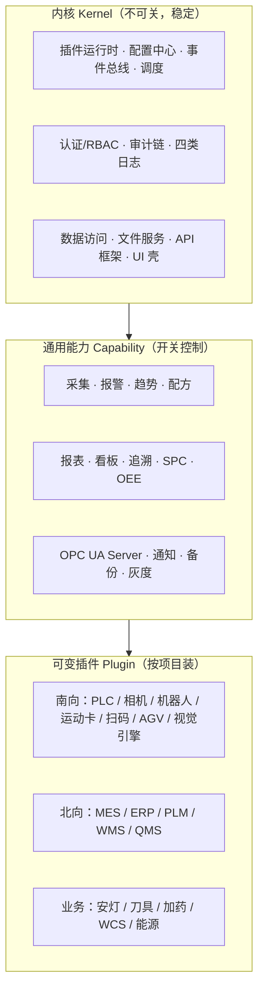

# 01 产品需求与目标（SmartDock）

> 拆分自《13 智舱 SmartDock · 技术架构与二次开发方案》。本文档回答「做什么、为谁做、做到什么程度算成功」。

> **章节 → 分册映射**（原文档章节号保持不变，交叉引用按此表找册）：
> 第 0~1 章 → **本册** ｜ 第 2~11 章、附录 A~E → [02 产品技术设计](02_产品技术设计.md) ｜ 第 12 章 → [05 测试与部署](05_测试与部署.md) ｜ 13.1/13.2/13.4/13.5/13.6/13.7 → [03 阶段实施计划](03_阶段实施计划.md) ｜ 13.3、附录 B → [04 阶段验收标准](04_阶段验收标准.md)

## 0. 怎么用这份方案

**结论：这不是一份「看完就算」的架构 PPT，而是一份能照着建仓库、照着写插件的施工图；每一章都给出「契约 + 代码 + 表结构 + 验收」四件套。**

### 0.1 它解决六个真实痛点

| 痛点 | 现场表现 | 本方案的解法 | 对应章节 |
|---|---|---|---|
| 设备一多就改代码 | 每来一台新设备，复制一份采集程序，改地址、改协议 | 驱动插件 + 点位配置化，装包即接 | 4、5 |
| 每家 MES 一套接口 | A 厂 WebService、B 厂 REST、C 厂中间表，各写一遍 | MES 适配插件 + 统一信封 + Outbox | 4、6 |
| 报表靠开发排期 | 车间要一张新表，开发改代码、重新发版 | 报表定义 + 安全 SQL；自助设计器属 P2（13.1） | 8 |
| 权限散落各处 | 谁都能点「下发参数」，出事故查不到人 | RBAC + 数据范围 + 双人复核 + 审计链 | 9 |
| 出问题只能猜 | 设备断了、接口超时、插件崩了，日志各写各的 | 四类日志 + TraceId + 指标告警 | 10 |
| 功能越加越多，版本失控 | 每个客户要不同组合，最后复制分支、越维护越乱 | 内核 + 能力开关 + 发行版裁剪 | 1.6、2.7、13.6 |

### 0.2 四条阅读路线

| 路线 | 读者 | 读什么 | 读完能做什么 |
|---|---|---|---|
| A 架构评审（1 天） | 技术负责人 / 甲方架构师 | 1、2、4.7~4.9、9、12.9~12.11、13 | 判断这套架构是否可落地、边界是否清楚 |
| B 脚手架落地（2 周） | 后端 / 上位机开发 | 3、4、5.2、6.1~6.5、7.3、11 | 建出可运行的平台骨架 + 2 个插件 |
| C 二次开发（按需查） | 业务开发 | 11、8.4、5.3、6.3、附录 B/C/D | 按模板新增模块 / 驱动 / 接口 / 报表 |
| D 排期与投标（半天） | 技术负责人 / 项目经理 | 13.1、13.2.1、13.2.2、13.7、12.9、12.10.3、**12.11、12.12、12.13** | 报出人月、日历期、配机档位、甲方前置条件、**交付物签名/割接/运维义务与报价结构** |

**路线 C 的几条扩展主线各有专章**：下位机驱动 → 5.12；运动卡/机器人/相机 → 5.11.4；机器视觉 → 5.13；上游 MES/ERP → 6.13；业务定制先过 11.2.1 判档。

### 0.3 六条架构原则（所有取舍都回到这六条）

1. **契约先行**：先定接口和报文，再写实现；插件只能依赖 `Platform.Abstractions`，不能依赖别的插件。
2. **插件隔离**：一个插件崩，不能拖垮采集和登录；**拉起原生 SDK 或 32 位的插件一律进程外，其余按 4.7 的信任度选级**（不可信 > 进程外 > 进程内），而不是无脑全拆进程。
3. **先落库再动作**：任何写设备、发 MES 的动作，先留「意图」再执行，超时不当失败。
4. **配置优于硬编码**：地址、映射、阈值、报表、菜单都可在客户端界面改；改配置要留版本。
5. **默认可观测**：每个请求有 TraceId，每次写操作有审计，每台设备有健康状态。
6. **渐进式拆分**：一期单体 + 插件，量上来再拆服务；不为了「架构好看」上微服务。

> **自检 5 问**
> 1. 你说的「平台」和「项目」差别在哪？三条以上。
> 2. 为什么插件只能依赖 Abstractions，不能直接引用 `Platform.Data`？
> 3. 如果只做一期，哪三样必须先有，哪三样可以砍？
> 4. 这套架构在你的团队手里，几个人、几个月能上线第一个可生产版本？答不出来就去读 13.2.1 和 13.7.4。
> 5. 这个现场有没有存量系统要替换、上线后谁伺候、这单怎么报价？三个问题里有一个答不上，就去读 12.12、12.13、13.2.2。

---

---

## 1. 目标、约束与量化指标

**结论：平台的成败不取决于功能多少，而取决于「新增一条产线 / 一家 MES / 一张报表时，改不改核心代码」。**

### 1.1 业务目标

| 编号 | 目标 | 可验证的结果 |
|---|---|---|
| G1 | 一套平台支撑多条产线 | 新增产线只加设备配置与驱动插件，核心零改动 |
| G2 | 一套平台对接多家 MES | 新增 MES 只加适配插件 + 映射配置，发版不重启 API |
| G3 | 业务模块可复制 | 用模板 1 天内生成「模块骨架 + 菜单 + 权限 + 迁移」 |
| G4 | 报表不排队 | 新增常规报表不改代码、不发版：P0/P1 靠「SQL 模板 + 参数 + 权限过滤 + 导出」由开发或实施配置完成，P2 起车间可自助设计（8.4、13.1） |
| G5 | 事故可追溯 | 任一设备写操作能查到「谁、何时、原值、新值、结果」 |
| G6 | 交付可复制 | 离线安装包 + 一键部署 + 验收清单，换现场不改代码 |
| G7 | 一套代码多版本交付 | 通过功能开关与发行版裁剪出 Basic/Standard/Pro，不复制分支 |

### 1.2 现实约束（架构必须迁就的现实）

| 约束 | 具体表现 | 架构应对 |
|---|---|---|
| 工控网隔离 | 产线网与办公网物理隔离，常无外网 | 离线安装包、本地依赖、可选单向数据摆渡 |
| 7×24 运行 | 停线损失按分钟计 | 插件热启停、灰度、断网缓存、看门狗 |
| 老设备多 | 十年机床只有 RS485，协议手册都没有 | 协议插件 + 地址模板 + 抓包工具 |
| 现场无专职运维 | 电工兼网管 | 自检页面、一键诊断、告警推到手机 |
| 断网是常态 | 与 MES 之间每天断几次 | Outbox + 幂等 + 对账，不靠「重发碰运气」 |
| 审计有硬要求 | 汽车/医药客户要查操作记录 | 审计链 + 保留期 + 导出 |
| 人员流动 | 二次开发换人接手 | 模板化、契约冻结、文档随代码 |

### 1.3 明确不做（一期）

1. 不做 ERP / PLM / MES 的产品替代，只做「设备与业务之间的平台层」。
2. 不做毫秒级运动控制闭环（那是 PLC / 运动卡的事，见 03）。
3. 不做通用低代码（只做「报表 + 表单」范围内的可配置）。
4. 不做多租户 SaaS（一期单厂多车间；多工厂留扩展点）。
5. 不做全量数据湖（一期时序数据留在 PostgreSQL 分区表）。
6. 不内置 3D 数字孪生与复杂组态设计器（作为可选插件，见 2.7 的 `ui.designer`）。
7. **不承担安全功能（Non-Safety-Claim）**：本平台的互锁、软限位、写前校验都是**生产可用性控制**，不是安全功能。急停、安全门、光幕、安全夹具必须走安全回路（PLC 安全模块 / 安全继电器），其 PL 等级 / SIL 认证由机械与电气集成方负责，不由本软件承担。对外表述、合同、验收文档一律不得写「平台保证操作者安全」——这条写错，出事故时是刑事与合同双重责任。详见 12.10.1。
8. **不做视觉算法与 AI 模型本身**：平台只做取像 → 引擎 → 判定 → 落库的编排（5.13），算子调参、模型训练与精度达标归项目算法工程师；把「装上引擎就能检出 0 漏检」当成平台交付承诺，是范围失控的头号来源。
9. **一期不承诺受监管行业合规（GMP / 21 CFR Part 11 / ALCOA+）**：医药、食品、医疗器械客户要的「数据完整性证据」不只是审计链，还包括**电子签名法定效力、审计追踪可导出为监管格式、系统验证文档（IQ/OQ/PQ）、变更与偏差管理流程**。本方案的 9.7 审计哈希链、双人复核、导出审批已经做了约 80% 的技术底座，但**验证文档与法规解读不是软件交付物**。目标客户含这类行业时，要么单列一个「合规证据包」子项目（报价与周期另计，12.10.1 同类处理），要么在投标阶段就说明不承担。**别用「我们有完整审计日志」去回答「你们能不能过 FDA 审计」。**

### 1.4 量化指标（验收就拿这张表打分）

| 指标 | 目标值 | 测量方法 |
|---|---|---|
| 平台冷启动到可接单 | ≤ 60 s | 日志打点：进程启动 → 健康检查通过 |
| 插件安装 / 启用 | ≤ 5 min（含配置） | 操作计时 |
| API 响应 P95 | ≤ 200 ms（常规查询） | 压测 + APM |
| 采集规模 | 200 台设备 / 8,000 点 / 1 s 周期 | 模拟器压测 72 h |
| 采集周期抖动 | P99 ≤ ±15% | 采集时间戳统计 |
| 设备指令端到端 | ≤ 1 s（下发到回读确认） | 指令日志 |
| 视觉检测端到端 | ≤ 项目节拍 × 0.8（留 20% 余量，5.13.6 口径） | 标准图集离线跑 + 现场实测，取像/引擎/判定/落库分段打点 |
| 视觉判定一致性 | 同一图集重跑 0 判定翻转 | 配方回归（5.13.3）。**前提是执行环境被锁死**：引擎线程数与并行度固定、随机种子固定、GPU 驱动与 CUDA/cuDNN 版本固定、图像来源为归档原图而非二次采集；四个条件任一不满足，本指标不适用（含 AI 推理配方时尤其如此），只能报「差异率」不能报「0 翻转」 |
| 运动指令安全拒绝 | 未回零/超软限位/报警态 100% 拒绝下发 | 故障注入 + `device_command` 审计（属生产可用性控制，非安全功能，见 1.3 第 7 条） |
| MES 报文不丢 | 断网 30 min 恢复后 100% 补传、0 重复入账 | 断网演练 + 对账。**另须演练两种更难的**：① 平台服务自身重启/崩溃期间产生的业务事件不丢（靠「先落库再动作」+ Outbox 持久化，不靠内存队列）；② PostgreSQL 短暂不可用期间的写指令与报工不丢、不重复。设备侧无历史缓存能力的点位，断点期间的数据只能标 `Stale`/缺失，**不承诺补齐**——这句要写进合同，否则验收必吵 |
| 报表 10 万行导出 | ≤ 5 s（同步）/ 大报表走异步 | 基准数据 |
| 审计覆盖 | 100% 写操作与权限变更 | 抽查 + 自动核对 |
| 单插件故障影响 | **服务端**：其他插件与登录不受影响；**客户端**：插件页崩溃不影响主窗口与其他页 | 故障注入（服务端在进程外宿主里杀插件；客户端在插件页里抛未捕获异常） |
| 连续运行（实验室） | 72 h 无重启、无内存/句柄/线程增长 | 模拟器满配长稳，见 13.3 第 10 条 |
| 连续运行（现场） | 30 天无重启、RSS 增长 < 100 MB | **现场试运行指标，不是实验室指标**：由真实设备、真实班次跑满 30 天，验收窗口按合同排期（见 13.7.4）。实验室只能证 72 h，把 30 天写成实验室可达标是自欺 |

### 1.5 关键架构决策（ADR 摘要）

| 编号 | 决策 | 理由 | 代价 / 何时推翻 |
|---|---|---|---|
| ADR-1 | 主栈 .NET 8 基线（存量工控机）/ .NET 10（新现场），而非 Java | 团队已有 C#/上位机积累，一套语言打通采集与平台；net8.0 多目标保存量机器可跑；工控现场部署轻 | 若甲方要求 Java 统一栈，按 2.5 等价迁移 |
| ADR-2 | 一期单体 + 进程内插件 | 现场一台服务器即可，运维简单 | **三条硬边界，越界就必须上进程外宿主（属 P0，不是 P1，见 13.1）**：① 厂商 SDK 是 32 位 DLL（雷赛 `LTDMC.dll`、正运动 `zmotion.dll`、VisionPro）；② 引擎许可要求独占线程/进程或绑定 GPU；③ 插件不可信或需独立扩缩容。进程内插件**不承诺原生 SDK 热卸载**（见 4.8 设计公理） |
| ADR-3 | PostgreSQL 而非 SQLite 作为中心库 | 并发、分区、JSONB、`FOR UPDATE SKIP LOCKED` 都是刚需 | 边缘单机可用 SQLite，靠同步上行 |
| ADR-4 | 自研报表引擎而非嵌 BI | 需要行级权限、工控口径、离线部署 | 分析型需求爆发时可外挂 BI，只读副本。**但一期只做「后端 SQL 模板 + 参数 + `/*SCOPE*/` 权限过滤 + 导出」，把拖拽设计器推到 P2**：设计器是 20% 功能吃 60% 工期的典型项，省下的 3~5 人月直接决定能否按期上线（13.7.2） |
| ADR-5 | Outbox 而非直接双写 | 断网、超时、重复推送是常态 | 不适用强一致场景（本平台没有） |

### 1.6 产品化定位：一个内核 + 通用能力 + 可变插件

**结论：市面上上位机的通用功能不塞进内核，而是做成「可开关的标准能力」；真正随项目变的只有三类插件——南向设备、北向系统、业务模块。**

| 层 | 内容 | 变化频率 | 交付方式 | 关闭影响 |
|---|---|---|---|---|
| 内核 | 插件运行时、权限、审计、日志、数据访问、API 壳 | 几乎不变 | 随平台版本 | 不允许关 |
| 通用能力 | 采集、报警、趋势、配方、报表、看板、追溯、SPC | 按客户选 | 配置开关（同一二进制） | 隐藏界面 + 接口拒绝，数据保留 |
| 可变插件 | 设备驱动、上游适配、业务模块、报表包 | 每个项目都变 | 插件包 | 不加载，不影响其他插件 |

**四条硬规则**：

1. 内核只提供机制，不预置业务；业务规则放模块。
2. 通用能力必须有唯一开关键、明确依赖、关闭后的行为；没有开关说明的能力不允许进平台。
3. 开关不是 `if` 散落在代码里：统一走 `IFeatureGate`，启动装配、接口拦截、界面显隐三处一致。
4. 关闭一个能力不删数据、不删权限、不删插件包；重新打开原样恢复。

**五个必须留在内核的能力**（关掉平台就不成立）：

- 插件加载与生命周期
- 身份认证 + 权限校验
- 审计写入与哈希链
- 结构化日志 + TraceId
- 配置与数据库迁移

> 这一段对应后面：能力清单见 2.7，开关实现见 3.7，插件联动见 4.13，发行版见 13.6。

> **自检 3 问**
> 1. 为什么「插件安装 ≤ 5 min」比「功能数量」更能说明平台成熟？
> 2. ADR-2 的代价是什么？什么信号出现时应该改？
> 3. 说出一个本方案明确不做、但客户常提的需求，并解释为什么不在一期做。

---
