# 02 产品技术设计（SmartDock）

> 拆分自《13 智舱 SmartDock · 技术架构与二次开发方案》第 2~11 章与附录 A~E。
> 施工图：总体架构、解决方案骨架、插件体系、设备接入、MES 对接、数据、报表、权限审计、日志、二次开发手册。

> **章节 → 分册映射**（原文档章节号保持不变，交叉引用按此表找册）：
> 第 0~1 章 → [01 产品需求与目标](01_产品需求与目标.md) ｜ 第 2~11 章、附录 A~E → **本册** ｜ 第 12 章 → [05 测试与部署](05_测试与部署.md) ｜ 13.1/13.2/13.4/13.5/13.6/13.7 → [03 阶段实施计划](03_阶段实施计划.md) ｜ 13.3、附录 B → [04 阶段验收标准](04_阶段验收标准.md)

## 2. 总体架构

**结论：平台是「一个宿主 + 两组插件 + 三层数据」——宿主管生命周期，插件管协议与业务差异，数据分热、温、冷三层。**

### 2.1 分层架构

> **全景架构图（SVG，独立文件）**：[architecture.svg](architecture.svg) —— 含默认链路与可选能力（MinIO/Redis 虚线）标注，可直接投屏评审；下方 mermaid 为同构简版。

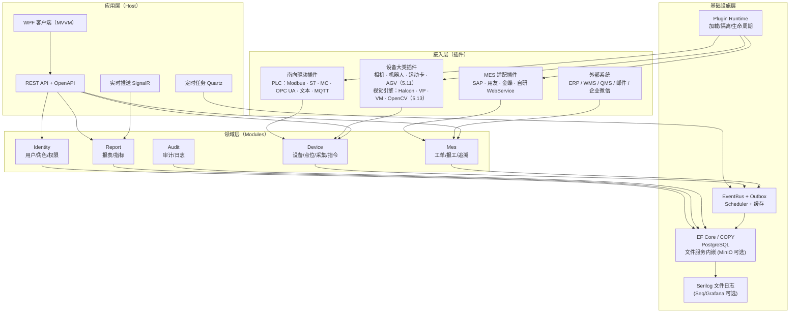

**依赖规则（编译期就要卡住）**：

| 层 | 可以依赖 | 禁止依赖 |
|---|---|---|
| Abstractions | 仅 BCL + 极少量扩展接口 | 任何实现工程、任何 NuGet 驱动库 |
| Modules | Abstractions + Core 的公共能力 | 其他 Module 的实现、插件实现 |
| Host | 所有 Module、Plugin Runtime | 插件内部类型（只能经接口） |
| Plugins | Abstractions（+ 自带第三方库） | Platform.Data、其他插件 |

> 一句话：**插件与模块之间只通过事件、接口、数据库表通信，不通过 `using` 对方的类。**

### 2.2 运行时组件

| 组件 | 职责 | 部署形态 | 崩溃影响 |
|---|---|---|---|
| Platform.Api | REST、鉴权、审计入口、OpenAPI | 主进程 | 客户端不可用，采集不受影响 |
| Platform.Client | WPF 桌面客户端（MVVM），操作员/工程师/看板共用 | Windows 桌面（每台操作站一份，可多开） | 单台操作站退出，采集不受影响 |
| DeviceRuntime | 连接管理、采集调度、指令队列 | 主进程内后台服务 | 采集停，API 仍在 |
| MesWorker | Outbox 投递、拉取工单、对账 | 主进程内后台服务 | 报文积压，恢复后补传 |
| VisionService | 视觉编排：取像 → 引擎 → 判定 → 落库（5.13.1） | 主进程内后台服务；重算法/AI 可拆独立进程（带 GPU） | 视觉判定停，采集与其他业务不受影响 |
| ReportWorker | 大报表、定时订阅、导出 | 主进程内（可独立进程） | 报表排队，业务不受影响 |
| PluginHost | 进程外宿主：32 位/原生 SDK 驱动与不可信插件（4.7 L2） | 独立进程 + gRPC（**最小宿主属 P0**，资源限额与 L3 容器属 P1/P2） | 只影响该插件，宿主被 kill 后自动重启 |
| Scheduler | 周期任务、对账、清理、备份 | Quartz 集群（一期单机） | 定时任务停，手动可触发 |

### 2.3 部署拓扑（边缘 / 车间 / 中心）

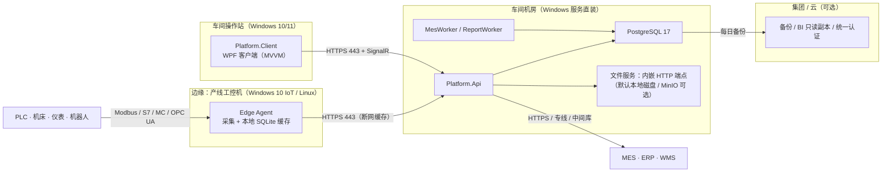

**部署要点**：

- 采集尽量靠边缘：串口设备离得近，减少 485 长线干扰；边缘断网仍能缓存 7 天。
- 客户端装在车间操作站：WPF 客户端只连 API（HTTPS + SignalR），**不直连数据库**；断网时界面显示「最后更新时间」并冻结写入口。
- 中心库只存「业务需要查询」的数据；高频原始点位可只在边缘保留 30 天。
- MES 对接走车间服务器，不占边缘资源；所有出站连接只走 443/8443。
- 工控网与办公网之间只开单向或白名单端口，不做全网互通。

### 2.4 技术选型

| 能力 | 选型 | 版本 | 选择理由 | 替代方案 |
|---|---|---|---|---|
| 运行时 | .NET | 8 LTS（长期维护，存量工控机主力）/ 10 LTS（新现场首选） | **决策：双轨支持**——老工控机大多是 .NET 8：平台代码按 net8.0 为基线编译（`<TargetFramework>net8.0</TargetFramework>` 或多目标 net8.0;net10.0），.NET 8 于 2026-11 结束官方支持属「安全更新停止」，运行不中断；新建现场/新操作站用 .NET 10 自包含发布。**同一套代码不允许出现仅 net10 的 API**（用 `#if NET10_0_OR_GREATER` 隔离，CI 双 TFN 构建） | — |
| Web 框架 | ASP.NET Core | 8/10 | 内置 DI、鉴权、OpenAPI、SignalR；API 版本用 `Asp.Versioning` 承载 11.7.1 契约稳定面 | Minimal API 足够，无需第三方框架 |
| ORM | EF Core | 8/10 | 迁移、全局查询过滤器、原生 SQL；**时序写入（point_history）禁走 EF，必须 Npgsql 二进制 COPY**；**报表/对账/历史查询一律 Dapper + 只读连接串（决策）** | Dapper |
| 主库 | PostgreSQL | 16（存量现场主流）/ 17（新装首选） | 分区、JSONB、`SKIP LOCKED`、窗口函数；16 与 17 均满足 7.x 全部设计；新装用 17 的 vacuum/逻辑复制改进，**不强制存量现场升级**；分区自动创建用 pg_partman 或 Quartz 作业 | SQL Server（甲方要求时） |
| 缓存/队列 | **默认进程内 IMemoryCache + BoundedChannel；Redis 做可选模块** | — | 单机桌面形态下 Redis 收益不抵运维成本；锁用 PG advisory lock。**Redis 以 `cache.distributed` 开关（2.7 E7）接入**：`IDistributedCache` 与 `IQueueTransport` 抽象在内核，默认进程内实现，装了 Redis 才开；开启后缓存切 Redis、**2.6A 分队列透明切 Redis Stream（2.6A.3A，可降级回本地队列）**；P1 多实例/看板横向扩时启用 | Redis 7（可选，非默认） |
| 客户端 | WPF + MVVM（CommunityToolkit.Mvvm） | 8/10 | 与后端同栈一套语言；工控主流形态；离线可用；**VM 由壳统一解析（走 `PluginPageHost`），插件不得自行 new ViewModel；高频点位刷新走 DispatcherTimer 节流 + 集合批量 Reset，禁双向绑定直刷** | WinForms（遗留项目）、Avalonia（跨平台需求时） |
| 客户端图表 | ScottPlot 5（Apache-2.0） | 5.x | 单库覆盖趋势+看板，百万点降采样渲染，协议干净；**弃 LiveCharts2**（双库冗余，动效在车间场景是负资产）；注意 ScottPlot 5 依赖 SkiaSharp，离线包带 win-x86/x64 native runtime | 自绘 WriteableBitmap（极致性能时） |
| 实时推送 | SignalR | 8/10 | 与 ASP.NET 同栈，自动重连 | SSE（只读看板更轻） |
| 定时 | Quartz.NET | 3.x | Cron、持久化、错过补偿 | Hangfire（侧重后台作业） |
| 日志 | Serilog（文件 sink 为主） | 10.x | 结构化、按天滚动；**Seq 降为开发期诊断工具**（商用 license 多用户受限），生产排障靠四类日志文件 + 10.7 诊断剧本 | Grafana Loki（单二进制可离线，日志量大时） |
| Excel | ClosedXML | 0.102 | 无需 Office、样式完整 | NPOI |
| PDF | QuestPDF（注意 Community 许可：公司年营收 > 100 万美元需付费，进 12.11.2 许可核查） | 2024.x | 流式布局、中文字体可控；**报表 PDF 需求优先用「xlsx + 打印样式」覆盖，确需 PDF 再采购** | iText（授权注意） |
| 对象存储 | **三档可选**：① MinIO（S3 兼容，大现场/多 GB 图像）② **平台内置本地 HTTP 文件服务**（默认，见下）③ 纯本地磁盘目录（最小现场，无 URL 直接读） | — | 大量 NG 图像/追溯图需要 HTTP URL 供客户端与 MES 回看；**默认实现为主进程内嵌 Kestrel 文件端点**（`/files/{bucket}/{key}`，鉴权走平台 JWT，目录即存储），零外部进程；图像量 > 50 GB 或多机部署才装 MinIO（`storage.s3` 开关，2.7 E 组） | 本地磁盘（无 URL 需求的最小现场） |
| 部署 | **.NET 自包含单文件发布 + Windows 服务（sc.exe）**，PG 直接安装，MinIO 可选 | — | 桌面软件形态，现场无 Docker；免装 .NET Runtime（附录 B 第 12 项由此实现） | Docker Compose（仅开发/测试环境用） |

### 2.5 给 Java 团队的等价映射（回应「类似 Java 脚手架」）

| 能力 | 本方案（.NET） | Java 脚手架常见做法 | 迁移注意 |
|---|---|---|---|
| 基础框架 | ASP.NET Core 8 | Spring Boot 3.2 | 注解/特性对应，概念一致 |
| 权限 | 自研 RBAC + JWT | Spring Security 6 + JWT | 权限码模型可直接复用 |
| 插件 | `AssemblyLoadContext` + manifest | PF4J 3.x + `plugin.properties` | 生命周期语义一致，需重写加载器 |
| ORM | EF Core | MyBatis-Plus | 分页、逻辑删除、审计字段要统一 |
| 迁移 | EF Migrations | Flyway | 插件迁移脚本建议统一为 SQL |
| 定时 | Quartz.NET | Quartz / XXL-Job | Cron 表达式一致 |
| 缓存 | Redis + `IDistributedCache` | Spring Cache + Redis | 键命名规范要统一 |
| 客户端 | WPF + MVVM | JavaFX / Swing + 平台 Web 前端 | MVVM 模式可平移；表单/表格/权限指令需重做 |
| 脚手架参考 | `dotnet new` 模板 | RuoYi 等脚手架 | 只借「模块+权限+代码生成」思路 |

> **不要照搬 Java 脚手架的表结构**：RuoYi 的 `sys_menu`/`sys_role` 可以直接借鉴，但工控侧的设备、点位、指令、Outbox 必须按本方案第 5~7 章重建。

### 2.6 选型里刻意不做的三件事

| 不做 | 原因 | 什么时候再做 |
|---|---|---|
| 微服务拆分 | 现场 1~2 台服务器，拆了只会增加运维与分布式事务 | 多工厂、多团队独立发版时 |
| Kafka | 一期消息量（< 50 条/s）PostgreSQL Outbox 足够 | 设备事件 > 5,000 条/s 或需多消费者 |
| K8s | 现场没人会运维，故障恢复靠电工 | 集团统一云平台时 |

### 2.6A 生产者–消费者与大数据量流水线设计（有界队列 · 背压 · 分队列 · 大图句柄）

**结论：平台内部所有「生产速率 ≠ 消费速率」的链路（采集→落库、相机→算法、MES 报工→Outbox、UI 刷新）一律走「有界队列 + 背压 + 按业务分队列」四件套；队列里绝不搬像素/大 payload。这是 5.5 采集调度、5.13 视觉编排、6.x Outbox 之外的第三根支柱，P0 即按此实现。**

#### 2.6A.1 四件套总纲

| # | 原则 | 一句话 |
|---|---|---|
| 1 | **有界队列 + 背压** | 绝不用无界队列吞数据；容量 = 峰值速率 × 可容忍时延 |
| 2 | **按业务拆队列** | 告警/指令/结果/图像/日志各自独立 `Channel<T>`，慢的拖不死快的 |
| 3 | **大图传句柄不搬像素** | 队列只放 `FrameRef`（几十字节），像素留在内存池或落盘引用 |
| 4 | **采集与算法解耦** | 算法慢就背压降帧，不卡采集线程 |

#### 2.6A.2 队列满策略：按数据可丢性分流

| 数据类型 | 满了策略 | 理由 |
|---|---|---|
| 预览/监控画面（可丢） | `BoundedChannelFullMode.DropOldest`，保最新 | 人眼只要当前画面 |
| 检测结果/工单（不可丢） | `Wait`（阻塞生产）+ 本地 WAL 落盘 + 上游限流 | 丢 = 漏检/账不平，宁可慢 |
| 告警/安全（最高优） | **独立高优队列** + 先写磁盘 WAL 双写，绝不与普通数据共队 | 迟一拍就是事故 |
| 图像原始数据（大） | **不进队列**，只放 `FrameRef` 句柄（见 2.6A.4） | 队列放大图 = 内存爆 |

**背压传递（从软到硬）**：应用层 `Wait` 阻塞 → 策略层降采样（每 N 帧处理一次）→ **硬件层把背压顶到相机/PLC（降帧率 / 暂停触发 / 缩小 ROI）**，从源头减流。背压 ≠ 丢弃；对不可丢数据，阻塞生产者正是背压生效的表现。

#### 2.6A.3 平台业务分队列表（P0 实现）

| 优先级 | 队列 | 丢失容忍 | 满了策略 | 消费者 | 容量起点 |
|---|---|---|---|---|---|
| P0 | 告警/安全 | 不可丢 | 阻塞 + WAL 双写 | 独立告警线程 1~2 | 128~512 |
| P1 | PLC/设备指令 | 不可丢·保序 | 阻塞 | 固定周期通信线程（5.6 指令队列） | 64~256 |
| P2 | 采集点值/检测结果 | 不可丢 | 阻塞 + 本地缓冲（A6 边缘缓存） | 批量落库池 2~4，100~500 ms 攒批 COPY | 512~2048 |
| P3 | 图像（仅句柄） | 可丢旧帧 | DropOldest / 降帧 | 视觉算法池 ≈ 物理核数 | 句柄 2~8 |
| P4 | 日志/审计 | 可丢 | 环形缓冲丢最旧 | Serilog 异步刷盘（已有 10.x） | ≥ 4096 |

> 隔离原则：每条业务独立有界队列 + 独立消费者；**优先级靠「独立线程」实现，不靠同队列排序**（同队排序会被慢任务堵死）。MES Outbox（6.x）本身就是 P2 队列的持久化形态，两者语义一致。

#### 2.6A.3A 队列传输层抽象：有 Redis 用 Redis，没 Redis 用进程内有界队列

**结论：分队列的「业务语义」（优先级/满策略/容量/消费者数）是平台契约，队列的「传输实现」是可替换件——同一套生产/消费代码，单机走 `BoundedChannel<T>`，开启 `cache.distributed`（E7）后透明切到 Redis Stream，多实例部署时业务不感知。**

| | 默认档（无 Redis） | Redis 档（`cache.distributed` 开启） |
|---|---|---|
| 实现 | `System.Threading.Channels.BoundedChannel<T>`（进程内） | **Redis Stream**（`XADD/XREADGROUP/XACK` + 消费组） |
| 有界性 | `BoundedChannelOptions(capacity)` + `FullMode` 硬界 | `XTRIM MAXLEN ~ capacity`（近似有界，异步裁剪不阻塞写）+ 消费组 Pending 上限 |
| 满策略映射 | `Wait` → 生产者 await；`DropOldest` → `XTRIM` + 生产侧限流 | `Wait` → 背压在 `XREADGROUP` 慢消费上体现（流变长触发上游限流）；可丢类靠 `MAXLEN` 自然淘汰最旧 |
| 持久性 | 内存（不可丢类仍走 L2 WAL/本地缓冲兜底） | AOF 持久化，进程重启队列不丢 |
| 消费确认 | try/finally 手动 Ack | `XACK`（未 Ack 消息留 Pending 列表，`XAUTOCLAIM` 交接死消费者） |
| 适用场景 | 单机桌面形态（P0 默认，零外部依赖） | 多实例部署、看板横向扩、进程重启不允许丢 Q3 点值（P1 起按需） |

**实现约束**：

1. **抽象在内核，实现可插拔**：`IQueueTransport<T>`（`Publish` / `Subscribe` / `Ack` / `Metrics`）定义在 `Platform.Abstractions`；`BoundedChannelTransport` 内置 P0 交付，`RedisStreamTransport` 与 `cache.distributed` 同包、同开关、同生命周期，**不存在「开了 E7 但队列还在进程内」的半开状态**。
2. **语义对齐是硬门禁**：Redis 档必须通过与默认档相同的契约测试（优先级隔离、背压传播、重放幂等），两档 CI 各跑一遍（11.11 双 TFN 思路的复用）。
3. **降级路径**：Redis 不可达时 `RedisStreamTransport` 自动降级为本地 `BoundedChannel` + L2 WAL 重放（断网续传语义与 A6 一致），恢复后按幂等键回灌 Stream，健康页标 `Degraded`。
4. **不要为了用 Redis 而用 Redis**：单机形态下 Redis Stream 比进程内 Channel 多一次网络往返与运维面；只有「多实例」或「重启不丢队列」成为真实需求（P1）才开。

#### 2.6A.4 大图（相机帧）规范

一张 500 万像素 RGB ≈ 15 MB，队列深度 32 就是 480 MB——所以：

| 手段 | 做法 |
|---|---|
| 零拷贝 | 相机 SDK 回调指针；只传 `FrameRef(frameId, ts, 触发号, w, h, 格式, ROI, poolIdx)` |
| 内存池 | 预分配 16~32 个固定缓冲（`ArrayPool<byte>` 或自建池），用完归还，杜绝高频 `new byte[]` 的 GC 抖动 |
| 引用计数 | 双/三缓冲，防「算法还在读、采集已覆盖」 |
| 落盘引用 | NG 图/追溯帧直写 NVMe → `IFileStore`（本地磁盘档 / MinIO 档，`file_object`，5.13），队列只放路径 |
| 先小后大 | 降采样小图做定位触发，确认后按 ROI 裁原图精算 |
| 压缩边界 | 存储/传输可 JPEG；**精算环节绝不压缩** |

**反模式（评审卡点）**：`Channel<byte[]>` / `Channel<Bitmap>` 直接塞原图；无界 `ConcurrentQueue` 吞采集数据；所有业务共用一条队列；告警与日志同队；一任务一线程；UI 线程同步等待队列。

#### 2.6A.5 线程定数（压测起点）

| 模块 | 池/线程 | 要点 |
|---|---|---|
| 相机采集 | 专用线程（高优先） | 只入池入队，不做算法；硬件触发优先 |
| 视觉算法 | ≈ 物理核数（`SemaphoreSlim` 闸门即天然背压） | CPU 密集，多于核数只会上下文切换 |
| PLC 轮询 | 独立通信线程，10~50 ms 固定 | 不阻塞视觉；指令保序 + 超时重试（5.6） |
| 落库/上报 | IO 池，核数×2 或按吞吐压测 | 攒批 + 幂等 + ACK |
| UI 刷新 | UI 线程，≈30 fps 合并 | 只更新快照；禁同步等待 |

#### 2.6A.6 不丢数据三级保障（与 6.6 对账、7.7 备份的关系）

| 级别 | 机制 | 落点 |
|---|---|---|
| L1 内存 | 有界队列（可丢类 DropOldest 保实时） | 2.6A.3 |
| L2 持久化 | 不可丢类**先落盘再处理，ACK 后删**；崩溃重启重放未 ACK（本地缓冲/Outbox 表） | A6 边缘缓存、6.x Outbox |
| L3 端到端 | ACK + 幂等键（工单号/帧号）+ 重试 ≈ 恰好一次 | 6.10 幂等、5.6 写后回读 |

**告警特殊待遇**：双写（内存队列 + 磁盘 WAL）、独立线程直达推送、不攒批、不与普通结果同队。

**可观测性**：每条队列暴露**深度 / 丢弃数 / 端到端延迟 / 消费耗时**四个指标进健康页（H1），阈值告警；背压阈值运行时可调。

### 2.7 通用能力全景与功能开关矩阵

**结论：把市面上位机/SCADA 的通用功能拆成 70 项——68 项可开关、2 项安全底线常开；默认组合覆盖 90% 现场，关掉不需要的只减界面与调度，不删数据、不破坏依赖。**

#### 2.7.1 为什么要「开关」而不是「删代码」

| 诉求 | 删代码的做法 | 开关的做法 | 代价 |
|---|---|---|---|
| 小客户不要报表设计器 | 拉分支删模块 | 关 `report.designer`，插件不加载 | 一次开发，多版本交付 |
| 某现场不用报警升级 | 注释掉调度 | 关 `alarm.escalate`，作业不注册 | 配置可回滚 |
| 新功能先在 1 个厂试点 | 单独发特殊版本 | 按 `feature_scope` 只对试点厂开启 | 无需另建分支 |
| 出故障要快速止血 | 回滚整个版本 | 关掉出问题的能力（hot/restart） | 影响面可控 |

**铁律：开关只能出现在「能力边界」上，不能散落在业务 `if` 里。** 所有判断统一走 `IFeatureGate`（实现见 3.7），后端不直接读配置表，客户端不硬编码菜单。

#### 2.7.2 关闭行为的四个码

| 码 | 含义 | 后端表现 | 客户端表现 | 典型能力 |
|---|---|---|---|---|
| **H** | 隐藏界面 | 接口仍可被内部调用 | 菜单、页签、按钮不渲染 | 趋势、看板、移动端 |
| **A** | 接口拒绝 | 返回 `403` + `FEATURE_DISABLED` | 入口置灰并提示「未开通」 | 配方下发、导出、双人复核 |
| **J** | 停调度 | 后台作业/采集任务不注册或暂停 | 状态页显示「已停用」 | 采集、归档、对账、告警升级 |
| **P** | 不加载插件 | 插件目录仍在，状态置 `Blocked` | 插件管理页显示「依赖能力未开启」 | 相机、机器人、报表设计器、MES 适配 |

> **数据保留原则**：任何关闭动作都不执行 `DELETE` / `DROP` / 清表；历史数据转只读保留，重新开启后从断点继续。关闭是「不做新动作」，不是「销毁证据」。

> **两个常开项**：`security.rbac`（鉴权执行）与 `security.auditChain`（审计写入与链校验）不提供关闭入口——关掉它们等于拆掉平台的安全地基。其余 68 项可按 2.7.5 裁剪。

#### 2.7.3 能力矩阵（70 项，A~J 十组）

**A 采集与设备（9）**

| 编号 | 能力 | 开关键 | 默认 | 关闭后 | 依赖 / 说明 |
|---|---|---|---|---|---|
| A1 | 采集调度核心 | `acq.core` | 开 | J | 关掉后所有驱动不轮询，只剩手动读写 |
| A2 | 设备台账 | `device.registry` | 开 | H/A | 无依赖；设备树、状态、分组 |
| A3 | 点位与地址表达式 | `device.points` | 开 | H/A | 依赖 A2；`40001:Float32:CDAB` 等解析 |
| A4 | 写入与联锁 | `device.write` | 开 | A | 依赖 A1；含权限、互锁、先落库、写后回读 |
| A5 | 通道 / 网关管理 | `device.channel` | 开 | H/A | 依赖 A2；串口、网口、网关分时复用 |
| A6 | 边缘缓存与断网续传 | `acq.edge` | 开 | J | 依赖 A1；断网缓存 7 天 |
| A7 | 虚拟设备与仿真 | `device.simulator` | 关 | P | 调试插件；产线环境建议关闭 |
| A8 | 批量读与自适应降频 | `acq.adaptive` | 开 | J | 依赖 A1；按响应时间自动调周期 |
| A9 | 设备时间同步 | `device.timeSync` | 关 | J | 依赖 A1；NTP 或读 PLC 时钟 |

**B 监控画面（7）**

| 编号 | 能力 | 开关键 | 默认 | 关闭后 | 依赖 / 说明 |
|---|---|---|---|---|---|
| B1 | 实时监控画面 | `ui.realtime` | 开 | H | 依赖 A1；点表绑定、刷新 1 s |
| B2 | 趋势曲线 | `ui.trend` | 开 | H | 依赖 E1；多点位叠加、缩放 |
| B3 | 业务看板 | `ui.dashboard` | 开 | H | 依赖 F5；产量、节拍、在制 |
| B4 | 简易组态流程图 | `ui.mimic` | 关 | P | 插件；静态底图 + 动态点 |
| B5 | 报警横幅与语音 | `ui.alarmBanner` | 开 | H | 依赖 C1；未确认报警常驻顶部 |
| B6 | 移动端 H5 | `ui.mobile` | 关 | H | 依赖 G1；扫码查看、报警确认 |
| B7 | 组态 / 看板设计器 | `ui.designer` | 关 | P | 插件；拖拽画布，见 1.3 不做项 |

**C 报警与事件（8）**

| 编号 | 能力 | 开关键 | 默认 | 关闭后 | 依赖 / 说明 |
|---|---|---|---|---|---|
| C1 | 报警引擎 | `alarm.engine` | 开 | J | 依赖 A1；等级、死区、延时确认 |
| C2 | 报警规则配置 | `alarm.rules` | 开 | H/A | 依赖 C1；阈值、持续时间、班次 |
| C3 | 报警确认与消音 | `alarm.ack` | 开 | A | 依赖 C1；记录确认人与时间 |
| C4 | 报警升级与值班 | `alarm.escalate` | 关 | J | 依赖 C1；站内升级默认可用，外部推送需 C8 |
| C5 | 报警历史与统计 | `alarm.history` | 开 | H | 依赖 C1；TopN、时长、误报率 |
| C6 | 报警搁置 / 屏蔽 | `alarm.shelve` | 关 | A | 依赖 C1；需审批与到期自动恢复 |
| C7 | 业务事件订阅 | `event.bus` | 开 | J | 事件总线机制在内核、不可关；此开关只控制「业务事件的订阅与投递」，审计/插件生命周期等内核事件不受影响 |
| C8 | 外部通知渠道 | `notify.channel` | 关 | P | 插件；短信、企微、邮件 |

**D 配方与工艺（8）**

| 编号 | 能力 | 开关键 | 默认 | 关闭后 | 依赖 / 说明 |
|---|---|---|---|---|---|
| D1 | 配方管理 | `recipe.manage` | 开 | H/A | 依赖 A2；参数组、上下限 |
| D2 | 配方下发与回读 | `recipe.download` | 开 | A | 依赖 D1 + A4；逐项校验 |
| D3 | 配方版本与审批 | `recipe.version` | 关 | H/A | 依赖 D1；生效日期、审批流 |
| D4 | 配方比对 | `recipe.compare` | 关 | H | 依赖 D1；两版本差异高亮 |
| D5 | SPC 过程能力 | `process.spc` | 关 | J | 依赖 E1；CPK、控制图、判异规则 |
| D6 | 批次 / 序列号追溯 | `process.trace` | 开 | H/A | 依赖 D8；正向、反向追溯 |
| D7 | 工位与工艺路线 | `process.station` | 开 | H/A | 依赖 A2；工序、节拍、在制 |
| D8 | 批次参数记录 | `recipe.batch` | 开 | J | 依赖 D1；每批实际值与配方快照 |

**E 数据与存储（6）**

| 编号 | 能力 | 开关键 | 默认 | 关闭后 | 依赖 / 说明 |
|---|---|---|---|---|---|
| E1 | 历史数据存储 | `data.history` | 开 | J | 依赖 A1；时序表按月分区 |
| E2 | 归档与清理 | `data.retention` | 开 | J | 依赖 E1；按策略转冷存储 |
| E3 | 数据导出 | `data.export` | 开 | A | 依赖 E1；CSV/Excel，异步大文件 |
| E4 | 备份与恢复 | `data.backup` | 开 | J | 平台基础；每日全量 + WAL |
| E5 | 基础数据导入 | `data.import` | 开 | A | 依赖 A2；模板校验、错误行回传 |
| E6 | 虚拟点 / 计算点 | `data.calc` | 关 | J | 依赖 A3；公式、累计、平均 |
| E7 | 分布式缓存与队列传输 | `cache.distributed` | **关** | 降级 | 依赖 E1；`IDistributedCache` 与 `IQueueTransport` 抽象常驻内核（默认走进程内 IMemoryCache / BoundedChannel 实现），开启需现场已装 Redis；开启后缓存切 Redis、**2.6A 分队列透明切 Redis Stream**（2.6A.3A，含降级回本地队列）；P1 多实例/看板横向扩时启用，单机形态保持关 |
| E8 | S3 对象存储（MinIO） | `storage.s3` | **关** | 切换 | 文件服务三档实现（2.4）：**默认走主进程内嵌 Kestrel 文件端点**（`/files/{bucket}/{key}`，JWT 鉴权，目录即存储，零外部进程）；图像量 > 50 GB 或多机部署时开启 `storage.s3` 装 MinIO；最小现场可降级纯本地磁盘（无 URL）。上层统一走 `IFileStore` 抽象，切换不改业务代码 |

**E7/E8 什么时候开：应用场景说明（选型判据，不满足就保持关）**

| | E7 分布式缓存与队列传输（Redis） | E8 S3 对象存储（MinIO） |
|---|---|---|
| **默认为什么关** | 单机桌面形态下，进程内 IMemoryCache/BoundedChannel 快一个数量级（纳秒/内存级 vs 网络 RTT ≈ 0.5~2 ms），Redis 引入额外安装、监控、备份、EDR 白名单四件运维负担，收益不抵成本 | 内嵌文件端点零外部进程、零额外许可，单机磁盘足够；MinIO 是独立服务，多一套账号/权限/备份/升级链路 |
| **开启场景 ①** | **多实例部署**：车间机房起 2+ 个 Platform.Host 实例分摊采集/看板/报表负载——会话态、快照缓存、点值队列必须跨实例共享，否则各实例各答各的，看板数据不一致 | **图像量 > 50 GB**：视觉检测高频产线（如每件 NG 图 5 MB × 10 万件/月 ≈ 500 GB/年），单盘容量与文件数（单目录超 10 万文件文件系统检索变慢）都扛不住，需要 MinIO 的纠删码/分层存储 |
| **开启场景 ②** | **看板/客户端横向扩**：50+ 并发看板或客户端操作站 > 20 台，点值推送经 Redis Pub/Sub 广播，单进程 SignalR 背板撑不住 | **多机部署 / 文件需被第二台机器访问**：Platform.Host 与 VisionService 分机，或 MES 要经 NFS/S3 网关读 NG 图——本地磁盘路径跨机不可达，S3 协议天然解决 |
| **开启场景 ③** | **进程重启不允许丢 Q3 点值/报工**：现场电源不稳或 Windows 补丁强制重启频繁，AOF 持久化让重启后队列从断点续跑（否则靠 L2 WAL 重放，恢复时间更长） | **备份策略要求文件与库同口径**：12.4 每日 pg_dump + 文件同步，MinIO 的版本化桶/生命周期策略让 NG 图按 90 天/1 年分级保留，比本地 robocopy 脚本可审计 |
| **开启场景 ④** | **未来接 Kafka/消息总线的过渡**：P2 若上消息中间件，Redis Stream 的消费组语义（XREADGROUP/XAUTOCLAIM）与 Kafka Consumer Group 同构，业务代码零改动迁移 | **多工厂集团客户**：文件统一入对象存储做集团级归档/BI 采集，各厂产线只写本厂 MinIO，集团侧按需同步 |
| **明确不开的场景** | 单机 ≤ 200 台设备（档 A/B）；无多实例需求；Windows 服务重启可接受分钟级恢复——**这些是 90% 现场** | 单机 ≤ 200 台设备；图像/文件年增量 < 50 GB；无跨机文件访问需求 |
| **开启代价** | +1 个 Redis 服务（安装/监控/备份/EDR 白名单）；+0.5~1 GB 内存；运维需掌握 Redis 基本排障（BGREWRITEAOF、慢查询） | +1 个 MinIO 服务（单二进制，运维较轻）；+0.5~1 GB 内存；备份脚本从「拷目录」变「mc mirror」 |
| **降级承诺** | Redis 不可达自动降级回本地 BoundedChannel + L2 WAL（健康页 `Degraded`），采集与落库**不中断** | MinIO 不可达时 NG 图先落本地磁盘缓冲（`IFileStore` 本地档兜底），恢复后异步补传，检测判定**不阻塞** |

> **选型口诀**：**先跑默认档，被真实瓶颈逼到再开**——单机跑得动就别引入分布式组件；开关存在是为了「现场逼到那一步时不用改代码」，不是为了「架构图上好看」。开启前按 12.9.2 实测表重跑容量口径，开启后把该服务的监控项（内存/持久化/磁盘）纳入 12.6 监控表。

**F 报表与分析（7）**

| 编号 | 能力 | 开关键 | 默认 | 关闭后 | 依赖 / 说明 |
|---|---|---|---|---|---|
| F1 | 固定报表 | `report.fixed` | 开 | H/A | 依赖 E1；预置模板直接可用 |
| F2 | 报表设计器 | `report.designer` | 关 | P | 插件；依赖 `report.fixed` + `data.history`；SQL 白名单 + 参数化 |
| F3 | 定时订阅与推送 | `report.schedule` | 关 | J | 依赖 F1；Cron + 邮件/企微 |
| F4 | 导出中心 | `report.export` | 开 | A | 依赖 F1；Excel/PDF、水印 |
| F5 | 指标 / KPI 看板 | `report.kpi` | 开 | H | 依赖 E1；口径统一在指标层 |
| F6 | OEE 与停机分析 | `report.oee` | 关 | J | 依赖 D7 + C1；可用率/性能/良率 |
| F7 | 能耗分析 | `report.energy` | 关 | J | 依赖 A1；电表/气表分摊 |

**G 权限与安全（7）**

| 编号 | 能力 | 开关键 | 默认 | 关闭后 | 依赖 / 说明 |
|---|---|---|---|---|---|
| G1 | 用户 / 角色 / 权限 | `security.rbac` | 常开 | — | 安全底线；鉴权执行不可关，仅角色管理界面随发行版 |
| G2 | 数据范围 | `security.scope` | 开 | A | 依赖 G1；全部/工厂/车间/本人 |
| G3 | 统一认证 SSO | `security.sso` | 关 | A | 依赖 G1；OIDC/LDAP/AD |
| G4 | 审计哈希链 | `security.auditChain` | 常开 | — | 安全底线；审计写入与链校验不可关 |
| G5 | 双人复核 | `security.doubleCheck` | 关 | A | 依赖 G1；关键写操作双签 |
| G6 | 授权与许可 | `security.license` | 开 | J | 平台基础；到期降级见 13.6 |
| G7 | 敏感操作二次确认 | `security.2fa` | 关 | A | 依赖 G1；改配方、强写、删数据 |

**H 系统运维（7）**

| 编号 | 能力 | 开关键 | 默认 | 关闭后 | 依赖 / 说明 |
|---|---|---|---|---|---|
| H1 | 健康检查 | `ops.health` | 开 | A | 平台基础；`/health/live`、`/health/ready` |
| H2 | 指标监控与告警 | `ops.metrics` | 关 | J | Prometheus + Grafana |
| H3 | 日志中心 | `ops.logCenter` | 开 | J | 四类日志 + TraceId |
| H4 | 诊断与排障剧本 | `ops.diagnostic` | 开 | H | 依赖 H3；7 个高频故障向导（见 10.7） |
| H5 | 定时任务管理 | `ops.jobAdmin` | 开 | H/A | 依赖 C7；暂停、立即执行、日志 |
| H6 | 参数配置中心 | `ops.config` | 开 | A | 平台基础；分组、校验、热更新 |
| H7 | 灰度升级 | `ops.upgrade` | 关 | J | 依赖 G6；按厂/线分批 |

**I 集成（5）**

| 编号 | 能力 | 开关键 | 默认 | 关闭后 | 依赖 / 说明 |
|---|---|---|---|---|---|
| I1 | MES 对接 | `northbound.mes` | 关 | P | 适配插件；工单/报工/追溯，见第 6 章 |
| I2 | ERP 对接 | `northbound.erp` | 关 | P | 适配插件；主数据/库存过账，见 6.12 |
| I3 | WMS 对接 | `northbound.wms` | 关 | P | 适配插件；出入库任务，见 6.12 |
| I4 | 开放 API / Webhook | `integration.api` | 关 | A | 依赖 G1；OAuth2 + 限流 |
| I5 | 文件 / 中间库对接 | `integration.file` | 关 | J | 依赖 C7；SFTP、共享目录、视图 |

> PLM / QMS / SRM 不单设开关键：它们与 ERP 共用 `northbound.erp` 的主数据与质量子域，同一适配框架按 `systemType` 区分（见 6.12）。这样 70 项不变，也不会出现「ERP 开了、PLM 没开」的半套主数据。

**J 高级扩展（4）**

| 编号 | 能力 | 开关键 | 默认 | 关闭后 | 依赖 / 说明 |
|---|---|---|---|---|---|
| J1 | 相机与视觉接入 | `vision.camera` | 关 | P | 插件；取像见 5.11.2，引擎与编排见 5.13，海康/大恒/Halcon |
| J2 | 机器人接入 | `robot.integration` | 关 | P | 插件；见 5.11，ABB/发那科/安川/库卡 |
| J3 | 运动控制卡接入 | `motion.card` | 关 | P | 插件；见 5.11，固高/雷赛/正运动 |
| J4 | 双机热备 | `ha.pair` | 关 | J | 依赖 A6 + E4；主备切换 ≤ 60 s |

#### 2.7.4 三条硬规则

1. **依赖闭包**：开启 X 必须同时满足 X 的依赖；否则 Toggle Planner 拒绝保存并列出缺失项。例：开 `report.designer` 而不开 `report.fixed`，设计器没有数据源，直接拒绝。
2. **关闭不等于卸载**：插件文件仍在磁盘，状态置 `Blocked` 并写明原因；重新开启后无需重新安装。卸载是独立动作，要单独审计。
3. **开关不等于授权**：`feature_flag` 决定「这个现场用不用」，`license` 决定「这个客户买了没有」。最终可用 = 开关 ∧ 许可 ∧ 插件就绪；任一为假都按关闭行为处理，但错误码要区分（`FEATURE_DISABLED` / `LICENSE_EXPIRED` / `PLUGIN_BLOCKED`）。**例外**：G1/G4 标记 `always_on`，不参与该公式——License 到期也必须能登录、必须继续写审计。

#### 2.7.5 默认组合与发行版

| 发行版 | 默认开启组 | 默认关闭组 | 典型客户 | 差异说明 |
|---|---|---|---|---|
| Basic | A1~A6、B1~B3、C1~C3+C5、E1~E5、F1+F4+F5、G1+G2+G4+G6、H1+H3+H4+H6 | 其余 | 单机台、单产线 | 能采、能看、能报警、能查历史 |
| Standard | Basic + D1~D2+D6~D8、F3、I1、C8、H5 | 设计器、SSO、高级分析 | 多产线车间 | 加配方、追溯、MES 对接 |
| Pro | 除 `device.simulator` 外全开 | 按现场裁剪 | 多工厂集团 | 加报表设计器、OEE、SPC、热备 |
| 定制 | 由 `features.yaml` 生成 | — | 特殊行业 | 见 11.11 脚手架 |

> 具体上限（设备数、用户数、工厂数）与升降级策略见 13.6；开关实现（表结构、`IFeatureGate`、生效方式）见 3.7；插件与开关的三类校验见 4.13.5。

> **自检 3 问**
> 1. 画出你所在现场的部署拓扑，标出哪一段会断网、断多久。
> 2. 为什么「插件不能引用 Platform.Data」这条规则，比选什么数据库更重要？
> 3. 如果甲方强制 Java，你会保留哪些设计、重写哪些部分？

### 2.8 客户端架构（WPF + MVVM）

**结论：客户端是「胖视图、薄数据」的桌面应用——所有数据来自 API，客户端不直连数据库、不跑业务规则；MVVM 三层（View / ViewModel / Service 代理）与平台三层架构一一对应，ViewModel 可脱离界面单测。**

#### 2.8.1 分层与目录

```text
Platform.Client/                     # WPF 入口：App.xaml、MainWindow、导航壳
├─ Views/                            # XAML：只写布局与绑定，无业务逻辑
│  ├─ Shells/                        # 主窗口、导航、登录窗、全屏看板窗
│  ├─ Device/                        # 设备台账、实时监控、趋势、报警
│  ├─ Report/                        # 报表查询、设计器宿主
│  └─ System/                        # 用户/角色、能力开关、插件管理、审计
├─ ViewModels/                       # 状态与命令（继承 ViewModelBase）
├─ Services/                         # API 代理：Refit 接口 + SignalR 客户端
├─ Converters/                       # 值转换器（质量码→颜色、UTC→本地）
└─ Resources/                        # 样式字典、图标、多语言

Platform.Client.Core/                # 无 UI 依赖，单测覆盖
├─ ViewModels/                       # 同名 ViewModel（链接编译或独立实现）
├─ Models/                           # DTO（由 OpenAPI 生成，禁止手写）
└─ Abstractions/                     # IDeviceApi、IAuthService、IDialogService
```

| 层 | 负责 | 禁止 |
|---|---|---|
| View（XAML） | 布局、样式、绑定、动画 | 业务判断、数据加工、直接 new Service |
| ViewModel | 属性通知、命令、页面状态编排、调用 Service | 引用控件类型（`Window`/`Button`）、`MessageBox`（走 `IDialogService`） |
| Service | HTTP/SignalR 通信、Token 附加与刷新、DTO ↔ VM 模型映射 | 业务规则（权限外的判定都在服务端） |
| Model | DTO 与展示模型 | 逻辑 |

#### 2.8.2 关键实现约定

| 项 | 约定 | 说明 |
|---|---|---|
| MVVM 框架 | **CommunityToolkit.Mvvm**（`[ObservableProperty]`、`[RelayCommand]`） | 手写 `INotifyPropertyChanged`/`RelayCommand` 仅用于理解原理，工程代码一律用该框架 |
| 导航 | `INavigationService` + `ContentControl`，页面=ViewModel 键 | 菜单来自 `menu.g.json` + `/features` 快照过滤，见 3.7 |
| 实时数据 | SignalR `HubConnection` → `Dispatcher` 投递 → VM 集合 | 断线指数退避重连；重连成功先拉一次全量快照再续推送 |
| Token | 内存 Access + `ProtectedData` 加密落盘 Refresh（DPAPI，当前用户） | 401 由 `DelegatingHandler` 统一刷新重放（9.2） |
| 质量码显示 | 值 + 质量 + 时间三列；`QualityCode → Brush` 转换器 | 不允许只显示值（5.7） |
| 高危操作 | `CanExecute` 检查权限码 + 双人复核弹窗（`IDialogService`） | 与 9.6 复核流对齐，复核超时 10 min 自动失效 |
| 曲线 | 一律 ScottPlot 5（DataLogger / Plot 自带降采样） | 高频点先走服务端降采样接口，客户端不拉原始 1 s 点画 24 h |
| 大列表 | `DataGrid` 开 `VirtualizingPanel.IsVirtualizing=True` + `Recycling`；行模板不用复杂嵌套 | 关闭虚拟化 = 万行必卡 |
| 单实例 | `Mutex` 保证每操作站单实例；看板大屏可用参数 `--kiosk` 起全屏第二实例 | 防止重复登录顶号互踢（9.2 `tokenVersion`） |

#### 2.8.3 与平台能力的对应关系

| 平台能力 | 客户端表现 |
|---|---|
| 能力开关（3.7） | 登录后拉快照，导航树与按钮显隐，`reason` 悬浮提示 |
| 报警（C1/C3） | 顶部横幅（未确认常驻）+ 声音 + 值班列表确认 |
| 报表（8.2~8.4） | 参数自动渲染 → 分页查询 → 导出中心取文件 |
| 插件 UI（4.9 `IPluginUiProvider`） | 插件页注入导航树，随能力开关显隐 |
| 审计（9.7） | 所有写操作由后端审计；客户端只保证「操作人即登录人」，不额外留本地日志 |

> **自检 3 问**
> 1. 为什么客户端不直连数据库，即使现场只有一台服务器？
> 2. SignalR 断线重连后，为什么必须先拉快照再续推送？
> 3. ViewModel 里出现 `MessageBox.Show` 违反了什么约定？应该怎么改？

---

## 3. 解决方案骨架与工程规范

**结论：骨架的价值在于「新人照着目录就知道代码该放哪」；目录一乱，插件化一定失败。**

### 3.1 解决方案目录树

```text
platform/
├─ src/
│  ├─ Platform.Abstractions/          # 契约：插件、驱动、MES、报表、事件
│  │  ├─ Plugins/                    # IPlatformPlugin、PluginManifest、IPluginContext
│  │  ├─ Devices/                    # IDeviceDriver、PointRef、QualityCode
│  │  ├─ Mes/                        # IMesAdapter、MesEnvelope、WorkOrderDto
│  │  ├─ Reports/                    # IReportProvider、ReportDefinition
│  │  └─ Security/                   # ICurrentUser、IPermissionChecker、IAuditSink
│  ├─ Platform.Core/                 # 插件加载、事件总线、Outbox、调度、审计链
│  ├─ Platform.Data/                 # EF Core DbContext、迁移、仓储
│  ├─ Platform.Host/                 # Program.cs、DI 组装、中间件、健康检查
│  ├─ Platform.Client/               # WPF 客户端（MVVM；Views / ViewModels / Services）
│  ├─ Platform.Client.Core/          # 客户端可测层：ViewModel、服务接口、无 UI 依赖
│  └─ Modules/
│     ├─ Identity/                   # 用户、角色、权限、登录、会话
│     ├─ Device/                     # 设备台账、点位、采集、指令、报警
│     ├─ Mes/                        # 工单、报工、物料、质量、追溯
│     ├─ Report/                     # 报表定义、查询、导出、看板
│     └─ Audit/                      # 审计查询、日志检索、导出
├─ plugins/
│  ├─ Driver.ModbusTcp/
│  ├─ Driver.ModbusRtu/
│  ├─ Driver.S7/
│  ├─ Driver.MitsubishiMc/
│  ├─ Driver.OpcUa/
│  ├─ Mes.Sap/
│  ├─ Mes.Yonyou/
│  ├─ Report.Oee/
│  └─ Auth.Ldap/
├─ templates/                        # dotnet new 模板：module / driver / vision / mes / report
├─ tests/
│  ├─ Platform.UnitTests/
│  ├─ Platform.IntegrationTests/
│  └─ Platform.ContractTests/        # MES 契约回放
├─ deploy/
│  ├─ docker-compose.yml
│  ├─ client/                        # WPF 客户端打包脚本（MSIX / Inno Setup）
│  ├─ offline/                       # 镜像 tar、字体、证书
│  └─ scripts/                       # 备份、恢复、巡检
└─ docs/
   ├─ adr/                           # 架构决策记录
   ├─ api/                           # OpenAPI 导出
   └─ runbook/                       # 排障手册
```

**各工程职责与「不该做什么」**

| 工程 | 职责 | 不该做 |
|---|---|---|
| Abstractions | 只放接口、DTO、枚举、常量 | 不放实现、不放 EF 实体、不引第三方 SDK |
| Core | 插件运行时、事件、Outbox、审计、调度 | 不放具体业务规则（工单状态机归 Modules） |
| Data | DbContext、实体映射、迁移 | 不放业务判断、不放 HTTP 调用 |
| Host | 组装、中间件、端点、健康检查 | 不写业务逻辑，不直接 new 驱动 |
| Modules | 业务用例、领域规则、权限声明 | 不直接读别的模块的表（走接口/事件） |
| Plugins | 协议差异、厂商差异、映射 | 不写平台级事务，不建平台表 |

### 3.2 启动流程

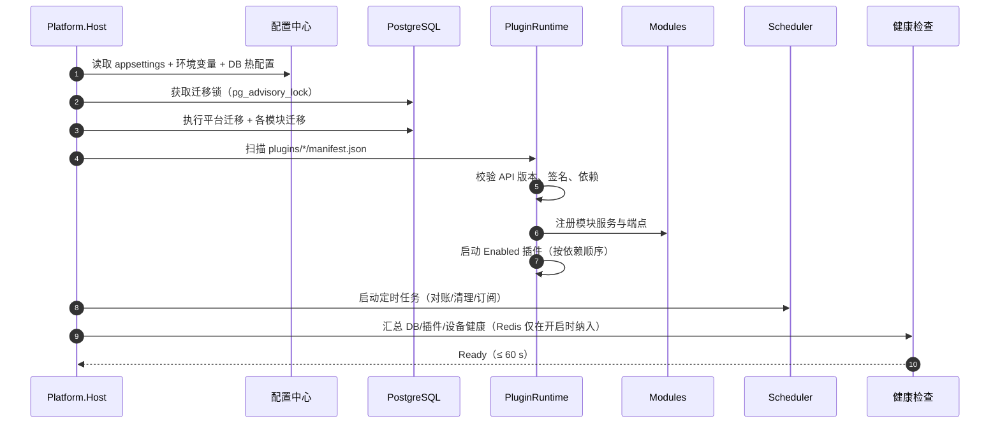

**启动失败策略**：

| 失败点 | 行为 | 是否阻止启动 |
|---|---|---|
| 平台迁移失败 | 回滚事务、写致命日志、退出 | 是 |
| 单个插件加载失败 | 标记 `Faulted`、告警、继续 | 否（核心插件除外） |
| Redis 不可用 | 降级为进程内缓存、告警 | 否 |
| 设备全离线 | 正常启动，设备状态标 Offline | 否 |
| 审计链校验失败 | 只读模式启动、禁止写操作 | 是（写操作） |

> **慢启动插件不占 60 s 预算**：视觉引擎（许可初始化、VPP/hdlt 流程反序列化，冷启动可达数十秒）与运动卡（`open + board_init`）按「懒启动」装配——`StartAsync` 只做注册与自检，真正初始化推迟到首次取像/首次运动或后台预热任务，超时归 5.13/5.11 的动作超时管，不计入平台就绪时间。客户端在引擎未就绪时显示「引擎预热中」，不允许静默把首件当成正常节拍。

### 3.3 配置体系（三级）

| 级别 | 存放 | 例子 | 变更方式 | 是否热生效 |
|---|---|---|---|---|
| 静态配置 | appsettings + 环境变量 | 端口、连接串、JWT 密钥 | 重启 | 否 |
| 业务配置 | `sys_config` 表 | 采集周期、保留天数、告警阈值 | 界面修改 + 版本 | 是（下一周期） |
| 插件配置 | `plugin_state.config` JSONB | 设备地址模板、MES 映射 | 插件页修改 + 校验 | 部分（重连后） |

**规则**：

1. 密钥只走环境变量或密钥文件，绝不进数据库明文、不进 Git。
2. 每个配置项必须有默认值、类型、范围、单位；保存前按 JSON Schema 校验。
3. 配置修改写审计（旧值/新值），并生成版本号，可回滚。
4. 插件配置里不允许出现「连接串密码」明文，统一引用密钥名。

### 3.4 数据库迁移

| 场景 | 做法 |
|---|---|
| 平台表 | EF Core Migration，启动时 `MigrateAsync()`，`pg_advisory_lock` 防并发 |
| 模块表 | 模块自带 `migrations/*.sql`，由 `ModuleMigrator` 按模块版本执行 |
| 插件表 | 插件目录 `migrations/`，安装/升级时执行，记录在 `plugin_state.applied_migrations` |
| 回滚 | 迁移脚本必须「向前兼容」：先加列/表，再切代码，最后删旧列（两阶段） |
| 禁止 | 迁移里写业务数据清洗（应独立为数据修复任务，可重跑） |

### 3.5 前后端与接口约定

| 约定 | 内容 |
|---|---|
| 响应结构 | `{ code, message, data, traceId }`；HTTP 状态码表达传输层，`code` 表达业务层 |
| 错误码分段 | `0` 成功；`10xxx` 认证；`20xxx` 参数；`30xxx` 业务；`40xxx` 设备；`50xxx` MES；`60xxx` 插件；`70xxx` 报表 |
| 分页 | `page`（从 1）、`size`（≤ 200）、`total`；禁止无上限全量接口 |
| 时间 | 存储 UTC（`timestamptz`），接口 ISO 8601，客户端按操作站本地时区显示（`TimeZoneInfo` 随登录用户设置走） |
| ID | 内部 `bigint` 自增；对外消息用 ULID；业务单号用规则生成（`WO-260102-001`） |
| 幂等 | 所有写接口接受 `Idempotency-Key`；重复返回首次结果，不重复执行 |
| 版本 | URL 前缀 `/api/v1`；破坏性变更升 `/api/v2`，旧版保留一个周期 |
| OpenAPI | 构建时导出 `docs/api/openapi.json`，客户端由此生成接口代理（Refitter/Kiota），禁止手写 DTO |

### 3.6 代码边界与事件

**跨模块通信只允许三种方式**：

1. **接口**（同步查询）：定义在 Abstractions，实现在提供方模块。
2. **领域事件**（异步通知）：`WorkOrderReleased`、`ProductionReported`、`DeviceOffline`。
3. **共享只读视图**（报表场景）：由 Data 层提供只读查询，不暴露写能力。

**禁止**：模块 A 直接 `using Modules.B` 的实体；插件直接查平台表；在控制器里写业务规则。

### 3.7 功能开关设计（FeatureGate）

**结论：开关是一张带依赖、带范围、带生效方式的配置表，不是一个全局 `bool`；读走缓存、写走 Planner，任何越权或破坏依赖的变更在保存时就被拒绝。**

#### 3.7.1 数据模型

```sql
-- 能力定义（随代码发布，不在界面随意新增）
CREATE TABLE feature_flag (
  flag_key        text PRIMARY KEY,              -- 例：recipe.download
  display_name    text NOT NULL,
  grp             text NOT NULL,                 -- A~J 组
  default_enabled boolean NOT NULL DEFAULT false,
  off_behavior    char(1) NOT NULL,              -- H/A/J/P，见 2.7.2
  requires        text[] NOT NULL DEFAULT '{}',  -- 依赖闭包
  conflicts       text[] NOT NULL DEFAULT '{}',  -- 互斥能力
  runtime_scope   text NOT NULL DEFAULT 'hot',   -- hot/restart/drain
  edition_min     text NOT NULL DEFAULT 'basic', -- basic/standard/pro
  requires_plugin boolean NOT NULL DEFAULT false,-- 该能力必须由插件提供
  always_on       boolean NOT NULL DEFAULT false,-- 安全底线，不提供关闭入口
  sort_no         int NOT NULL DEFAULT 0,
  updated_at      timestamptz NOT NULL DEFAULT now()
);

-- 范围覆盖（只覆盖取值，不覆盖定义）
CREATE TABLE feature_scope (
  id             bigserial PRIMARY KEY,
  flag_key       text NOT NULL REFERENCES feature_flag(flag_key),
  scope_type     text NOT NULL,                  -- global/factory/workshop/line
  scope_id       text NOT NULL,                  -- global 固定为 '*'
  enabled        boolean NOT NULL,
  effective_from timestamptz,
  effective_to   timestamptz,
  reason         text NOT NULL,                  -- 变更原因，必填
  ticket_no      text,                           -- 变更单号
  updated_by     bigint NOT NULL,
  updated_at     timestamptz NOT NULL DEFAULT now()
  -- 不设唯一约束：历史生效记录要保留；同一范围取 effective_from 最新的一条
);
CREATE INDEX ix_feature_scope_lookup
  ON feature_scope (flag_key, scope_type, scope_id, effective_from DESC);

-- 缓存版本号：任何写入 +1，各节点据此失效本地缓存
CREATE TABLE feature_version (
  id      int PRIMARY KEY DEFAULT 1,
  version bigint NOT NULL DEFAULT 1,
  updated_at timestamptz NOT NULL DEFAULT now()
);
```

**解析顺序（窄覆盖宽）**：`line > workshop > factory > global > default_enabled`。同一层取 `effective_from ≤ now < effective_to`（为空视为长期有效）的最新一条。

#### 3.7.2 契约与实现

```csharp
// Platform.Abstractions/Features/IFeatureGate.cs
public interface IFeatureGate
{
    bool IsEnabled(string key);                       // 最终可用 = 开关 ∧ 许可 ∧ 插件就绪
    bool IsEnabled(string key, FeatureScope scope);   // 按工厂/车间/产线
    void Demand(string key);                          // 未开启抛 FeatureDisabledException
    FeatureState Get(string key, FeatureScope? scope = null);
    IReadOnlyDictionary<string, FeatureState> Snapshot(FeatureScope? scope = null); // 客户端一次拉全量（含原因）
}

public readonly record struct FeatureScope(string Factory, string? Workshop = null, string? Line = null);

public readonly record struct FeatureState(
    string Key,
    bool Enabled,
    char OffBehavior,
    string Reason,        // DISABLED_BY_FLAG / LICENSE_EXPIRED / PLUGIN_BLOCKED / DEPENDENCY_MISSING
    bool FlagOn,
    bool Licensed,
    bool PluginReady);
```

```csharp
// Platform.Core/Features/FeatureGate.cs（节选）
public sealed class FeatureGate(IFeatureStore store, ILicenseService license,
                                IPluginReadiness plugins) : IFeatureGate
{
    // 本地缓存 30 s，键为 feature_version；实现细节略
    public FeatureState Get(string key, FeatureScope? scope = null)
    {
        var flag = store.GetDefinition(key)
            ?? throw new ArgumentException($"未定义的能力键：{key}", nameof(key));

        if (flag.AlwaysOn)                               // G1/G4：不受开关与许可影响
            return new FeatureState(key, true, '-', "ALWAYS_ON", true, true, true);

        var flagOn = store.Resolve(key, scope) ?? flag.DefaultEnabled;
        var licensed = license.Allows(key);              // 未购买 → false，但保留数据
        var pluginReady = !flag.RequiresPlugin || plugins.IsReady(key);

        var reason = flagOn ? (!licensed ? "LICENSE_EXPIRED" : !pluginReady ? "PLUGIN_BLOCKED" : "OK")
                            : "DISABLED_BY_FLAG";
        return new FeatureState(key, flagOn && licensed && pluginReady, flag.OffBehavior,
                                reason, flagOn, licensed, pluginReady);
    }

    public bool IsEnabled(string key) => Get(key).Enabled;

    public void Demand(string key)
    {
        var s = Get(key);
        if (!s.Enabled) throw new FeatureDisabledException(key, s.Reason, s.OffBehavior);
    }

    public IReadOnlyDictionary<string, FeatureState> Snapshot(FeatureScope? scope = null)
        => store.AllKeys().ToDictionary(k => k, k => Get(k, scope));
}
```

**性能**：一次快照 68 个键，命中本地缓存（30 s）+ Redis 版本号；未命中时一次 `SELECT` 取全表，不在循环里查库。开关变更后 `feature_version + 1`，各节点在下一次访问时失效，最坏延迟 30 s。

#### 3.7.3 接口拦截：声明式，不写业务 if

```csharp
// 端点标注
[HttpGet("recipes/{id}/download")]
[RequiresFeature("recipe.download")]     // 生成时写入路由-能力映射表
public Task<IActionResult> Download(...) { ... }
```

```csharp
// Platform.Host/Middleware/FeatureGateMiddleware.cs
public async Task InvokeAsync(HttpContext ctx, IFeatureGate gate)
{
    var key = ctx.GetEndpoint()?.Metadata.GetMetadata<RequiresFeatureAttribute>()?.Key;
    if (key is not null && !gate.IsEnabled(key, ctx.User.ToFeatureScope()))
    {
        var s = gate.Get(key, ctx.User.ToFeatureScope());
        ctx.Response.StatusCode = StatusCodes.Status403Forbidden;
        await ctx.Response.WriteAsJsonAsync(ApiResult.Fail(60001, "FEATURE_DISABLED",
            $"能力 {key} 未开启（{s.Reason}）", ctx.TraceIdentifier));
        return;                        // 不进入控制器，不产生半截业务
    }
    await _next(ctx);
}
```

**约定**：

| 位置 | 做法 | 禁止 |
|---|---|---|
| 后端 | `[RequiresFeature]` 或 `gate.Demand()` 在**入口**判断 | 在 Service 深处零散 `if (gate.IsEnabled(...))` |
| 客户端 | 登录后拉 `/api/v1/features`，导航与按钮按 key 过滤（读 `enabled`，展示 `reason`） | 硬编码 `if (Edition == Pro) 控件.Visible = false` |
| 定时任务 | 注册前 `if (!gate.IsEnabled(key)) return;`，运行中每轮再判一次 | 只在启动判一次，关掉后仍在跑 |
| 插件 | `PluginManifest.requiresFeatures`，见 4.13 | 插件自己在 `Configure` 里读配置表 |

#### 3.7.4 开关变更：Planner 六步

```csharp
public sealed record FeatureChange(string Key, bool Enabled, FeatureScope Scope,
                                   string Reason, string? TicketNo);

public sealed record PlanResult(bool Allowed, IReadOnlyList<string> Errors,
                               IReadOnlyList<string> HotApplied,
                               IReadOnlyList<string> RestartRequired,
                               IReadOnlyList<string> DrainRequired);
```

| 步 | 检查 | 失败表现 |
|---|---|---|
| 1 | 操作人具备 `platform:feature:write`，且范围在其数据权限内 | 403；不允许越厂改开关 |
| 2 | 依赖闭包：要开的键，其 `requires` 必须全开 | 拒绝，返回缺失键清单 |
| 3 | 冲突：`conflicts` 中的键必须全关（如 `ui.designer` 与 `ui.mimic` 二选一） | 拒绝，要求先关另一个 |
| 4 | 许可：`edition_min` 与 License 匹配 | 拒绝；提示升级发行版而非改开关 |
| 5 | 插件就绪：`P` 类能力要求插件已安装且签名有效 | 拒绝，提示先装插件；或允许保存但状态 `Blocked` |
| 6 | 生效方式分类：按 `runtime_scope` 分到 hot / restart / drain | 返回三类清单，由界面提示 |

**生效方式**：

| 类型 | 适用 | 动作 | 用户感知 |
|---|---|---|---|
| `hot` | 纯界面、纯查询 | 写库 → 版本号 +1 → 发 `FeatureChanged` 事件 → 清缓存 | 刷新页面即生效 |
| `restart` | 影响 DI 注册、路由表、迁移 | 写库并置 `pending_restart=true` | 顶部提示「重启后生效」 |
| `drain` | 采集、作业、Outbox | 先停止接新任务 → 等在途 ≤ 30 s → 停调度 → 写库 | 显示「正在停止（剩余 N 个任务）」 |

**审计**：每次变更写 `audit_log`，`action=FEATURE_CHANGE`，`before/after` 为 `{enabled, scope, reason}` 的规范化 JSON，进哈希链（见 9.7）；批量变更生成一个 `change_id`，可整体回滚。

#### 3.7.5 接口清单

| 方法 | 路径 | 说明 | 权限 |
|---|---|---|---|
| GET | `/api/v1/features` | 当前范围的能力快照：返回 `FeatureState` 列表（`enabled` + `reason` + `offBehavior`） | 已登录 |
| GET | `/api/v1/features/{key}` | 单键详情：依赖、冲突、生效方式 | `platform:feature:read` |
| PUT | `/api/v1/features/{key}` | 单键变更（走 Planner） | `platform:feature:write` |
| POST | `/api/v1/features/batch` | 批量变更 + 依赖闭包 | `platform:feature:write` |
| POST | `/api/v1/features/{key}/rollback` | 回滚到上一个 `change_id` | `platform:feature:write` |
| POST | `/api/v1/features/reload` | 强制刷新本节点缓存（排障用） | `platform:ops` |

#### 3.7.6 命名与反模式

**命名**：`域.对象[.子项]`，全小写、点分隔、≤ 40 字符；域固定为 `acq / device / ui / alarm / recipe / process / data / report / security / ops / northbound / integration / vision / robot / motion / ha / event / notify`。**不带环境前缀**（`prod.`、`test.` 一律禁止），环境差异靠 `feature_scope`。

| 反模式 | 为什么错 | 正确做法 |
|---|---|---|
| 用开关代替权限 | 开关是「这个现场有没有」，权限是「这个人能不能」 | 两者都判：先权限，后开关 |
| 用开关代替数据修复 | 关掉后脏数据仍在，重新打开继续错 | 走数据修复任务，可重跑、有记录 |
| 一个开关管多个不相关功能 | 无法单独裁剪，客户要 A 不要 B 就卡住 | 一能力一键，粒度到「菜单级」 |
| 开关只在客户端隐藏 | 直接调接口仍能写，属于安全漏洞 | 后端必须 `[RequiresFeature]` |
| 废弃能力长期留开关 | 组合爆炸，测试矩阵失控 | 下线一个版本后删除定义与代码 |
| 变更不写原因 | 半年后没人知道为什么关的 | `reason` 必填 + 变更单号 |

> **自检 3 问**
> 1. 为什么插件目录里要有 `migrations/`，而平台迁移不能由插件随意改表？
> 2. 一个新模块要加菜单、权限、迁移、接口，分别落在哪个工程？
> 3. 如果两个模块都要「工单完成」事件，谁会收到、顺序如何保证？

---

## 4. 插件体系（核心）

**结论：插件不是「把 DLL 丢进目录」，而是一套带清单、带版本、带权限、带生命周期、带失败隔离的运行机制；没有清单的 DLL 一律不加载。**

### 4.1 插件分类

| 类型 | 扩展点 | 典型插件 | 是否可热装卸 |
|---|---|---|---|
| Driver | `IDeviceDriver` 及 5.11 的大类接口（`ICameraDriver` / `IRobotDriver` / `IMotionDriver` / `IAgvDriver`，靠 manifest `deviceClasses` 区分） | Modbus、S7、MC、OPC UA、文本；海康相机、ABB 机器人、固高运动卡 | 可（无活动连接/在途动作时） |
| Vision | `IVisionEngine` | Halcon、VisionPro、VisionMaster、OpenCV | 可（无在途检测时，见 5.13） |
| MesAdapter | `IMesAdapter` | SAP、用友、金蝶、自研 | 可（排空在途后） |
| Report | `IReportProvider` | OEE、SPC、能耗 | 可 |
| AuthProvider | `IAuthProvider` | LDAP、OIDC | 需重启 |
| Job | `IPluginJob` | 对账、清理、巡检 | 可 |
| Module | `IPlatformModule` | 安灯、刀具、能源 | 需迁移窗口 |

### 4.2 插件契约

```csharp
// Platform.Abstractions/Plugins/IPlatformPlugin.cs
namespace Platform.Abstractions.Plugins;

public interface IPlatformPlugin
{
    PluginManifest Manifest { get; }

    /// <summary>注册服务与扩展点；此时不得访问数据库或网络。</summary>
    void Configure(IPluginContext context, IServiceCollection services);

    /// <summary>启动插件；可建立连接、订阅事件、启动后台任务。</summary>
    Task StartAsync(IPluginContext context, CancellationToken ct);

    /// <summary>停止插件；必须释放连接、取消后台任务、落盘未完成状态。</summary>
    Task StopAsync(CancellationToken ct);
}

public interface IPluginContext
{
    string PluginId { get; }
    ILogger Logger { get; }
    IPluginConfiguration Config { get; }      // 带 schema 校验与版本
    IEventBus Events { get; }                  // 发布/订阅领域事件
    IPluginStorage Storage { get; }            // 插件私有目录（只允许写这里）
    IServiceProvider Services { get; }         // 平台只读服务（受限）
    string PlatformApiVersion { get; }
}
```

**`PluginManifest`（强类型，反序列化自 `manifest.json`）**

**`PluginKind` 合法取值（加载器按此分派生命周期与宿主）**：`Driver`（南向设备，含 Camera/Robot/Motion/Agv 派生）、`MesAdapter`（北向上游系统，含 `IBusinessSystemAdapter` 实现）、`Module`（业务模块，`IPlatformModule`）、`Vision`（视觉引擎封装，`IVisionEngine`）、`Copilot`（能力型插件，如 15 号 PLC AI 编程 Agent——只挂接 WPF 页面、权限与审计，不注册驱动/适配器）、`Exporter`（数据导出，`IDataExporter`）。**取值不在枚举内 = 拒绝加载**；每类 kind 的必填字段见 11.6 扩展点清单。

```csharp
public sealed record PluginManifest
{
    public required string Id { get; init; }              // 全局唯一，如 "driver.modbus.tcp"
    public required string Name { get; init; }
    public required string Version { get; init; }         // SemVer
    public required PluginKind Kind { get; init; }
    public required string PlatformApi { get; init; }     // 兼容范围，如 ">=1.4 <2.0"
    public required string EntryAssembly { get; init; }   // "lib/Driver.ModbusTcp.dll"
    public required string EntryType { get; init; }       // 完整类型名
    public IReadOnlyList<string> DependsOn { get; init; } = [];
    public IReadOnlyList<string> Capabilities { get; init; } = [];  // "device.read", "device.write"
    public IReadOnlyList<string> Permissions { get; init; } = [];   // 插件申请的权限码
    public string? ConfigSchema { get; init; }            // "config.schema.json"
    public string? Sha256 { get; init; }
    public string? Signature { get; init; }
    public IReadOnlyList<string> RequiresFeatures { get; init; } = []; // 依赖的能力键
    public IReadOnlyList<string> ProvidesFeatures { get; init; } = []; // 能补上的能力键
    public IReadOnlyList<string> DeviceClasses { get; init; } = [];    // Plc/Camera/Robot/Motion/Scanner/Agv
    public int Priority { get; init; } = 100;                          // providesFeatures 冲突时的优先级
}
```

### 4.3 manifest.json 样例

```json
{
  "id": "driver.modbus.tcp",
  "name": "Modbus TCP 驱动",
  "version": "1.3.0",
  "kind": "Driver",
  "platformApi": ">=1.4 <2.0",
  "entryAssembly": "lib/Driver.ModbusTcp.dll",
  "entryType": "Platform.Drivers.ModbusTcp.ModbusTcpPlugin",
  "dependsOn": ["core.device.runtime"],
  "capabilities": ["device.read", "device.write", "device.batch"],
  "permissions": ["device:read", "device:write"],
  "requiresFeatures": ["acq.core", "device.registry"],
  "providesFeatures": [],
  "deviceClasses": ["Plc"],
  "priority": 100,
  "configSchema": "config.schema.json",
  "sha256": "9f2c...e1",
  "signature": "signature.sig"
}
```

| 字段 | 必填 | 校验规则 | 失败后果 |
|---|---|---|---|
| `id` | 是 | 小写 + 点分，全局唯一 | 拒绝加载 |
| `version` | 是 | SemVer | 拒绝加载 |
| `platformApi` | 是 | 必须匹配宿主 API 范围 | 标记 Incompatible |
| `entryType` | 是 | 必须实现 `IPlatformPlugin` | 标记 Faulted |
| `dependsOn` | 否 | 依赖必须已 Enabled，且无环 | 标记 Blocked |
| `capabilities` | 是 | 必须在宿主能力白名单内 | 拒绝加载 |
| `permissions` | 否 | 安装时由管理员确认 | 未授权则受限运行 |
| `requiresFeatures` | 否 | 必须是已定义的能力键；任一未开启 | `Blocked`，不加载（见 4.13） |
| `providesFeatures` | 否 | 同一能力只允许一个 Active 提供者 | 冲突时拒绝安装或保持 `Blocked` |
| `deviceClasses` | 否 | 仅 Driver 类必填，须与 `kind` 匹配（5.12.1） | 拒绝安装 |
| `arch` | 否 | 仅带厂商 DLL 的 Driver 必填：`x86` / `x64` / `any`；与宿主位数不符 → `Blocked`（见 5.11.4 ②） | 拒绝启动 |
| `mesTargets` | 否 | 仅 MesAdapter 类必填：本插件承接的路由目标码（逻辑码，非厂商名，见 6.13.1） | 空列表 → 装了也不投递 |
| `mesInterfaces` | 否 | 仅 MesAdapter 类必填：实现的 `bizType` 白名单；未声明的报文判 `Dead`（6.13.1） | 声明与实际不符 → 契约测试不过 |
| `priority` | 否 | 整数，默认 100；用于 `providesFeatures` 与 `mesTargets` 同名冲突裁决 | 平级时拒绝启动 |
| `sha256` | 是 | 与包内文件一致 | 拒绝安装 |

### 4.4 加载器实现（关键 40 行）

```csharp
// Platform.Core/Plugins/PluginLoader.cs
public sealed class PluginLoader(
    IServiceProvider hostServices,
    ILogger<PluginLoader> log,
    PluginOptions options)
{
    private readonly Dictionary<string, PluginHandle> _running = new();

    public async Task<PluginHandle> LoadAsync(PluginPackage pkg, CancellationToken ct)
    {
        var m = pkg.Manifest;
        if (!ApiVersion.IsCompatible(m.PlatformApi, PlatformInfo.ApiVersion))
            throw new PluginLoadException($"API 不兼容：插件要求 {m.PlatformApi}，平台 {PlatformInfo.ApiVersion}");

        if (options.RequireSignature && !SignatureVerifier.Verify(pkg))
            throw new PluginLoadException("签名校验失败");

        // 每个插件独立 ALC，可卸载；依赖从插件自带 lib/ 解析
        var alc = new PluginLoadContext(pkg.MainAssemblyPath);
        var asm = alc.LoadFromAssemblyPath(pkg.MainAssemblyPath);
        var type = asm.GetType(m.EntryType, throwOnError: true)!;

        if (Activator.CreateInstance(type) is not IPlatformPlugin plugin)
            throw new PluginLoadException($"入口类型未实现 IPlatformPlugin：{m.EntryType}");

        var services = new ServiceCollection();
        var context = new PluginContext(m, log, pkg.Directory, hostServices);
        plugin.Configure(context, services);              // 只注册，不动作
        var provider = services.BuildServiceProvider(new ServiceProviderOptions
        {
            ValidateOnBuild = true,
            ValidateScopes = true
        });

        try
        {
            await plugin.StartAsync(context, ct);         // 此时才允许连接/订阅
            var handle = new PluginHandle(m, alc, provider, plugin, PluginState.Running);
            _running[m.Id] = handle;
            log.LogInformation("插件已启动 {Id} {Version}", m.Id, m.Version);
            return handle;
        }
        catch (Exception ex)
        {
            await SafeStopAsync(plugin, log);
            alc.Unload();
            throw new PluginLoadException($"启动失败：{m.Id}", ex);
        }
    }

    public async Task UnloadAsync(string id, TimeSpan drainTimeout, CancellationToken ct)
    {
        var h = _running[id];
        h.State = PluginState.Draining;                   // 排空：拒绝新请求
        using var drainCts = CancellationTokenSource.CreateLinkedTokenSource(ct);
        drainCts.CancelAfter(drainTimeout);               // 超时交出排空权，不杀线程
        await h.Plugin.StopAsync(drainCts.Token);         // 停连接、停任务
        await h.Provider.DisposeAsync();
        h.Alc.Unload();                                   // 可卸载 ALC
        _running.Remove(id);
    }
}

internal sealed class PluginLoadContext(string mainAssemblyPath)
    : AssemblyLoadContext(isCollectible: true)
{
    private readonly AssemblyDependencyResolver _resolver = new(mainAssemblyPath);
    protected override Assembly? Load(AssemblyName name)
    {
        var path = _resolver.ResolveAssemblyToPath(name);
        return path is null ? null : LoadFromAssemblyPath(path);
    }
}
```

**必须知道的三个限制**：

1. `AssemblyLoadContext` 只隔离依赖版本，**不是安全沙箱**；不可信插件必须进程外运行。
2. 卸载要求所有线程、定时器、事件订阅都释放；否则 ALC 不会被回收（用 `WeakReference` 验证）。
3. 插件不能引用 `Platform.Data`；需要数据能力时只能通过 `IPluginContext.Services` 暴露的受限接口。

### 4.5 生命周期状态机

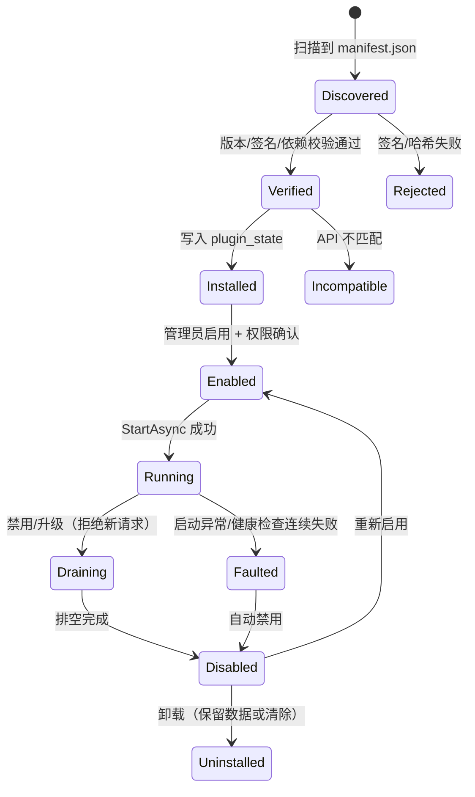

> **两套状态不要混用**：本节是**生命周期状态**（`plugin_state.state`），描述插件本身走到哪一步；4.13.2 的 `Active / Blocked / Degraded / Absent` 是**开关组合态**（`plugin_state.binding_state`），描述「在当前开关与许可下是否可用」。同一插件可以生命周期为 `Running`、组合态为 `Blocked`（装了但开关关）。

| 状态 | 允许操作 | 数据行为 |
|---|---|---|
| Installed | 配置、启用、卸载 | 不改数据 |
| Enabled | 启动、停用 | 不改数据 |
| Running | 使用、配置热更新（部分）、停用 | 正常读写 |
| Draining | 只允许查询，拒绝新任务 | 等在途 ≤ 30 s |
| Faulted | 查看日志、修复后重试 | 不改数据，告警 |
| Disabled | 配置、启用、卸载 | 数据保留 |
| Uninstalled | — | 默认保留数据，显式选择清除 |

### 4.6 依赖、版本与冲突

| 规则 | 说明 | 例子 |
|---|---|---|
| API 兼容 | 宿主声明 `PlatformApi = 1.5`，插件声明范围 | `>=1.4 <2.0` 可装；`>=2.0` 拒绝 |
| 依赖顺序 | 拓扑排序启动，反向停止 | `driver.modbus` 依赖 `core.device.runtime` |
| 同名能力 | 同一 `capability` 只允许一个 Active | 两个 Modbus 驱动同时启用 → 第二个 Blocked |
| 版本并存 | 允许旧版本保留在 `disabled/`，不参与加载 | 回滚用 |
| 强依赖缺失 | 依赖未启用 → Blocked，不影响其他插件 | 报表插件依赖 OEE 模块 |
| 循环依赖 | 加载时检测，直接拒绝 | A→B→A |

### 4.7 隔离级别（按信任度选）

| 级别 | 机制 | 适用 | 隔离强度 | 性能 |
|---|---|---|---|---|
| L1 进程内 ALC | 独立程序集加载上下文 | 自研插件、可信厂商 | 依赖隔离，非安全隔离 | 最高 |
| L2 进程外 Host | `PluginHost.exe` + gRPC，独立账号 | 第三方、不可信代码 | 崩溃/内存/权限隔离 | 中（IPC 开销） |
| L3 容器 | 每插件一容器，限制 CPU/内存/网络 | 多租户、SaaS | 最强 | 较低 |

**选择建议**：自研纯托管驱动与 MES 适配用 L1；**拉起原生 SDK 或 32 位 DLL 的驱动（`gts.dll`/`LTDMC.dll`/`zmotion.dll`/Halcon/VP/VM）无论自研还是外包，一律 L2**（位数不匹配装不进 64 位主进程，且 4.8.1 的热卸载限制只有子进程模型能干净绕开）；客户提供的 DLL、外包团队插件用 L2；对外售卖的插件市场用 L3。**最小 L2 宿主属 P0 范围**（13.1、13.7.1 C1）。

**进程外契约（L2）**：

```csharp
// 由 PluginHost 暴露，平台侧只依赖这个接口
public interface IRemoteDriver
{
    Task<ConnectResult> ConnectAsync(EndpointDto ep, CancellationToken ct);
    Task<ReadBatchResult> ReadAsync(PointRefDto[] points, CancellationToken ct);
    Task<WriteBatchResult> WriteAsync(PointWriteDto[] writes, CancellationToken ct);
    IAsyncEnumerable<DeviceEventDto> SubscribeAsync(CancellationToken ct);
}
```

### 4.8 热插拔边界（写清楚，避免现场乱来）

| 操作 | 可热 | 前置条件 | 失败回退 |
|---|---|---|---|
| 新增报表插件 | 是 | 无 | 禁用即可 |
| 启用/停用 MES 适配 | 是 | 在途消息 ≤ 30 s 排空 | 重新启用，Outbox 补发 |
| 启用设备驱动 | 是 | 无活动连接 | 禁用 |
| 升级设备驱动（**纯托管协议**：Modbus/MC3E/OPC UA/HTTP） | 排空后 | 停止采集 → 卸载 ALC → 重连 → 回读校验 | 回滚旧版本 |
| 升级设备驱动（**拉起原生 SDK**：`gts.dll`/`LTDMC.dll`/`zmotion.dll`/Halcon/VP/VM） | **否** | 排空 → 子进程整体重启（见 4.8.1） | 回滚旧版本 + 重启宿主进程 |
| 新增业务模块 | 否（需迁移窗口） | 备份 + 停写 | 迁移回滚脚本 |
| 更换认证插件 | 否（需重启） | 维护窗口 | 回滚配置 |
| 升级审计组件 | 禁止热替换 | 停机 | 备份 |
| 修改平台核心 | 禁止 | 走发版流程 | 镜像回滚 |

**「排空」定义**：不再接受新任务；等在途指令/消息完成或超时；超时任务转「待对账」，不丢。

#### 4.8.1 设计公理：进程内插件不承诺原生 SDK 热卸载

**结论：`AssemblyLoadContext.Unload()` 只回收托管内存，不保证卸掉 P/Invoke 拉起的原生 DLL；凡是厂商 SDK，热卸载就是伪需求，正确做法是「换版本 = 重启宿主进程」。**

这条不是保守，是 CLR 的现实。以下四类都会让「卸载成功」变成假象：

| 泄漏源 | 为什么卸不掉 | 现场表现 |
|---|---|---|
| 原生模块 | `NativeLibrary.Load` 拉起的 DLL 由 OS 持有；厂商 `DllMain` 普遍不为反复装卸设计（卡句柄、线程 TLS、Halcon per-thread init） | 第二次 `Unload` 后 `WeakReference` 仍不死；换版本后旧 DLL 被占用，新 DLL 加载失败 |
| 托管残留 | 静态事件、未取消的 `Timer`/`CancellationTokenSource`、async state machine 捕获 `this` | 插件停了还在回调，报「对象已释放」 |
| captive dependency | 插件类型被平台单例字段持有（如注册进 `IDriverFactory` 后没摘干净） | ALC 整体驻留，内存只涨不降 |
| 许可与硬件句柄 | 加密狗句柄、板卡句柄、GPU 上下文不随 ALC 释放 | 重启前拿不到第二份许可 |

**因此本方案把承诺收窄成三句，验收也照这三句验**：

1. **新装配可热**：首次安装并启用一个驱动/适配插件，不需要重启平台。
2. **停用可热**：排空后停止采集/发送、摘除注册、释放连接；托管侧允许 `Unload`，失败只记警告，不影响其他插件。
3. **换版本走进程重启**：拉起原生 SDK 的插件升级一律「排空 → 停子进程 → 起新子进程」，不做同进程内 DLL 替换；纯托管驱动可尝试热卸载，**失败即降级为进程重启**，不允许「卸载失败但继续跑」这种中间态。

> **落到工程上**：这条公理是「最小进程外宿主属于 P0」的直接原因（13.1、13.7.1）——32 位厂商 DLL 本来就必须跑独立子进程，热卸载问题在子进程模型下自然消解：重启进程比卸载 DLL 简单一个数量级。
>
> **自检 2 问**：① 你的 `Unload` 是真验证过 `WeakReference` 死了，还是只看没抛异常？② 升级一张运动卡的固件适配版本，现场要停机多久？答案应该是「子进程重启秒级」，而不是「等平台发版」。

### 4.9 配置 Schema 与自动表单

```json
{
  "$schema": "https://json-schema.org/draft/2020-12/schema",
  "type": "object",
  "required": ["host", "port", "timeoutMs"],
  "properties": {
    "host": { "type": "string", "title": "IP 地址", "format": "ipv4" },
    "port": { "type": "integer", "title": "端口", "minimum": 1, "maximum": 65535, "default": 502 },
    "timeoutMs": { "type": "integer", "title": "超时(ms)", "minimum": 100, "maximum": 5000, "default": 800 },
    "byteOrder": { "type": "string", "enum": ["ABCD", "CDAB", "BADC", "DCBA"], "default": "CDAB" }
  },
  "additionalProperties": false
}
```

- 客户端根据 schema 自动渲染表单（平台提供 `SchemaFormGenerator`：`title/minimum/enum` → `Label/NumericUpDown/ComboBox`），不写死页面。
- 保存时服务端再次校验（不能只信客户端）。
- `password` 字段用 `format: "secret"`，实际值存密钥库，配置只存引用名。

**插件客户端扩展点（UI 插件）**：驱动/适配插件通常无 UI；带界面的插件（组态设计器、OEE 分析）实现 `IPluginUiProvider`：

```csharp
// Platform.Abstractions/Plugins/IPluginUiProvider.cs
public interface IPluginUiProvider
{
    /// <summary>声明插件页：导航路径、标题、图标、所需能力键。</summary>
    PluginPageDescriptor Page { get; }

    /// <summary>返回页面（由平台宿主加载进 ContentControl）。
    /// 约定：View 须绑定插件自己的 ViewModel；程序集必须与平台共享 ContractVersion。</summary>
    FrameworkElement CreateView(IServiceProvider pluginServices);
}

public sealed record PluginPageDescriptor(
    string Route,          // "plugins/vision-camera"
    string Title,          // "视觉相机"
    string IconKey,        // 资源字典图标键
    string PermCode,       // "plugin.camera:view"
    IReadOnlyList<string> RequiresFeatures);  // 为空表示随插件启用
```

> UI 插件三条约束：① 页面注册进主窗口导航树，随 `IFeatureGate` 显隐；② 插件 View 不得直接引用平台主窗口的控件（只通过 DataContext 绑定）；③ 插件卸载时平台负责 `UnloadAsync` 并移除导航项，未释放的订阅在日志里告警。

#### 4.9.1 插件页宿主规则（客户端崩溃隔离）

**结论：插件页与平台壳同进程、同 UI 线程，服务端那套「进程外隔离」在客户端不成立。所以隔离必须在 WPF 内部做：一页崩，只禁一页，主窗口和其他页照常可用。**

这一条不写清，1.4「单插件故障影响」和 13.3 第 4 条在客户端就是空头承诺。

| 规则 | 平台侧做法 | 插件侧义务 | 违反后果 |
|---|---|---|---|
| 页级异常捕获 | 每页包一个 `PluginPageHost`（`ContentControl` 容器），`CreateView` 与首次布局、绑定求值都在 `try/catch` 内；异常 → 该页替换为错误面板 + 「重试/禁用」按钮 | 构造函数与 `CreateView` 里不做阻塞 IO；异步加载并处理自身异常 | 未捕获异常冒到 `DispatcherUnhandledException`，整客户端退出 |
| 崩溃后降级 | 记 `plugin_ui.crash`（插件 Id + 页 Route + TraceId）→ 导航项标灰、本会话内不再实例化该页 → 提示管理员 | 提供 `IVersion` 便于定位 | 反复点击反复崩，现场判定「平台不稳」 |
| 订阅与定时器释放 | 页卸载（导航离开/插件停用）时调 `IDisposable`/`IPluginPageLeaving`，未实现则日志告警 | ViewModel 订阅平台事件必须随页生命周期取消；禁止静态事件持有页实例 | 内存只涨不降；插件停用后回调打到已释放对象 |
| 资源字典冲突 | 插件资源用 `pack://` 私有 URI + 前缀键名（`vision.` / `camera.`）；平台图标键为保留前缀 | 不向 `Application.Resources` 合并同名键；不覆盖平台 `Style`/`DataTemplate` | 后加载者赢，界面随机错乱且难复现 |
| `DataTemplate` 选择器 | 平台用显式 `x:Type` 映射，插件自带模板只作用于自己的 VM 类型 | 不注册全局隐式模板（无 `DataType` 限定的 `DataTemplate`） | 全局隐式模板劫持平台控件渲染 |
| 第三方控件授权 | 插件带 UI 控件（图表、网格）须在 manifest 声明 `uiDependencies`，`platform-cli doctor` 检查其许可证文件随包 | 商用控件的 license 必须随 `.pkg`，不假设现场有开发版 | 客户端弹出试用水印/直接抛异常，验收现场极难看 |
| 线程纪律 | 平台不替插件切线程：`CreateView` 在 UI 线程，其余全归插件 | 引擎调用、取像、读卡一律 `Task.Run` 后台；回 UI 用 `Dispatcher.Invoke` | UI 卡死，看板不动——单机教程时代的典型事故 |
| 程序集版本 | 插件必须引用与本机平台同 `ContractVersion` 的 `Platform.Abstractions`/`Platform.Client.Core`；不符 → 导航项不出现并提示（4.6、11.7） | 不打包自己的 `Platform.*` DLL 副本 | `MissingMethodException`，且报错信息完全看不出根因 |

```csharp
// Platform.Client/Hosting/PluginPageHost.cs（节选）
public sealed class PluginPageHost : ContentControl
{
    public void Activate(IPluginUiProvider provider, IServiceProvider services)
    {
        try
        {
            Content = provider.CreateView(services);   // 只保护实例化与首次布局
            SetValue(NavigationItemStateProperty, PageState.Ready);
        }
        catch (Exception ex)
        {
            _metrics.Counter("plugin_ui.crash", ("plugin", provider.Page.Route));
            Content = new PluginPageErrorView(provider.Page.Title, ex);  // 错误面板，不重抛
            SetValue(NavigationItemStateProperty, PageState.Disabled);    // 本会话禁再进
        }
    }
}
```

> **客户端不做的两件事**（写下来免得评审反复讨论）：① 不给每个插件页开独立进程——WPF 跨进程 UI 要么丢样式要么引额外运行时，收益远小于成本；② 不承诺「插件页崩溃后能原地热恢复」——本会话禁用、重启客户端恢复，够用且可解释。
> 需要真正强隔离的重型可视化（3D 组态、GPU 图像墙），走 5.13.5 的独立窗口或外挂进程，不进主窗口导航树。

### 4.10 失败隔离与熔断

| 机制 | 参数（默认） | 行为 |
|---|---|---|
| 调用超时 | 设备 800 ms / MES 5 s / 报表 30 s | 超时记 `Timeout`，不记 `Failed` |
| 熔断 | 连续 10 次失败或 50% 错误率（30 s 窗口） | 打开 30 s，半开探测 |
| 健康检查 | 每 30 s 一次 | 连续 3 次失败 → `Faulted` + 告警 |
| 自动禁用 | 仅对非核心插件 | 记录原因，通知管理员 |
| 隔离仓 | 每插件独立线程池/队列 | 一个插件队列满不占其他 |

### 4.11 插件包规范与私有仓库

```text
Driver.ModbusTcp-1.3.0.pkg   （zip）
├─ manifest.json
├─ lib/
│  ├─ Driver.ModbusTcp.dll
│  └─ NModbus.dll
├─ config.schema.json
├─ migrations/
│  └─ 001_init.sql
├─ README.md
└─ signature.sig
```

| 规则 | 说明 |
|---|---|
| 包名 | `{Id}-{Version}.pkg`，大小写敏感 |
| 哈希 | `manifest.sha256` 覆盖除签名外全部文件 |
| 签名 | 私钥签 `sha256`，平台内置公钥验签（可选强制） |
| 仓库 | 一期本地目录 `plugins/`；二期私有 NuGet/对象存储 + 索引 JSON |
| 灰度 | 按设备组/车间分批启用，观察 24 h 再全量 |
| 卸载 | 默认保留 `data/`；清除需二次确认 + 审计 |

### 4.12 插件开发十步

1. `dotnet new platform-driver -n Driver.MyPlc -o plugins/Driver.MyPlc`
2. 实现 `IPlatformPlugin`，在 `Configure` 里注册 `IDeviceDriver`
3. 写 `manifest.json`（Id、版本、API 范围、能力、权限）
4. 写 `config.schema.json`（地址模板、超时、字节序）
5. 实现连接/读/写/订阅，处理超时与异常码
6. 加 `migrations/`（仅当需要私有表）
7. 写单测：地址解析、字节序、异常码映射、断线重连
8. 写契约测试：用模拟器回放 100 帧
9. `dotnet platform-cli pack` 生成 `.pkg` + 哈希 + 签名
10. 在测试环境安装 → 启用 → 采集 1 h → 检查日志与指标 → 灰度

### 4.13 插件与开关联动

**结论：开关决定「要不要」，插件决定「有没有」；两者是「与」关系。插件装了但开关关 → 不加载；开关开了但插件没装 → 能力降级并明确报 `PLUGIN_BLOCKED`，绝不静默失败。**

#### 4.13.1 manifest 增补四个字段

```json
{
  "id": "driver.camera.hik",
  "version": "1.2.0",
  "kind": "Driver",
  "platformApi": ">=1.4 <2.0",
  "requiresFeatures": ["vision.camera", "device.registry"],
  "providesFeatures": ["vision.camera"],
  "deviceClasses": ["Camera"],
  "priority": 100,
  "dependsOn": ["core.device.runtime>=1.2.0"]
}
```

| 字段 | 作用 | 校验时机 |
|---|---|---|
| `requiresFeatures` | 插件运行所需能力，任一未开 → 不加载 | 安装、启动、开关变更 |
| `providesFeatures` | 该插件能补上的能力键；一个键全局只能有一个 Active 提供者 | 安装、启用 |
| `deviceClasses` | 该驱动能接的设备大类（Plc/Camera/Robot/Motion/Scanner/Agv） | 设备绑定、驱动选择 |
| `priority` | `providesFeatures` 冲突时的裁决优先级，默认 100 | 启动计算（4.13.3） |

#### 4.13.2 四种组合与状态

| # | 开关 | 插件 | 状态 | 平台动作 | 界面提示 |
|---|---|---|---|---|---|
| 1 | 开 | 已装且就绪 | `Active` | 正常加载、采集/服务运行 | 正常 |
| 2 | 关 | 已装 | `Blocked` | 不加载；文件保留；不执行迁移 | 「能力未开启」 |
| 3 | 开 | 未装 | `Degraded` | 能力仍标记为不可用；相关入口置灰 | 「缺少插件 X，请安装」 |
| 4 | 关 | 未装 | `Absent` | 无动作 | 插件市场显示「未安装」 |

> 组合 2 是最容易做错的地方：**不能因为开关关闭就拒绝安装**。安装与启用是两件事——现场可能先装好、等 License 到位再开。

> 这张表的 `Active / Blocked / Degraded / Absent` 是**开关组合态**，写入 `plugin_state.binding_state`；与 4.5 的生命周期状态（`Installed / Running / Uninstalled` 等）并存，不要混用（见 4.5 的两套状态说明）。

#### 4.13.3 启动时的计算顺序

```text
1. 连接数据库 → 读 feature_flag / feature_scope → 得到「期望开启集」E
2. 扫描 plugins/ → 读每个 manifest → 校验签名、API 范围、依赖拓扑
3. 对每个插件：requiresFeatures ⊆ E ?
     是 → 候选加载
     否 → 状态 Blocked（原因 DEPENDENCY_MISSING），跳过
4. 检查 providesFeatures 唯一性：同一能力多个候选 → 只允许一个 Active（按 manifest.priority，平级则拒绝启动）
5. 按 dependsOn 拓扑排序 → 逐个 Configure → StartAsync
6. 汇总：E 中没有任何插件提供的能力 → Degraded，写入 plugin_state 并在 /api/v1/features 标注
```

#### 4.13.4 运行时联动

```csharp
// Platform.Core/Plugins/PluginLifecycleCoordinator.cs（节选）
public async Task OnFeatureChangedAsync(FeatureChanged e)
{
    foreach (var p in _registry.Where(x => x.Manifest.RequiresFeatures.Contains(e.Key)))
    {
        if (e.Enabled && !p.Manifest.RequiresFeatures.All(_gate.IsEnabled))
        {
            _log.LogWarning("插件 {Id} 依赖未满足，保持 Blocked", p.Manifest.Id);
            continue;
        }

        if (e.Enabled) await _loader.LoadAsync(p.Package, ct);          // 装载 + StartAsync
        else           await _loader.UnloadAsync(p.Manifest.Id,         // 先排空再卸载
                             TimeSpan.FromSeconds(30), ct);
    }
}
```

**排空语义**：停止接收新任务 → 等待在途调用（采集批次、写指令、MES 投递）完成 → 取消订阅事件 → 释放连接 → `AssemblyLoadContext.Unload()`。超时未排空则标记 `DrainTimeout`，不强制杀线程，转人工处理（避免写一半的事务）。

**迁移时机（与 4.13.2 组合 2 对齐）**：安装只做解包与验签，不执行迁移；首次启用（`Blocked → Active`）前执行 `migrations/`，结果记入 `plugin_state.applied_migrations`；关闭（`Active → Blocked`）不执行迁移、不回滚；重新启用只补执行尚未应用的脚本。4.13.5 启动校验里的「迁移已执行」只针对当前 `Active` 插件，`Blocked` 插件不在此列。

#### 4.13.5 三类校验清单

| 时机 | 校验 | 失败处理 |
|---|---|---|
| 安装 `.pkg` | 签名、哈希、API 范围、`providesFeatures` 是否已被占用、`deviceClasses` 是否与 kind 匹配 | 拒绝安装，返回具体原因码 |
| 启动（仅当前 `Active` 插件） | `requiresFeatures` 闭包、依赖插件版本、迁移是否已执行 | 该插件 `Blocked`，其余插件继续启动（不整体失败） |
| 运行时改开关 | 依赖闭包（3.7.4 六步）、在途任务数、排空超时 | 拒绝变更或转人工；写审计 |

> **一条硬规则**：`providesFeatures` 不允许两个插件同时 Active。相机驱动装了两家（海康 + 大恒）时，只能选一个启用；另一个保持 `Installed`，切换需走「停一个、启一个」的变更单，防止同一台相机被两个驱动抢占用。

> **自检 3 问**
> 1. 为什么 `Configure` 阶段不允许连数据库/网络？
> 2. 插件升级时「排空」具体在等什么？超时了怎么办？
> 3. 什么情况下必须把插件放到进程外？举两个判断依据。

---

## 5. 设备接入（下位机）插件

**结论：设备接入的难点不是「读到一个数」，而是「200 台设备、8,000 个点、常年不断线、写下去要能证明生效」；驱动只负责协议，调度与安全由平台统一做。**

### 5.1 领域模型

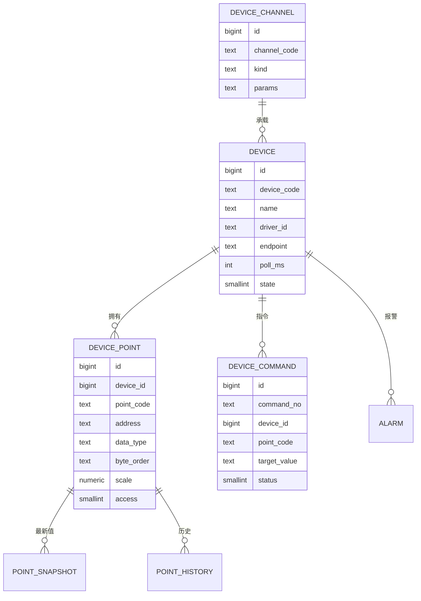

**四层概念，别混**：

| 概念 | 含义 | 例子 | 谁维护 |
|---|---|---|---|
| 通道 Channel | 一条物理链路（串口/网口） | COM3（9600 8N1）、192.168.1.10:502 | 设备工程师 |
| 设备 Device | 一个从站/一台机床 | 1 号加工中心、3 号污水仪表 | 设备工程师 |
| 点位 Point | 一个有业务含义的地址 | `主轴负载`、`产量计数`、`换刀许可` | 工艺 + 电控 |
| 指令 Command | 一次写动作（含期望值） | 写 `换刀许可=1` | 平台生成，操作员触发 |

### 5.2 驱动契约

```csharp
// Platform.Abstractions/Devices/IDeviceDriver.cs
public interface IDeviceDriver
{
    DriverDescriptor Describe();
    Task<ConnectResult> ConnectAsync(DeviceEndpoint endpoint, CancellationToken ct);
    Task DisconnectAsync(CancellationToken ct);
    Task<ReadBatchResult> ReadAsync(IReadOnlyList<PointRef> points, CancellationToken ct);
    Task<WriteBatchResult> WriteAsync(IReadOnlyList<PointWrite> writes, CancellationToken ct);
    IAsyncEnumerable<DeviceEvent> SubscribeAsync(IReadOnlyList<PointRef> points, CancellationToken ct);
}

public sealed record PointRef(
    string PointCode,      // 业务点号，如 "spindle_load"
    string Address,        // 协议地址表达式，如 "40001:Float32:CDAB"
    PointDataType DataType,
    int Length = 1,
    ByteOrder ByteOrder = ByteOrder.CDAB);

public sealed record ReadValue(
    string PointCode, object? Value, QualityCode Quality, DateTimeOffset Timestamp, string? Error);

public enum QualityCode { Good = 0, Uncertain = 1, Bad = 2, Stale = 3 }
```

**驱动必须遵守的五条约定**：

1. 读失败返回 `Bad` + 错误，不抛异常中断整批；单点失败不影响同批其他点。
2. 写失败必须带协议异常码（Modbus exception / S7 error class）。
3. 连接方法必须幂等：重复 `ConnectAsync` 不产生新连接。
4. 所有耗时操作接受 `CancellationToken`，超时由平台控制。
5. 驱动不落库、不发 MES、不做业务判断；只做「地址 ↔ 字节」。

### 5.3 地址表达式规范（统一语法，减少配置错误）

格式：`地址[:数据类型[:字节序]]`，大小写不敏感。

| 协议 | 读保持寄存器 | 读线圈 | 写 | 说明 |
|---|---|---|---|---|
| Modbus | `40001:UInt16`、`40003:Float32:CDAB` | `00001:Bool` | `40001:UInt16=123` | 40001 对应偏移 0；4 区 |
| S7 | `DB100.DBW0:Int16`、`DB100.DBD2:Float32` | `DB100.DBX4.0:Bool` | 同左 | 需在 PLC 侧允许 PUT/GET |
| 三菱 MC | `D100:Int16`、`D200:Float32` | `M100:Bool` | 同左 | 3E 帧，软元件编码 |
| OPC UA | `ns=2;s=Machine1.Load` | 同左 | 同左 | 依赖服务端节点 |
| 文本协议 | `$03#R#D100` | — | `$03#W#D100#12` | 由插件自定义模板 |

**字节序四种（Float32 为例）**：

| 枚举 | 寄存器顺序 | 字节顺序 | 例子（12.34） |
|---|---|---|---|
| ABCD | reg0 高字 | 大端 | `41 45 70 A4` |
| CDAB | reg0 低字 | 字交换 | `70 A4 41 45` |
| BADC | reg0 高字 | 字节交换 | `45 41 A4 70` |
| DCBA | reg0 低字 | 全交换 | `A4 70 45 41` |

> 现场判断口诀：**先读一个已知值（如 12.34），四种顺序逐个试；能对上就是它。** 不要靠猜。

### 5.4 协议插件能力矩阵

| 协议 | 传输 | 推荐库 | 批量读 | 订阅 | 单次上限 | 典型现场 | 主要坑 |
|---|---|---|---|---|---|---|---|
| Modbus TCP | TCP 502 | **FluentModbus**（Apache-2.0，活跃维护）/ 自研；NModbus 已停更多年勿选 | 是 | 轮询 | 125 寄存器/请求 | 仪表、变频器、远程 IO | 单元标识、字节序、连接数 |
| Modbus RTU | RS485 | 自研（见 02） | 是 | 轮询 | 125 寄存器 | 老仪表、电表 | 半双工、3.5 字符间隔、CRC |
| S7 | TCP 102 | S7.NetPlus / Snap7 | 是 | 轮询 | 按 PDU（约 200 B） | 西门子 1200/1500 | 优化块访问、PUT/GET 开关 |
| 三菱 MC | TCP/UDP | 自研 3E 帧 / HSL | 是 | 轮询 | 按软元件 | 三菱 FX5U/Q 系列 | 软元件地址编码、二进制/ASCII |
| OPC UA | TCP 4840 | OPCFoundation .NET | 是 | 是（Subscription） | 服务端限制 | 新设备、SCADA | 证书、命名空间、会话 |
| TCP 文本 | TCP | 自研 | 否 | 是 | 按协议 | 扫码枪、称重、老设备 | 粘包、心跳、编码 |
| HTTP/JSON | HTTP | HttpClient | 否 | 轮询 | 服务端限制 | 智能仪表、网关 | 超时、重试、鉴权 |
| MQTT | TCP 1883/8883 | MQTTnet | 否 | 是 | Broker 限制 | 传感器、边缘网关 | QoS、断线重连、主题设计 |

**选型顺序**：设备支持 OPC UA 就优先 OPC UA（有订阅、语义清楚）；否则 Modbus；西门子优先 S7；三菱优先 MC；剩下的走文本/HTTP。

### 5.5 采集调度（平台统一做，不让驱动各自为政）

```csharp
// Platform.Core/Devices/PollScheduler.cs（节选）
public sealed class PollScheduler(
    IDeviceRegistry registry,
    ICommandQueue commands,
    WriteGuard writeGuard,                 // 写路径统一走四道闸，见 5.6
    ILogger<PollScheduler> log) : BackgroundService
{
    protected override async Task ExecuteAsync(CancellationToken ct)
    {
        await foreach (var group in registry.Groups(ct))   // 按通道分组，串行占用总线
        {
            _ = RunGroupAsync(group, ct);                  // 每组一个循环
        }
        await Task.Delay(Timeout.Infinite, ct);
    }

    private async Task RunGroupAsync(PollGroup g, CancellationToken ct)
    {
        var period = TimeSpan.FromMilliseconds(g.PollMs);
        while (!ct.IsCancellationRequested)
        {
            var sw = Stopwatch.StartNew();

            // 1) 写优先：先处理待下发的指令（最多 2 条，避免饿死读）
            foreach (var cmd in await commands.DequeueAsync(g.DeviceIds, max: 2, ct))
                await writeGuard.ExecuteAsync(cmd, ct);   // 权限→互锁→落库→写→回读，不直连驱动

            // 2) 周期读：按驱动能力批量
            var points = g.Points;
            var result = await g.Driver.ReadAsync(points, ct);
            await g.Snapshot.ApplyAsync(result, ct);       // 更新快照 + 质量码

            // 3) 变化点入历史（离散变位 / 模拟量死区）
            await g.History.WriteIfChangedAsync(result, ct);

            // 4) 抖动控制：睡到下一个整周期，不累积漂移
            var rest = period - sw.Elapsed;
            if (rest > TimeSpan.Zero) await Task.Delay(rest, ct);
            else if (sw.Elapsed > period * 2)
                log.LogWarning("采集超期 {Group} 用时 {Elapsed}ms 周期 {Period}ms",
                    g.Code, sw.ElapsedMilliseconds, g.PollMs);
        }
    }
}
```

**调度规则**：

| 规则 | 参数 | 理由 |
|---|---|---|
| 同一 485 总线串行 | 每通道 1 个循环 | 半双工，不能并发 |
| 不同网口设备并行 | 并发上限 32 | 避免线程爆炸 |
| 写优先于读 | 每次最多 2 条写 | 指令要快，但不能饿死采集 |
| 批量合并 | 连续地址合并 | 减少请求数（Modbus 125 寄存器上限） |
| 自适应降频 | 连续 5 次超时 → 周期 ×2（上限 10 s） | 设备忙/网络差时保命 |
| 抖动告警 | 实际周期 > 2 倍设定值 | 判断是否该扩容或拆通道 |

**容量算式（本方案的基准场景）**：

- 200 台设备、平均 40 点 = 8,000 点。
- 其中 80 台走 RS485，分 20 条总线、每条 4 台；每台 2 次批量请求、单次约 30 ms → 单总线一轮 ≈ 4 × 2 × 30 = 240 ms，1 s 周期占用 **24%**。
- 其余 120 台走以太网，每台 4 次请求/s → 480 请求/s；单请求 1~2 ms，网卡与线程池均有余量。
- 合计峰值约 **640 请求/s**（RS485 160 + 以太网 480）。

> **这段算式只证明「通信侧不是瓶颈」，不证明「一台 4 核 8 GB 工控机够用」**——这是本方案早期版本最容易误导人的一句。同一台机器上还跑着 PostgreSQL 17、MinIO、Outbox Worker、SignalR 与 3~8 GB/天的日志写入（7.7、10.8）。通信只吃 640 请求/s，归档写入吃的是 **磁盘 IOPS 与 PG 的 CPU**：345.6 万行/天 + 200 行/s 采集日志 + 采样帧日志，全在同一块盘上。
>
> **所以资源结论以 12.9 的最小单机 BOM 与实测表为准**：那里给出「按设备数分档的 CPU/内存/盘」配置基线，并要求上线前用满配实测 P95 回填。**没跑过 12.9 那张表之前，任何「够用」的结论都只是假设。**

### 5.6 写入安全（四道闸，缺一不可）

```csharp
// Platform.Core/Devices/WriteGuard.cs（节选）
public async Task<WriteOutcome> ExecuteAsync(DeviceCommand cmd, CancellationToken ct)
{
    // 闸 1：权限 + 数据范围
    _auth.Demand(cmd.RequiresPermission, cmd.DeviceId);

    // 闸 2：互锁（软件侧；硬件互锁仍由 PLC 负责）
    var block = await _interlocks.CheckAsync(cmd, ct);
    if (block is not null) return WriteOutcome.Blocked(block);

    // 闸 3：先落库「意图」，状态 Pending（断电后可对账）
    var record = await _repo.CreatePendingAsync(cmd, ct);

    try
    {
        var w = await _driver.WriteAsync([cmd.ToWrite()], ct);
        if (!w.AllOk) return await _repo.FailAsync(record, w.Error, ct);

        // 闸 4：写后回读（带容差），证明「真的生效」
        await Task.Delay(_opt.ReadbackDelayMs, ct);
        var rb = await _driver.ReadAsync([cmd.ToReadRef()], ct);
        var ok = rb.Values.Count == 1 && ValueEquals(rb.Values[0].Value, cmd.TargetValue);

        return ok
            ? await _repo.AckAsync(record, ct)
            : await _repo.SuspectAsync(record, "readback_mismatch", ct);  // 挂起，人工对账
    }
    catch (OperationCanceledException) when (ct.IsCancellationRequested)
    {
        throw;                                        // 调用方主动取消，不算超时
    }
    catch (Exception ex) when (ex is TimeoutException || ex is TaskCanceledException)
    {
        // 超时 ≠ 失败：设备可能已执行，先回读再判定，绝不盲目重发
        var rb = await TryReadbackAsync(cmd, ct);
        if (rb is null) return await _repo.SuspectAsync(record, "timeout_unreachable", ct);
        return ValueEquals(rb.Value, cmd.TargetValue)
            ? await _repo.AckAsync(record, ct)        // 执行了，只是响应丢了
            : await _repo.SuspectAsync(record, "readback_mismatch", ct);
    }
}
```

> `TryReadbackAsync` 内部吞掉单次读失败并返回 `null`；不要把「回读也失败」直接当成写失败——设备可能已经动作，只是通信断了。

| 闸 | 检查什么 | 失败处理 | 谁能绕过 |
|---|---|---|---|
| 1 权限 | 权限码 + 车间/产线范围 | 403 + 审计 | 无人（管理员也要有权限码） |
| 2 互锁 | 设备运行态、联锁条件、维护模式 | 拒绝 + 原因码 | 仅「维护模式」+ 双人复核 |
| 3 落库 | 先写 `device_command`（Pending） | 数据库不可用则拒绝下发 | 禁止绕过 |
| 4 回读 | 读回值与目标值一致（浮点容差） | 挂起 + 异常工单 | 禁止绕过 |

**浮点比较**：`Math.Abs(a - b) <= max(1e-6, |b| * 1e-4)`；不要用 `==`。

**超时后的三种处置**：

| 场景 | 处置 |
|---|---|
| 写超时、回读成功且等于目标 | 记 Ack（设备执行了，只是响应丢了） |
| 写超时、回读成功但不等于目标 | 挂起 `Suspect`，人工确认后重发或作废 |
| 写超时、回读也失败 | 挂起 `Unreachable`，转设备维护工单，禁止自动重发 |

### 5.7 数据质量与快照

| 质量码 | 含义 | 产生条件 | 界面表现 |
|---|---|---|---|
| Good | 正常 | 最近一次读成功且在有效期内 | 绿色 |
| Uncertain | 可疑 | 值在量程边缘、变化率异常、校验和异常 | 黄色 |
| Bad | 坏值 | 协议异常、设备返回错误码 | 红色 |
| Stale | 过期 | 超过 3 个采集周期未更新；设备整机 Offline 时立即全部转 Stale（见 5.8） | 灰色 + 时间戳 |

**快照规则**：

- `point_snapshot` 每点一行，只保留最新值 + 质量 + 时间戳；查询快，不扫历史。
- 界面显示「值 + 质量 + 时间」，不允许只显示值。
- 报表统计必须排除 `Bad`；`Stale` 单独计数，不能混入正常。

### 5.8 断线重连与缓存

| 阶段 | 行为 |
|---|---|
| 首次连接失败 | 退避 1/2/4/8/16/30 s（上限 30 s），期间设备状态 Offline |
| 运行中断线 | 立即标记 Offline，所有点位**立即**转 Stale（不等 3 个周期），产生一次报警（去抖 30 s） |
| 重连成功 | 全量读一轮校验，状态回 Online，补记断线时长 |
| 指令在断线期间 | 不丢弃：留在队列，超时转「待对账」，不自动重发 |
| 边缘断网 | 本地 SQLite 缓存业务数据（报工、报警），恢复后按时间顺序补传 |

**与常见单机上位机做法的差别**：常见做法是「单机缓存重传」；平台把缓存做成**统一 Outbox**，所有模块共用一套补传与对账，不再各写各的。

### 5.9 时钟与对时

| 项 | 规则 |
|---|---|
| 平台时间 | 统一 UTC，NTP 同步，偏移 > 1 s 告警 |
| 设备时间 | 支持对时的设备每天对一次；不支持的在采集时打「平台接收时间」 |
| 历史时间戳 | 优先设备时间（若有），否则平台时间，字段区分 `ts_source` |
| 跨时区 | 只存 UTC，展示按用户时区；报表按工厂时区聚合 |

### 5.10 模拟器与驱动自检清单

**模拟器**：每个驱动插件必须配一个 `Simulator` 工程（控制台或 Windows 服务），能模拟正常、超时、异常码、断线、乱序五种场景。没有模拟器的驱动不允许进测试环境。

**驱动上线前 12 项自检**：

1. 地址解析覆盖全部数据类型（Bool/Int16/UInt16/Int32/Float32/Float64）。
2. 四种字节序都有单测。
3. 单点失败不影响同批其他点。
4. 批量读不超过协议上限，自动拆分。
5. 连接幂等，重复调用不泄漏句柄。
6. 断线 30 次重连无内存增长。
7. 写失败能映射出协议异常码。
8. 读超时能区分「超时」与「协议错误」。
9. 取消令牌能在 100 ms 内退出。
10. 连续运行 72 h 无句柄/线程增长。
11. 日志不打印明文密码，不刷屏（正常帧不打）。
12. 模拟器能复现现场抓包的同一条报文。

### 5.11 相机 / 机器人 / 运动卡 / 扫码 / AGV 接入

**结论：PLC 之外的设备不能只靠 `IDeviceDriver` 的点位模型表达——相机给「帧」，机器人给「位姿」，运动卡给「轴」，扫码器给「码」，AGV 给「任务」；它们共享 `IDeviceDriver` 的连接/健康检查基类，各自扩展专用动作接口，调度统一、安全约束写死。**

#### 5.11.1 设备大类矩阵

| 大类 | 驱动接口 | 典型通信 | 数据形态 | 采样/交互 | 写操作风险 | 能力键 |
|---|---|---|---|---|---|---|
| PLC | `IDeviceDriver` | S7 / Modbus / MC / OPC UA | 点位值 | 周期采集 + 写值 | 中（可改工艺参数） | `acq.core` |
| 相机 | `ICameraDriver` | 厂商 SDK / GigE Vision / USB3 | 图像 + 元数据 | 软触发 / IO 硬触发 / 编码器触发 | 低（参数会改曝光） | `vision.camera` |
| 机器人 | `IRobotDriver` | 厂商 SDK / TCP 自定义 / OPC UA | 位姿、状态、IO | 事件 + 指令 | **高**（可致碰撞） | `robot.integration` |
| 运动卡 | `IMotionDriver` | 厂商 DLL（固高/雷赛/正运动） | 轴位置、状态、IO | 周期 + 指令 | **高**（可致超程） | `motion.card` |
| 扫码器 | `IDeviceDriver`（只读） | TCP 文本 / 串口 / SDK | 字符串 + 质量 | 触发读码 | 低 | `device.points` |
| AGV / RGV | `IAgvDriver` | 调度系统 HTTP / 无线 | 任务、位置、电量 | 任务下发 + 状态回报 | 中（可堵线） | `acq.core`（驱动插件） |
| 称重 / 电表 | `IDeviceDriver`（只读） | Modbus RTU / 脉冲 | 数值 | 周期采集 | 低 | `acq.core` |

**共同约定**（所有设备类都遵守）：

1. 连接、断开、重连、健康检查由 `DeviceRuntime` 统一调度，驱动只实现「一次动作」。
2. 所有动作带 `CancellationToken`，取消 100 ms 内退出。
3. 所有返回值带 `QualityCode` 与 `ErrorCode`，不允许「失败返回 0」。
4. 图像、点云、大文件不塞进消息体，只回 `StorageRef`（MinIO 键），避免内存爆。
5. 高风险动作（机器人运动、轴运动）必须过 `WriteGuard` 的等价闸门：权限 → 互锁 → 落库 → 执行 → 回读。

#### 5.11.2 相机契约

```csharp
// Platform.Abstractions/Devices/ICameraDriver.cs
public interface ICameraDriver : IDeviceDriver
{
    Task<CameraInfo> GetInfoAsync(CancellationToken ct);                 // 型号、分辨率、序列号
    Task<GrabResult> GrabAsync(GrabRequest req, CancellationToken ct);   // 单帧
    Task<StreamSession> OpenStreamAsync(StreamOptions opt, CancellationToken ct);
    Task SetParameterAsync(string name, object value, CancellationToken ct); // 曝光/增益/ROI
}

public sealed record GrabRequest(
    TriggerMode Mode,          // Soft / HardwareLine / Encoder
    int TimeoutMs,
    string? RecipeId);         // 视觉配方：ROI、算法、标定

public sealed record GrabResult(
    StorageRef Image,          // MinIO 键，不传 byte[]
    int Width, int Height, int BitDepth,
    DateTime TimestampUtc,
    long FrameNo,
    QualityCode Quality,
    string? ErrorCode);
```

| 触发方式 | 适用 | 配置要点 | 常见坑 |
|---|---|---|---|
| 软触发 | 低速、人工放料 | 平台发 `GrabAsync` | 与 PLC 节拍不同步 → 拍到空位 |
| IO 硬触发 | 产线节拍、飞拍 | PLC 输出 → 相机 Line0 | 触发脉宽 < 相机要求 → 丢帧 |
| 编码器触发 | 线扫、连续料带 | 编码器 A/B 相 + 分频 | 分频比错 → 图像拉伸 |

#### 5.11.3 机器人契约

```csharp
// Platform.Abstractions/Devices/IRobotDriver.cs
public interface IRobotDriver : IDeviceDriver
{
    Task<RobotState> GetStateAsync(CancellationToken ct);                 // 模式/报警/使能
    Task<CartesianPose> GetPoseAsync(string tool, string uframe, CancellationToken ct);
    Task MoveLinearAsync(CartesianPose target, MotionProfile p, CancellationToken ct);
    Task MoveJointAsync(JointTarget target, MotionProfile p, CancellationToken ct);
    Task SetDigitalOutAsync(int port, bool value, CancellationToken ct);
    Task<ProgramResult> StartProgramAsync(string program, CancellationToken ct);
}
```

**职责边界（必须写进接口注释）**：

- 轨迹规划、奇异点规避、碰撞检测在**机器人控制器**内完成；平台只发「目标位姿 + 速度档 + 允许信号」，不在 PC 里做插补。
- 抓取逻辑优先写成机器人程序（RAPID/KRL/TP），平台只切换程序号与传参；否则网络抖动会直接变成机械动作抖动。
- `MoveLinearAsync` 必须校验：机器人处于 `AUTO`、远程模式、无报警、伺服使能、目标在安全区。

#### 5.11.4 运动卡契约

```csharp
// Platform.Abstractions/Devices/IMotionDriver.cs
public interface IMotionDriver : IDeviceDriver
{
    Task HomeAsync(int axis, HomingMode mode, CancellationToken ct);
    Task MoveAbsoluteAsync(int axis, double position, MotionProfile p, CancellationToken ct);
    Task MoveRelativeAsync(int axis, double distance, MotionProfile p, CancellationToken ct);
    Task<double[]> ReadPositionsAsync(int[] axes, CancellationToken ct);
    Task EnableAsync(int axis, bool enable, CancellationToken ct);
    Task SetSoftLimitAsync(int axis, double min, double max, CancellationToken ct);
    Task StopAsync(int axis, StopMode mode, CancellationToken ct);        // 减速停 / 急停
}
```

| 概念 | 平台侧要求 |
|---|---|
| 脉冲当量 | 由配置给出 `mm/pulse`，启动自检时与机械参数比对，偏差 > 5% 拒绝运行 |
| 回零 | 必须记录回零状态；未回零禁止绝对运动 |
| 软限位 | 启动作业前写入，不由操作员临时改 |
| 轴组 | 龙门/十字滑台用 `AxisGroup` 同步，不允许两轴各自 `MoveAbsolute` 拼轨迹 |
| 停止 | 区分「减速停」与「急停」；急停必须同时切硬件回路，不能只调 SDK |

**① 厂商 SDK 封装要点**（综合现场经验，落到插件工程上就是这三家）：

| 厂商 | 入口 DLL | 核心函数族 | 插件封装要点 |
|---|---|---|---|
| 固高（GTS 系列） | `gts.dll` | `GTS_*`：`GTS_Open / GTS_Init / GTS_Reset / GTS_GetSts / GTS_ClrSts / GTS_GetAxisEncPos / GTS_Home / GTS_Stop` | 单轴定位先 `GTS_SetTrapPrm` 设梯形、`GTS_ClrSts` 清状态，再 `GTS_SetPos + GTS_Update`；跟随误差 = 指令位置 − `GTS_GetAxisEncPos`；插补走 `GTS_CrdInit / GTS_CrdDataFifo / GTS_CrdStart` 队列，不用单轴拼 |
| 雷赛（DMC3000 等） | `LTDMC.dll` | `dmc_board_init / dmc_home_move / dmc_pmove / dmc_stop / dmc_get_axis_state_machine / dmc_axis_io_status` | 轴号是「卡号 + 轴号」双索引，配置里分开存；`dmc_board_init` 返回的实际轴数必须与配置比对，少一张卡就整卡拒启 |
| 正运动（ZMC） | `zmotion.dll`（`zmcaux` 封装） | `ZAux_OpenEth` + 指令流 `ZAux_Execute / ZAux_Direct_Single_Vmove / ZAux_Direct_SetAtype` | 逻辑轴 ↔ 物理轴映射必须显式建表，严禁在业务代码里硬编码轴号；扩展轴用 `ZAux_Direct_GetAxisStatus` 逐轴读 |

**② P/Invoke 声明规范**（写错一个 Marshal 特征比丢包更难查）：

```csharp
// Platform.Drivers.Motion.Googol/Native.cs（节选）
internal static partial class Native
{
    // 32 位卡驱动只能在 x86 进程里跑：插件工程输出 RuntimeIdentifier，
    // 平台侧 DeviceRuntime 按 manifest "arch" 字段把该驱动隔离进独立位数子进程。
    [LibraryImport("gts", EntryPoint = "GTS_GetSts")]
    internal static partial int GTS_GetSts(short axisNo, out int status);

    [LibraryImport("gts", EntryPoint = "GTS_GetAxisEncPos")]
    internal static partial int GTS_GetAxisEncPos(short axisNo, out double encPos);
}

// 轴状态位 → 平台枚举，一个函数做完，业务侧永远看不到位掩码
internal static AxisState ToAxisState(int sts)
{
    if ((sts & (1 << 9)) != 0) return AxisState.Error;      // 报警位
    if ((sts & (1 << 6)) != 0) return AxisState.Moving;     // 运动位（位号以厂商手册为准）
    if ((sts & (1 << 2)) != 0) return AxisState.Disabled;   // 伺服未就绪
    return AxisState.Ready;
}
```

| 约定 | 规则 |
|---|---|
| 声明写法 | 统一 `[LibraryImport]`（源生成，无反射）；不用 `DllImport` 新写 |
| 按引用参数 | 入参 `in`、出参 `out`；禁止裸 `IntPtr` 传给业务层 |
| 返回值 | `0` 成功，非 0 是厂商错误码 → 原样填进 `ErrorCode`（如 `GTS:-1`、`LTDMC:-6`），同时映射平台错误码 |
| 结构体 | 必须显式 `[StructLayout(LayoutKind.Sequential, Pack = n)]`，`n` 按厂商头文件 `#pragma pack` 抄，不猜 |
| 进程位数 | 厂商 32 位 DLL → 驱动子进程 `win-x86`；64 位 → `win-x64`；manifest `"arch": "x86"` 声明，加载器不匹配直接 `Blocked`（x86/x64 位数必须与卡驱动一致，否则 open 直接失败） |
| 句柄归属 | 卡句柄只在驱动插件进程内，崩了由 `DeviceRuntime` 重启子进程并重新 `open + init + 比对轴数` |

**③ 轴状态机**（`MoveAbsolute` 等所有动作先过这张图，不符合状态的指令一律拒绝）：

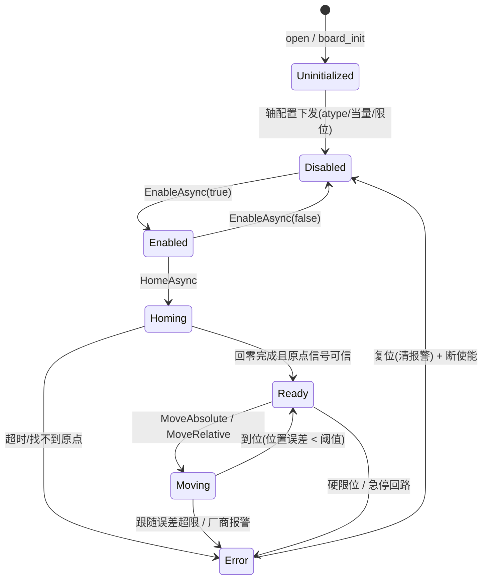

**④ 运动指令闸门 MotionGuard**（5.6 四道闸在运动场景全部适用，另加两道运动特有的「状态闸」与「几何闸」）：

| 闸 | 检查 | 不过闸的后果 |
|---|---|---|
| 权限 | `motion:run:{zone}` + 当前非示教器模式 | 拒绝，记审计 |
| 状态 | 轴处于 `Ready`；**未回零拒绝一切绝对运动**（回零前轴位置未知，绝对运动目标点无意义） | 拒绝 + 提示先回零 |
| 几何 | 目标位置 ∈ 软限位 ∩ 本次作业区间；跟随误差当前值 < 阈值 | 拒绝，绝不裁到限位内再发 |
| 联锁 | 安全门闭合、无报警、急停回路正常（读硬件 DI，不信软件标志） | 拒绝 |
| 落库 | 下发前把意图写 `device_command`（Pending），断电重启后可对账 | 不落库不下发 |
| 回读 | 下发后轮询到位；超时或 `Error` → 该轴禁止继续动作，上报 `MOTION_FOLLOW_ERR` | 停该轴，线级报警 |

> 与 5.11.6 的分工：本节是「平台软件拒绝发指令」；硬件急停、安全门断使能是「安全回路直接切电」。两层都要在，软件层永远不被当成安全层。

#### 5.11.5 视觉引导抓取时序（跨插件协作）

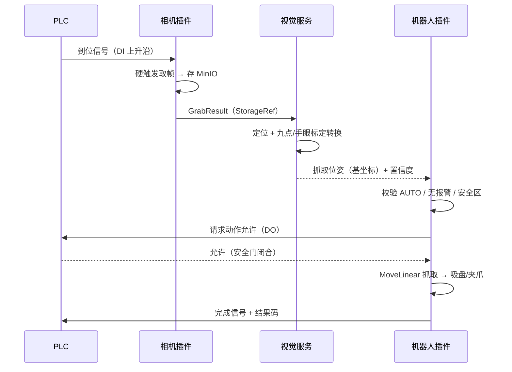

| 失败点 | 处理 |
|---|---|
| 取帧超时 | 重试 1 次；仍失败 → 报警 `CAM_GRAB_TIMEOUT`，料不流入下一站 |
| 定位置信度低 | 不抓，转人工/复检工位；禁止「凑合抓」 |
| 标定过期 | 超过 30 天或换镜头后未复标 → 禁止自动抓取 |
| 机器人非 AUTO | 拒绝远程运动，只允许读状态 |
| 安全门打开 | PLC 联锁优先，平台收到「不允许」直接放弃任务 |

#### 5.11.6 安全约束（不可配置关闭）

| 约束 | 实现 | 为什么不能做成开关 |
|---|---|---|
| 硬件急停 | 安全继电器/安全 PLC 直接切动力 | 软件开关不能替代安全回路 |
| 安全门联锁 | 门开 → 伺服断使能 | 与人身安全相关，不属于「功能裁剪」 |
| 示教器优先 | 示教器使能键按下时，平台指令一律拒绝 | 现场调试必须人优先 |
| 手动模式限速 | 手动 ≤ 250 mm/s（按 ISO 10218 口径） | 超速属违规 |
| 软限位 + 硬限位 | 双重；软限位可配，硬限位不可绕过 | 防撞机械 |
| 写前状态校验 | 报警/未使能/非远程 → 拒绝 | 避免「带故障运行」 |

> 这六条**不放进 `feature_flag`**：功能可以裁剪，安全不能。它们属于内核，任何发行版都强制开启。

### 5.12 新增下位机驱动实操（注册、发现与教学接口的迁移）

**结论：新协议进平台只有「注册一个工厂」一个入口；协议逻辑按公开协议文档原样实现，连接管理、重试、落库、业务判断一律留给平台。**

> 11.3 是发布 SOP（8 步表），本节讲代码级决策：驱动如何从插件包变成可绑定的设备驱动。

#### 5.12.1 注册与发现

```csharp
// Platform.Abstractions/Devices/DriverDescriptor.cs
public sealed record DriverDescriptor(
    string DriverId,            // 必须等于 manifest 的 "id"，如 "driver.mitsubishi.mc3e"
    string DisplayName,
    DeviceClass Class,          // Plc / Camera / Robot / Motion / Scanner / Agv
    TransportKind Transport,    // Tcp / Serial / Sdk / Http / Mqtt / OpcUa
    string AddressSyntax,       // 5.3 的地址族："modbus" | "s7" | "mc" | "ua" | "custom"
    bool SupportsWrite,
    bool SupportsSubscribe,
    int MaxBatchPerRequest,     // 0 = 不支持批量，平台逐点轮询
    string[] DataTypes);        // 支持的 PointDataType 子集

// 插件只注册「工厂」；DeviceRuntime 按设备端点创建驱动实例（一设备一实例）
public interface IDriverFactory
{
    DriverDescriptor Describe();
    IDeviceDriver Create(DeviceEndpoint endpoint, IPluginConfiguration cfg);
}
```

```csharp
// 驱动插件的 Configure（5.11.4 的运动卡、MC 3E 都走这一个入口）
public void Configure(IPluginContext ctx, IServiceCollection services)
    => services.AddSingleton<IDriverFactory, Mc3eDriverFactory>();
```

| 环节 | 谁做 | 动作 | 失败后果 |
|---|---|---|---|
| 安装 | 加载器（4.4） | 校验 manifest；`id` 与 `Describe().DriverId` 一致 | 不一致拒绝安装 |
| 启动 | DeviceRuntime | 汇总所有 `Active` 插件的 `IDriverFactory` → 驱动清单 | `id` 全局唯一（4.3），重复即拒绝加载；`providesFeatures` 同名能力冲突按 `priority` 裁决（4.6） |
| 建模 | WPF 客户端（2.8） | 按 `deviceClasses` + 功能开关过滤可选驱动；地址表达式按 `AddressSyntax` 族校验 | 无可用驱动 → 入口置灰，提示「缺少插件，请安装」（`Degraded`，4.13.2 组合 3） |
| 运行 | DeviceRuntime | 按 `device.driver_id` 建实例，负责连接、重连、健康检查 | `driver_id` 查不到 → 设备置 `Bad`，报警 `DRIVER_MISSING` |

#### 5.12.2 三条扩展路线（先选路线再动手）

| 路线 | 适用 | 做法 | 例子 |
|---|---|---|---|
| A 复用传输、只换帧 | 平台已有 TCP/串口帧框架，协议只是新报文 | 实现 Framer（组帧/拆帧/CRC），复用 `IDeviceChannel` | 新扫码枪文本协议、老仪表私有报文 |
| B 公开协议自研 | 协议文档公开（Modbus、MC 3E、S7） | 按协议规范文档实现帧逻辑，包成插件 | 三菱 MC 3E（帧格式见协议规范） |
| C 厂商 SDK/DLL | 无公开协议，只有厂商动态库 | P/Invoke 封装 + 位数隔离（5.11.4 ①②） | 固高/雷赛/正运动运动卡、相机 SDK |

#### 5.12.3 从常见教学接口到平台契约

常见的教学版驱动接口是同步 7 成员（`Name/IsConnected/Stats/Connect/Close/ReadWords/WriteWord`），平台契约是异步批量（5.2）。迁移不是改名，是**职责边界变化**：

| 常见教学接口 | 平台契约 | 迁移时改什么 |
|---|---|---|
| `Connect()` 同步、抛异常 | `ConnectAsync(endpoint, ct)` 返回 `ConnectResult` | 幂等：已连接直接返回成功；异常不外抛 |
| `ReadWords(start, count)` 返回 `ushort[]` | `ReadAsync(IReadOnlyList<PointRef>, ct)` 逐点 `ReadValue` | 地址解析、字节序、类型换算从调用方搬进驱动；单点失败只标该点 `Bad` |
| `WriteWord(addr, val)` | `WriteAsync(PointWrite[], ct)`，回读由平台做 | 驱动只保证「写下去且协议应答成功」；5.6 四道闸的回读校验不在驱动里重复 |
| `Close()` | `DisconnectAsync(ct)` | 释放幂等，重复调用安全 |
| `IsConnected` 属性 + 自己循环重连 | 状态快照 + `DeviceRuntime` 触发重连（5.8） | 驱动不再自己重连 |
| `Stats` 自统计 | 平台指标统一上报（10.5） | 驱动只计数，不决定采样与展示 |
| 单扫描线程天然串行 | `PollScheduler` 并发调度多设备（5.5） | 485/半双工的串行保证从「线程模型」改成「通道内锁」 |

```csharp
// 骨架：02 的协议逻辑保留，外壳换成平台契约（节选）
public sealed class Mc3eDriver(IDeviceChannel channel, Mc3eOptions opt) : IDeviceDriver
{
    private readonly SemaphoreSlim _gate = new(1, 1);   // 半双工/共享通道串行化

    public DriverDescriptor Describe() => new(
        "driver.mitsubishi.mc3e", "三菱 MC 3E", DeviceClass.Plc, TransportKind.Tcp,
        "mc", SupportsWrite: true, SupportsSubscribe: false,
        MaxBatchPerRequest: 256, ["Bool", "Int16", "UInt16", "Int32", "Float32"]);

    public async Task<ConnectResult> ConnectAsync(DeviceEndpoint ep, CancellationToken ct)
    {
        await _gate.WaitAsync(ct);
        try { return channel.IsOpen ? ConnectResult.Ok()      // 幂等
                                    : await channel.OpenAsync(ep, opt.Timeout, ct); }
        finally { _gate.Release(); }
    }

    public async Task<ReadBatchResult> ReadAsync(IReadOnlyList<PointRef> points, CancellationToken ct)
    {
        await _gate.WaitAsync(ct);
        try
        {
            var results = new List<ReadValue>(points.Count);
            foreach (var chunk in points.SplitBySoftElement(256))          // 超上限自动拆分（5.10 第 4 项）
            {
                var frame = Mc3eFrame.BuildRead(chunk);                    // 02 §5.3 组帧逻辑原样搬
                var resp  = await channel.SendAsync(frame, opt.Timeout, ct);
                results.AddRange(Mc3eFrame.Decode(chunk, resp));           // 字节序/类型换算在驱动内
            }
            return ReadBatchResult.Ok(results);
        }
        catch (Exception ex) when (ex is not OperationCanceledException)
        {
            return ReadBatchResult.AllBad(points, ex.MapToErrorCode());    // 读失败返回 Bad，不抛（5.2 约定 1）
        }
        finally { _gate.Release(); }
    }

    // WriteAsync / SubscribeAsync / DisconnectAsync 同理：协议搬过来，外壳换掉
}
```

> 唯一不许动的是「协议逻辑」（组帧、拆帧、CRC、软元件编码、字节序）；其余全归平台。练习：给驱动加一个心跳帧解析。

#### 5.12.4 驱动共存与卸载边界

| 规则 | 说明 |
|---|---|
| 一个 deviceClass 多驱动共存 | `Plc` 下 Modbus TCP / S7 / MC 并存，设备用 `driver_id` 选定，不存在「全局协议优先级」 |
| 同 `DriverId` 只允许一个 Active | 重复 `id` → 后装的拒绝加载（4.3）；两个驱动抢同一 `providesFeatures` 能力 → 高 `priority` 生效，其余 `Blocked`（4.6） |
| 驱动不引用驱动 | 相机插件不许 using 运动卡插件；跨插件协作走 5.11.5 事件时序，由平台编排 |
| 卸载前置条件 | 该驱动名下所有设备处于断开/空闲才能装卸（4.8 热插拔边界）；有活动连接时只能「停止采集 → 排空 → 升级」，不能直接卸载 |
| 改核心 = 设计失败 | 接入新设备若需要动 `Platform.Core`，先检查能否用 5.11 大类接口或 `custom` 地址族表达 |

> **打包自检 4 条**（叠加在 5.10 的 12 项代码自检之上）：① manifest `id` == `Describe().DriverId`；② `deviceClasses` 与实现的契约大类一致（`IMotionDriver` → `Motion`）；③ `arch` 与厂商 DLL 位数一致（32 位卡驱动漏写 = 现场崩溃）；④ `Simulator` 工程打进 `.pkg`。

### 5.13 机器视觉插件扩展实操

**结论：视觉接入拆三层——取像（相机驱动，5.11.2）、算法引擎（引擎插件）、编排判定（平台 VisionService）；引擎插件只做「图像进、结构化结果出」，不碰 PLC、不落库、不判合格。这是 5.2「驱动只做地址↔字节」边界在视觉域的复制。**

#### 5.13.1 三层拆分与职责边界

| 层 | 归属 | 输入 → 输出 | 允许做 | 绝不允许 |
|---|---|---|---|---|
| 取像 | 相机驱动 `ICameraDriver` | 触发指令 → `StorageRef` + 帧元数据 | 曝光/增益/触发、存图 | 跑算法、判 OK/NG |
| 算法引擎 | 引擎插件 `IVisionEngine` | 图像 + 配方 → 结构化结果 | 定位/测量/检测/识别，输出数值与置信度 | 读 PLC、写库、调 MES、决定处置 |
| 编排判定 | 平台 VisionService | 结果 + 配方规则 → 合格/复检/分流 | 判定、记录落库、发 MES、按 5.11.5 时序与机器人/PLC 协作 | 内嵌任何厂商算子 |

```csharp
// Platform.Abstractions/Vision/IVisionEngine.cs
public interface IVisionEngine
{
    VisionDescriptor Describe();     // 引擎名、支持的任务类型（定位/测量/检测/识别）、许可形态
    Task<bool> CheckLicenseAsync(CancellationToken ct);   // 许可是视觉插件最脆弱的一环（5.13.2）
    Task<VisionResult> RunAsync(string recipeId, StorageRef image, CancellationToken ct);
    Task<CalibrationResult> CalibrateAsync(string recipeId, CalibRequest req, CancellationToken ct);
}

public sealed record VisionResult(
    bool Completed,                        // 算法是否跑完（≠ 合格）
    IReadOnlyList<MeasuredItem> Measures,  // 名称/值/单位/公差
    IReadOnlyList<DefectItem> Defects,     // 类型/位置框/评分
    string? Recognized,                    // OCR / 条码内容
    double Confidence,                     // 0~1
    IReadOnlyList<OverlayItem> Overlay,    // 客户端绘制用：十字/框/轮廓
    int ElapsedMs,
    string? ErrorCode);
```

> **判定公式留在平台**：`Measures` 对配方上下限（D1 配方管理）、`Confidence` 对阈值、`Defects` 对零容忍清单——三个条件都在配置里，引擎只报事实。换引擎（Halcon → VM）时判定口径不变，这是 5.13.3 标准图集回归能自动化的前提。

#### 5.13.2 四类主流引擎的封装要点

| 引擎 | 封装形态 | 关键坑 | 插件侧对策 |
|---|---|---|---|
| Halcon | 算子集直调，或 `HDevEngine` 跑导出的 hdlt 流程 | 开发许可与运行许可是两种（加密狗/授权文件，另有按用量计费形态）；多线程需逐线程初始化，算子并行要显式开关 | `CheckLicenseAsync` 启动 + 周期探测；引擎实例池绑线程；配方 = hdlt 文件，存插件私有目录并随配方版本走 |
| VisionPro（Cognex） | `CogToolBlock` / VPP 工程 | 以 x86 为主，必须 32 位进程；VPP 反序列化慢；部分 COM 互操作需 STA 线程 | 与运动卡同策：manifest `arch: "x86"` + 位数子进程隔离（5.11.4 ②）；VPP 加载一次复用；专用 STA 任务线程 |
| VisionMaster（海康） | VM 流程工程 + SDK 调用 | 流程在 VM 工具里编辑，代码只传图、按工具名读结果组 | 工具名 ↔ 平台字段映射进配方配置；改工具名即断映射——用标准图集回归锁住（5.13.3） |
| OpenCV | Emgu / 自编译绑定 | 无工业工具链：标定、OCR、3D 自己拼；版本升级会改算法行为 | NuGet 版本固化进 `.pkg`；算法行为变化按「新配方版本」发布，禁止静默升级 |

> 选型对照：Halcon 算子全/许可重、VisionPro 稳定/32 位枷锁、VM 性价比高/工具名耦合、OpenCV 灵活/无工业工具链——按「许可预算 + 位数约束 + 团队经验」三轴取舍。AI 推理（缺陷分割、OCR 大模型）同样落在 `IVisionEngine` 实现内，平台不感知。

#### 5.13.3 配方与标定资产

| 资产 | 内容 | 版本规则 | 失效条件 |
|---|---|---|---|
| 视觉配方 | ROI、算法参数、阈值、工具/字段映射、引擎类型 | 走 D1~D3（`recipe.version` 审批） | 引擎大版本变更、换相机/镜头 |
| 标定 | 内参 + 畸变、九点仿射矩阵、手眼矩阵与残差 | 随配方存，记录标定日期与操作人 | 超 30 天、换镜头、支架碰撞 → 禁止自动判定（5.11.5 已有此规则） |
| 标准图集 | 良品 + 不良品各 ≥100 张 | 配方回归基线 | 产品工艺变更时随配方一起改版 |

**配方回归必须自动化**：每个引擎插件附「标准图集回归」命令——最新配方跑基线图集，任一测量值超差或判定翻转即拒绝发布；人工「看几张图没问题」不算通过。

#### 5.13.4 结果落库与追溯（复用基线表，不加新表）

| 数据 | 落点 | 规则 |
|---|---|---|
| 原图 | `file_object`（MinIO） | NG 全存，OK 抽样存（默认 10%）；保留期按 7.7「MinIO 文件与数据库同批」，抽样比例进配方配置 |
| 测量值/缺陷明细 | `quality_record.measured`（jsonb）+ `defect_code` | 与判定同事务写入；`inspectionNo` 即幂等键（6.4） |
| 图 ↔ 工件绑定 | `trace_link`（`from_type='process'`，值含 `msgId`） | 追溯查询按批次回捞图像（6.2 #9） |
| 引擎原始响应 | `file_object`（JSON/XML） | 保留 30 天，用于复核「为什么判 NG」 |
| Overlay 绘制数据 | 随 `VisionResult` 序列化存储 | 客户端回放不重跑引擎，结果不可变 |

#### 5.13.5 客户端显示（WPF）

| 场景 | 做法 | 坑 |
|---|---|---|
| 结果复核页 | 实现 `IPluginUiProvider`（4.9）：左图右测量表，Overlay 绘制在 `Image` 之上 | 不把 `byte[]` 拷进 ViewModel；按 `StorageRef` 异步加载 |
| 实时预览 | 5~10 fps 节流，`WriteableBitmap` 复用 | 全帧率渲染吃满 UI 线程；预览可丢帧，检测不可丢 |
| NG 弹窗 | 订阅 VisionService 事件，仅 NG/低置信弹 | 频率受报警收敛（C3）限制，否则操作员直接关掉 |
| 历史回放 | 按 `inspectionNo` 取图 + Overlay 重绘 | 不重跑引擎 |

#### 5.13.6 验收指标

沿用机器视觉行业通行口径：漏检率（关键件 0）、过杀率 < 1%、重复精度 ±0.02 mm 级、GRR < 10%、节拍 < 产线节拍且留 20% 余量。平台侧另加两条：**72 h 连续运行无内存增长**（图像管线最易泄漏，`StorageRef` 必须释放）；**许可失效场景**（拔狗/过期 → `CheckLicenseAsync` 失败 → 引擎报 `Bad`，平台停止自动判定并报警，绝不静默放行）。

#### 5.13.7 新增视觉引擎：6 步（发布 SOP）

| # | 动作 | 要点 |
|---|---|---|
| 1 | 生成 | `dotnet new platform-vision -n Vision.Halcon` |
| 2 | 封装 | 实现 `IVisionEngine` 四方法；引擎实例池与线程模型按 5.13.2 |
| 3 | 映射 | 引擎输出 → `VisionResult` 字段表（`Measures` 名称与配方对齐，禁止把厂商字段名透传给业务） |
| 4 | 许可 | `CheckLicenseAsync` 实现 + 失效行为验证（拔狗/过期） |
| 5 | 回归 | 标准图集 ≥100 良品 + ≥100 不良品跑通，0 判定翻转（5.13.3） |
| 6 | 打包 | `.pkg` 含引擎运行时与配方模板；`arch`、许可说明写进 manifest 与 README（附录 B 第 12/13 项） |

> 与 11.3/11.4 同级：驱动与 MES 适配的 SOP 在 11.3/11.4，视觉引擎的 SOP 在本节（因为它跨「取像 + 算法 + 判定」三层，不只是一种驱动）。

> **视觉插件自检 4 条**：① 引擎插件编译期无 DB/MES/PLC 引用；② `CheckLicenseAsync` 启动与周期都有探测；③ 标准图集回归可一键执行；④ 图像句柄释放经 72 h 验证。

> **自检 3 问**
> 1. 为什么写超时不能直接重发？举一个会造成什么后果的例子。
> 2. 同一 485 总线为什么必须串行？如果两条总线共用一个串口会怎样？
> 3. 质量码 `Stale` 和 `Bad` 在报表统计里分别怎么处理？

---

## 6. MES 对接插件

**结论：MES 对接的可靠性不靠「接口稳定」，而靠「幂等键 + Outbox + 对账」三件套；接口一定会变，这三样不变。**

### 6.1 适配器契约

```csharp
// Platform.Abstractions/Mes/IMesAdapter.cs
public interface IMesAdapter
{
    MesDescriptor Describe();

    /// <summary>拉取工单（增量，按水位）；不支持拉取的返回 NotSupported。</summary>
    Task<MesResult<IReadOnlyList<WorkOrderDto>>> PullWorkOrdersAsync(
        Watermark watermark, CancellationToken ct);

    /// <summary>推送业务报文（报工/物料/质量/设备状态），必须幂等。</summary>
    Task<MesResult<Ack>> PushAsync(MesEnvelope envelope, CancellationToken ct);

    /// <summary>按业务键查询对方状态，用于超时对账。</summary>
    Task<MesResult<MesStatus>> QueryAsync(string bizKey, CancellationToken ct);
}

public sealed record MesEnvelope(
    string MsgId,            // ULID（26 位），平台生成，全局唯一，见 6.8 示例
    string BizType,          // "production.report"
    string BizKey,           // 幂等业务键
    DateTimeOffset OccurredAt,
    JsonNode Payload,
    string TraceId);
```

### 6.2 接口矩阵（与主流 MES 集成实践对齐）

| # | 接口 | 方向 | 触发 | 频率 | 幂等键 | 失败影响 |
|---|---|---|---|---|---|---|
| 1 | 工单下发 | MES→平台 | MES 下达/变更 | 事件 + 5 min 轮询兜底 | `workOrderNo + version` | 产线无单可做 |
| 2 | 工单状态回传 | 平台→MES | 开工/完工/暂停 | 状态变化 | `workOrderNo + status + seq` | MES 看不到进度 |
| 3 | 报工上传 | 平台→MES | 每工序完成/每班 | 事件 + 批量 | `workOrderNo + stepNo + reportSeq` | 产量账不平 |
| 4 | 物料领用/倒冲 | 平台→MES | 投料/完工 | 事件 | `workOrderNo + materialCode + moveType + seq` | 库存账不平 |
| 5 | 质量结果 | 平台→MES | 检验完成 | 事件 | `inspectionNo` | 放行卡住 |
| 6 | 不良/报废 | 平台→MES | 判定不良 | 事件 | `defectNo` | 质量成本失真 |
| 7 | 设备状态 | 平台→MES | 状态变化/每 5 min | 变化 + 心跳 | `deviceCode + state + 时间窗(5 min)` | OEE 失真 |
| 8 | 报警 | 平台→MES | 报警产生/恢复 | 事件 | `alarmId` | 响应超时 |
| 9 | 追溯查询 | MES→平台 | 扫码/客诉 | 按需 | 查询无幂等 | 追溯断链 |
| 10 | 主数据同步 | ERP/MES→平台 | 物料/BOM/工艺变更 | 每日 + 变更 | `type + code + version` | 领错料 |
| 11 | 排产结果 | APS/MES→平台 | 排程发布 | 事件 | `scheduleVersion` | 做错顺序 |
| 12 | 库存过账 | 平台→ERP/WMS | 完工入库/发运 | 事件 | `postingNo` | 账实不符 |

> **键由谁生成**：`seq` / `reportSeq` 与 `deviceCode + state + 时间窗` 的窗口号由**平台**生成并落库；`workOrderNo`、`inspectionNo`、`defectNo`、`alarmId`、`postingNo`、`scheduleVersion` 是**业务单号**，由业务系统或设备产生，平台只透传并参与键，不在本地另造新单号。
>
> **一期必须做**：1、3、4、5、7、8、9。其余可按客户优先级排。

### 6.3 字段映射（配置化，不写死在代码里）

```json
{
  "bizType": "production.report",
  "target": "REST",
  "fields": [
    { "from": "workOrderNo", "to": "orderCode", "type": "string", "required": true },
    { "from": "stepNo",      "to": "operationSeq", "type": "int", "required": true },
    { "from": "goodQty",     "to": "qualifiedQty", "type": "decimal", "required": true },
    { "from": "scrapQty",    "to": "scrapQty", "type": "decimal", "default": 0 },
    { "from": "reportedAt",  "to": "reportTime", "type": "datetime", "format": "yyyy-MM-dd HH:mm:ss" },
    { "from": "operatorId",  "to": "workerCode", "type": "string", "lookup": "user.mesCode" }
  ]
}
```

| 映射能力 | 说明 | 例子 |
|---|---|---|
| 重命名 | 平台字段 → 对方字段 | `goodQty → qualifiedQty` |
| 类型转换 | 日期、枚举、单位 | 秒 → 分钟；`Good → 01` |
| 默认值 | 对方必填但平台没有 | `plantCode = "SZ01"` |
| 查表 | 平台编码 → 对方编码 | 用户工号、物料码 |
| 条件映射 | 按业务类型分支 | 返工单走另一字段 |
| 数组展开 | 明细行 | 报工明细 → `details[]` |

**禁止**：在映射配置里写任意脚本/表达式执行（代码注入风险）。需要复杂逻辑时写进适配器代码，走插件评审。

### 6.4 幂等键设计（最容易出错的地方）

| 业务 | 幂等键 | 为什么 |
|---|---|---|
| 报工 | `workOrderNo + stepNo + reportSeq` | 同一工序可多次报工，序号必须由平台生成且唯一 |
| 物料 | `workOrderNo + materialCode + moveType + seq` | 领用与退料是不同类型 |
| 质量 | `inspectionNo` | 检验单本身唯一 |
| 设备状态 | `deviceCode + state + 时间窗(5 min)` | 避免每秒都推 |
| 工单 | `workOrderNo + version` | 工单可变更，版本区分 |
| 库存过账 | `postingNo` | 一次过账一个号 |

**三条铁律**：

1. 幂等键由**平台组装并落库**：`seq` / `reportSeq` 等平台侧序号必须平台生成；业务单号（`inspectionNo`、`postingNo`、`workOrderNo`）由业务系统产生，平台透传，不能依赖对方在响应里返回的 ID。
2. 同一幂等键重复推送，对方必须返回「已处理」，平台记 Ack，不重复入账。
3. 对方不支持幂等时，平台侧先查 `QueryAsync` 再推（查不到才推），并接受「查+推」之间的极小窗口风险。

### 6.5 Outbox / Inbox 实现

```csharp
// Platform.Core/Mes/OutboxWorker.cs（节选）
public sealed class OutboxWorker(
    IOutboxStore store,
    IMesAdapterProvider adapters,
    ILogger<OutboxWorker> log) : BackgroundService
{
    protected override async Task ExecuteAsync(CancellationToken ct)
    {
        while (!ct.IsCancellationRequested)
        {
            var batch = await store.ClaimBatchAsync(50, ct);   // SKIP LOCKED，多实例安全
            if (batch.Count == 0)
            {
                await Task.Delay(TimeSpan.FromSeconds(1), ct);
                continue;
            }

            foreach (var msg in batch)
            {
                var adapter = adapters.Get(msg.Target);        // 按目标系统选插件
                try
                {
                    var result = await adapter.PushAsync(msg.ToEnvelope(), ct);
                    if (result.Success) await store.MarkAckedAsync(msg.Id, result.Value, ct);
                    else await store.BackoffAsync(msg.Id, result.Message, ct);
                }
                catch (OperationCanceledException) when (!ct.IsCancellationRequested)
                {
                    await store.SuspectAsync(msg.Id, "timeout", ct);   // HttpClient 超时抛 TaskCanceledException，同样转对账
                }
                catch (TimeoutException)
                {
                    await store.SuspectAsync(msg.Id, "timeout", ct);   // 超时转对账，不直接重发
                }
                catch (Exception ex)
                {
                    log.LogError(ex, "MES 推送异常 {MsgId}", msg.Id);
                    await store.BackoffAsync(msg.Id, ex.Message, ct);
                }
            }
        }
    }
}
```

```sql
-- 认领一批（多实例部署不会重复认领）
WITH cte AS (
  SELECT id FROM mes_outbox
  WHERE status = 0 AND next_at <= now()
  ORDER BY id
  LIMIT @batch
  FOR UPDATE SKIP LOCKED
)
UPDATE mes_outbox o
SET status = 1, attempts = attempts + 1, updated_at = now()
FROM cte
WHERE o.id = cte.id
RETURNING o.*;
```

**Outbox 状态机**

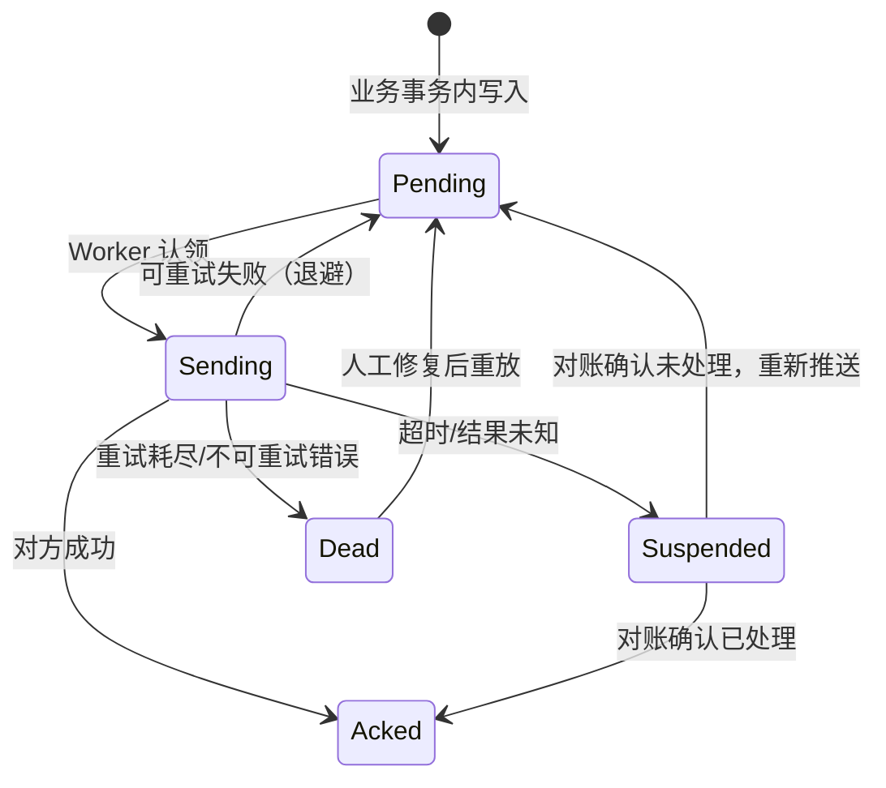

### 6.6 重试、死信与对账

| 次数 | 间隔 | 动作 |
|---|---|---|
| 1 | 5 s | 自动重试 |
| 2 | 30 s | 自动重试 |
| 3 | 2 min | 自动重试 + 记 Warning |
| 4 | 10 min | 自动重试 + 通知接口运维 |
| 5 | 30 min | 最后一次自动重试 |
| ≥6 | — | 转 `Dead`，生成异常工单，停止自动重发 |

> **认领后崩溃的兜底**：`ClaimBatch` 会把状态置 `Sending`；若 Worker 在推送途中崩溃，记录会停在 `Sending`。Scheduler 每 10 min 扫一次 `status = Sending AND updated_at < now() - interval '10 min'`，回置 `Pending`（`attempts` 已计），超过上限则转 `Dead`。没有这一步，消息会永久卡住。

**对账任务（每日 02:00）**：

1. 按 `bizType + 日期` 汇总平台已发条数、对方已收条数。
2. 差异清单：平台 Acked 但对方无记录 → 对方补录；平台 Suspended → 逐条 `QueryAsync`。
3. 差异 > 0.5% 或 > 10 条 → 告警到接口负责人。
4. 对账结果落 `mes_reconcile`，保留 1 年。

### 6.7 拉取模式（工单增量）

| 项 | 做法 |
|---|---|
| 水位 | 存 `mes_sync_state.last_modified` + `last_id` |
| 窗口重叠 | 每次回溯 5 min，防对方事务提交延迟 |
| 去重 | `workOrderNo + version` 唯一键，重复更新不新建 |
| 分页 | 每页 200，最多 50 页；超时中断，下次从水位继续 |
| 全量兜底 | 每周日凌晨全量对一次，修复漏单 |

### 6.8 报文示例

**报工（JSON）**

```json
{
  "msgId": "01JCG7YQ9K3M2N8PQR4T5V6W7X",
  "bizType": "production.report",
  "bizKey": "WO-261102-001|10|3",
  "occurredAt": "2026-11-02T06:12:33Z",
  "traceId": "4f2a9c1e8b7d4a63",
  "payload": {
    "orderCode": "WO-261102-001",
    "operationSeq": 10,
    "qualifiedQty": 118,
    "scrapQty": 2,
    "reportTime": "2026-11-02 14:12:33",
    "workerCode": "E1027",
    "equipmentCode": "CNC-07"
  }
}
```

**B2MML（SAP/OPC 场景，片段）**

```xml
<ProductionPerformance xmlns="http://www.wbf.org/xml/B2MML-V0600">
  <ProductionPerformanceHeader>
    <DocumentID>01JCG7YQ9K3M2N8PQR4T5V6W7X</DocumentID>
    <ProductionRequestID>WO-261102-001</ProductionRequestID>
    <EquipmentID>CNC-07</EquipmentID>
  </ProductionPerformanceHeader>
  <ProductionPerformanceRecord>
    <OperationID>10</OperationID>
    <Quantity>118</Quantity>
    <ScrapQuantity>2</ScrapQuantity>
    <RecordedTime>2026-11-02T14:12:33+08:00</RecordedTime>
  </ProductionPerformanceRecord>
</ProductionPerformance>
```

### 6.9 鉴权与限流

| 方式 | 适用 | 实现 |
|---|---|---|
| OAuth2 Client Credentials | 标准 REST API | `client_id/secret` 换 token，缓存至过期前 5 min |
| HMAC 签名 | 老系统、无 OAuth | `X-Sign = HMAC-SHA256(body + timestamp + nonce)`，时间窗 5 min |
| IP 白名单 | 内网、中间库 | 防火墙 + 应用层校验 |
| 双向 TLS | 高安全场景 | 客户端证书，插件配置引用证书名 |
| 限流 | 保护对方系统 | 令牌桶，默认 20 QPS，可配 |

### 6.10 契约测试（上线前必做）

| 测试 | 做法 | 通过标准 |
|---|---|---|
| 正常报文 | 用 Mock Server 返回成功 | 平台记 Ack，对方收到 1 条 |
| 重复推送 | 同一幂等键推 3 次 | 对方入账 1 次，平台 3 次 Ack |
| 超时 | Mock 延迟 10 s | 平台转 Suspended，不重复推 |
| 4xx 参数错 | 返回 400 + 错误码 | 平台记 Dead，告警，不重试 |
| 5xx | 返回 503 | 平台退避重试，最终 Dead |
| 字符集 | 中文/特殊字符 | 无乱码 |
| 大量明细 | 1 张单 500 行 | 报文完整，耗时可接受 |

### 6.11 切换与灰度

1. **影子期**：平台照常报工到旧系统，同时把报文写日志不发送；人工比对字段。
2. **双跑期**：新旧系统同时收，旧系统为准，差异每日对账。
3. **切换**：按产线/车间切开关，保留回滚开关 30 天。
4. **收尾**：旧接口只读保留一个月，之后下线。

### 6.12 上游 ERP / PLM / WMS / QMS 适配

**结论：MES 适配器解决「工单执行」，北向适配器解决「主数据与账务」；两者共用 Outbox，但语义、频率、失败容忍度完全不同，不能混成一个接口。**

#### 6.12.1 为什么要单独一层

| 系统 | 平台向它要什么 | 平台给它什么 | 频率 | 失败容忍 | 账本归属 |
|---|---|---|---|---|---|
| ERP | 物料、BOM、工艺路线、供应商、客户、库存基线 | 领料、完工入库、报废、盘盈亏、工时 | 分钟~小时 | 可延迟，不可丢 | **ERP 是账本** |
| PLM | 图纸、EBOM、版本、ECN、SOP | 变更执行反馈、首件结果 | 小时~天 | 可延迟 | PLM 是定义源 |
| WMS | 库位、可用库存、出入库任务结果 | 领料申请、完工入库请求 | 秒~分钟 | 可重试 | WMS 管实物 |
| QMS | 检验标准、抽样方案、放行结论 | 过程检验数据、不良、批次 | 分钟~小时 | 可延迟 | QMS 管质量状态 |
| SRM | ASN、到货计划 | 来料到货、退货 | 小时 | 可延迟 | SRM 管供应商协同 |

**三条边界**：

1. 平台**不做总账、不做成本核算、不做 MRP**；这些留在 ERP。平台只保证「事务单据传过去、结果收回来」。
2. 主数据**单一来源**：物料/BOM/工艺以 ERP/PLM 为准，平台只读 + 缓存 + 映射，不允许在平台新建正式物料码。
3. 库存数量**以 WMS/ERP 为准**；平台只报「消耗与产出入库」，不自行扣减账面库存。

#### 6.12.2 契约

```csharp
// Platform.Abstractions/Integration/IBusinessSystemAdapter.cs
public interface IBusinessSystemAdapter
{
    string SystemCode { get; }                       // ERP_SAP / ERP_YONYOU / WMS_xxx / QMS_xxx
    IntegrationCapabilities Capabilities { get; }    // 支持哪些单据、是否支持增量拉取
    Task<PushResult> PushAsync(BusinessDocument doc, CancellationToken ct);
    Task<IReadOnlyList<BusinessDocument>> PullAsync(PullRequest req, CancellationToken ct);
    Task<ReconcileResult> ReconcileAsync(DateOnly bizDate, CancellationToken ct);
}

// 主数据单独抽出来：它只下行、只读、带水位
public interface IMasterDataAdapter
{
    Task<MasterDataPage<Material>>  PullMaterialsAsync(Watermark wm, CancellationToken ct);
    Task<MasterDataPage<BomLine>>   PullBomAsync(string materialCode, string version, CancellationToken ct);
    Task<MasterDataPage<Routing>>   PullRoutingsAsync(Watermark wm, CancellationToken ct);
    Task<MasterDataPage<Partner>>   PullPartnersAsync(Watermark wm, CancellationToken ct);
}
```

```csharp
public enum BusinessDocType
{
    MaterialIssue,        // 领料
    ProductionReceipt,    // 完工入库
    Scrap,                // 报废
    ReturnToVendor,       // 退供应商
    StockAdjust,          // 盘盈亏
    QualityRelease,       // 质量放行
    QualityHold,          // 质量冻结
    LaborActual           // 工时回传
}

public sealed record BusinessDocument(
    BusinessDocType DocType,
    string DocNo,               // 平台生成，全局唯一
    string IdempotencyKey,      // 见 6.4，由平台生成
    string? WorkOrderNo,
    string? MaterialCode,
    decimal Quantity,
    string Uom,
    string? BatchNo,
    DateTime OccurredAtUtc,
    IReadOnlyDictionary<string, string> Extensions);   // 字段映射兜底，避免改代码
```

**与 `IMesAdapter` 的关系**：同一家厂商（如 SAP）可以一个插件同时实现 `IMesAdapter` 与 `IBusinessSystemAdapter`，但**注册为两个能力**（`northbound.mes`、`northbound.erp`），可以单独开关。理由：某现场只用 MES 不用 ERP 接口时，不应被迫启用整套适配器。

#### 6.12.3 接口矩阵（北向）

| # | 方向 | 单据 / 数据 | 触发时机 | 幂等键 | 目标系统 |
|---|---|---|---|---|---|
| N1 | 下行 | 物料主数据（增量） | 每 30 min 或对方推送 | `md:material:{code}:{ver}` | ERP / PLM |
| N2 | 下行 | BOM（按物料 + 版本） | 工单下达前按需拉取 | `md:bom:{code}:{ver}` | ERP / PLM |
| N3 | 下行 | 工艺路线 / 工作中心 | 同上 | `md:routing:{code}:{ver}` | ERP / PLM |
| N4 | 下行 | 供应商 / 客户 | 每 6 h | `md:partner:{code}` | ERP |
| N5 | 下行 | 可用库存 / 库位 | 每 5 min（按需） | 只读，不幂等 | WMS |
| N6 | 上行 | 领料申请 | 工单开工前 | `issue:{wo}:{materialCode}:{seq}` | ERP / WMS |
| N7 | 上行 | 完工入库 | 末道工序报工后 | `receipt:{wo}:{seq}` | ERP / WMS |
| N8 | 上行 | 报废 / 退料 | 发生时 | `scrap:{wo}:{seq}` | ERP |
| N9 | 上行 | 盘盈亏 | 盘点确认后 | `adjust:{loc}:{date}` | ERP |
| N10 | 上行 | 检验结果 / 放行 | 检验完成 | `qc:{batch}:{item}` | QMS / ERP |
| N11 | 上行 | 工时 / 产量 | 每班次 | `labor:{wo}:{shift}` | ERP |
| N12 | 双向 | 对账 | 每日 02:00 | 按日期 | 全部 |

> N6~N8 必须与业务事务同库同事务写 Outbox（见 6.5），不允许「先调接口、成功再记账」。

#### 6.12.4 主数据同步规则

| 规则 | 做法 | 反例 |
|---|---|---|
| 水位增量 | 每次记 `max(updated_at)` 与对方游标，下次从水位拉 | 每次全量拉 5 万条，接口被限流 |
| 停用不删 | 对方 `status=disabled` → 平台置 `enabled=false`，保留历史引用 | 直接删，历史工单查不到物料 |
| 映射表 | `md_mapping(system_code, external_code, internal_id)`，双向可查 | 用名称匹配，改名就断 |
| 冲突裁决 | 物料/BOM 以 ERP/PLM 为准；平台侧只读字段不允许改 | 平台改物料描述，下次同步被覆盖 |
| 版本快照 | 工单下达时冻结 BOM/工艺版本 | 工单执行中 BOM 变更，领料对不上 |
| 失败隔离 | 单条主数据校验失败 → 进 `md_reject` 表，其余继续 | 一条脏数据导致整批同步失败 |

#### 6.12.5 过账与对账

```text
本地业务提交（报工/领料）
  └─ 同事务写 mes_outbox(target_system='ERP', doc_type, doc_no, payload, idempotency_key)
       └─ OutboxWorker 按 target_system 分组投递（各自限流、各自退避）
            ├─ 2xx → Acked
            ├─ 4xx（参数/主数据缺失）→ Dead + 告警（修数据后人工重推）
            ├─ 5xx / 超时 → 退避重试 → 超限 Dead
            └─ 对方明确「已受理但未入账」→ Suspended，等对账
每日 02:00 对账
  ├─ 本地 Acked、对方无记录 → 重推（幂等键保证不重复入账）
  ├─ 对方有、本地无 → 人工补录 + 告警（可能是手工过账）
  └─ 数量/金额不一致 → 冻结该单据 + 生成差异工单
```

**对账三条铁律**：只比「单据号 + 数量 + 金额」，不比时间戳；差异必须落到「差异工单」，不能只发消息；连续 3 天有差异 → 停自动过账，转人工。

#### 6.12.6 安全与限流

| 项 | 规则 |
|---|---|
| 鉴权 | OAuth2 Client Credentials 或双向证书；账号按系统单独申请，不复用 |
| 网络 | 只走 443/8443；白名单 IP；不允许平台主动连办公网数据库 |
| 限流 | 按对方配额配置（如 20 req/s），超限排队不丢弃 |
| 报文 | 不传明文密码、不传身份证等敏感字段；附件走对象存储链接 |
| 留痕 | 每份报文存 `file_object`（原始 JSON/XML），保留 180 天，可回放 |
| 权限 | 触发过账需 `integration:post`；手工重推需 `integration:retry` + 双人复核 |

### 6.13 新增上游 MES/业务系统插件实操

**结论：上游系统千变万化，插件只消化「传输形态与报文格式」的差异；信封、幂等键、Outbox、对账四件套永远在平台侧——写适配器不是「对接一个接口」，是「把一个系统翻译成这四件套」。**

> 11.4 是发布 SOP（8 步表），本节讲代码级决策：怎么注册、选什么传输形态、常见厂商的坑在哪。

#### 6.13.1 注册与路由：`IMesAdapterProvider`

6.5 的 `OutboxWorker` 用 `adapters.Get(msg.Target)` 选插件，这个提供者就是所有北向插件的汇聚点：

```csharp
// Platform.Abstractions/Mes/IMesAdapterProvider.cs
public interface IMesAdapterProvider
{
    IReadOnlyList<MesDescriptor> DescribeAll();          // 安装/健康页展示用
    bool TryGet(string target, out IMesAdapter adapter); // target = 路由目标码，非厂商名
    IMesAdapter Get(string target);                      // 查不到抛 AdapterNotFoundException
}
```

```json
// manifest（kind=MesAdapter 的两个关键增量字段）
{
  "id": "mes.kingdee.k3cloud",
  "kind": "MesAdapter",
  "capabilities": ["mes.pull", "mes.push", "mes.query"],
  "requiresFeatures": ["northbound.mes"],
  "mesTargets": ["MES_MAIN", "ERP_MAIN"],
  "mesInterfaces": ["workOrder.pull", "production.report", "quality.result", "masterdata.material"]
}
```

| 环节 | 规则 | 反例 |
|---|---|---|
| 路由 | `mes_outbox.target_system` = 逻辑目标码（`MES_MAIN`/`ERP_MAIN`），厂商名只出现在插件内部 | 直接写 `target='金蝶'`——换供应商要把历史数据里的字符串改掉 |
| 注册 | 插件 `Configure` 注册 `IMesAdapter` 实例 + manifest `mesTargets`；同 target 多插件按 `priority` 裁决（4.6） | 两个插件抢同一 target，运行时随机投递 |
| 能力声明 | `mesInterfaces` 与实际实现一致；未声明的 `bizType` 投递到该 target 直接判 `Dead`（不重试） | 「大概都支持」，报工发过去才发现对方没这个接口，重试 5 次全超时 |
| 开关 | `requiresFeatures` 绑 `northbound.mes / northbound.erp / northbound.wms / integration.file`（2.7.3 I 组）；`Blocked` 时该 target 查不到适配器 → 退避重试不丢弃（6.6），长期关闭会转 `Dead`，恢复后人工重放 | 关 ERP 开关前不停业务侧写入，攒一周消息全变 Dead |

#### 6.13.2 新上游接入七步（开发视角）

| # | 动作 | 产出 | 卡住了怎么办 |
|---|---|---|---|
| 1 | 契约确认 | 按附录 C 模板逐接口填写：方向/频率/鉴权/幂等/错误码 | 对方说不清幂等 → 默认「不幂等」，走 `QueryAsync` 先查后推（6.4 铁律 3） |
| 2 | 传输选型 | 6.13.3 五类里选一类；同一上游多种可用时优先 REST | 对方只给中间库 → 触发 `integration.file` 评审（安全 6.12.6：平台不直连办公网 DB，走只读账号 + 视图） |
| 3 | 信封映射 | `mapping/*.json`（6.3）+ 幂等键组装（6.4） | 对方必填但平台没有的字段 → 默认值/查表，禁止在映射里写脚本 |
| 4 | 鉴权实现 | 6.9 五选一；token 缓存至过期前 5 min | 对方 session 过期返回 200 + 业务错误码 → 在适配器里翻译成「可重试」 |
| 5 | 契约测试 | 6.10 七用例 + 附录 C 第 5 节用例回放 | 拿不到测试环境 → Mock Server 按契约文档搭，先跑通再约联调 |
| 6 | 影子/双跑 | 6.11 四阶段，差异每日对账 | 双跑差异 > 0.5% → 停下排查，不带病切换 |
| 7 | 灰度上线 | 按产线切 target，回滚开关留 30 天 | 回滚 = 把 `target_system` 指回旧适配器，两个插件并存期间新插件只收影子流量 |

#### 6.13.3 按传输形态的五类接入模式

| 模式 | 典型上游 | 插件内要点 | 幂等落点 | 主要坑 |
|---|---|---|---|---|
| REST/JSON | 自研 MES、用友 YonSuite、金蝶云 | `HttpClient` + 映射配置；超时转 `Suspended` | 请求头带 `bizKey`，对方按它去重 | 4xx/5xx 语义混用：401 要刷新 token 重试，400 直接 `Dead`；对方把业务失败包在 200 里 |
| WebService/SOAP | 鼎捷 eBO、老 SAP PI/PO | `dotnet-svcutil` 生成代理或手写信封；SOAP Header 放鉴权 | 依赖 `DocumentID`（B2MML 6.8 场景） | WSDL 与线上行为不一致；命名空间大小写敏感；.NET 8 下老加密（WS-Security 1.0）要补库 |
| 中间表/DB | 老 MES、第三方小系统 | 独立插件 + 只读视图/专用账号；写表带 `status` 位由对方回写 | 表上 `(biz_type, biz_key)` 唯一索引 | 双方时区不一致；对方清表 = 留痕丢失（平台侧 `file_object` 仍存原始报文）；直连违反 6.12.6 时改走文件 |
| 文件（SFTP/共享目录） | 集团批量接口、QMS 报告 | 文件名含 `bizKey + msgId`；`.tmp → rename` 原子落盘；处理完移 `done/` 目录 | 文件名即幂等键，重复投递先查 Inbox | 编码（GBK vs UTF-8）、半文件、目录权限；必须约定心跳文件 |
| MQ/ESB（RabbitMQ/Kafka） | 集团级 ESB、IoT 平台 | 消费端手动 ack；死信队列映射到平台 `Dead`；顺序要求按 `bizKey` 分区 | 消息 ID = `MsgId`（ULID），Inbox 去重 | 对方 at-least-once 重发 → 没有 Inbox 就重复入账；消费者停摆积压要靠告警不是重试 |

**中间表/文件两类「弱协议」的共同纪律**：平台侧一切照旧（Outbox、幂等、对账），只是把「HTTP 调用」换成「写表/写文件」；不允许因为「对方是表」就绕过 6.5 直接同步事务里写中间表——那是分布式事务陷阱，断网即雪崩。

#### 6.13.4 常见厂商画像（接入前先对号）

| 上游 | 常见形态 | 鉴权 | 工单下发 | 报工/过账 | 现场高频坑 |
|---|---|---|---|---|---|
| SAP（ERP/MII/DMO） | OData、PI/PO 中间件、IDoc、B2MML | OAuth2 或证书 | IDoc 下达或 OData 拉取 | MIGO/确认 BAPI，走 PI | 字段语义靠业务方解释（「确认」分生产确认和反冲）；IDoc 状态码 00/03/51 要逐一翻译成 Ack/Suspended/Dead；时区与单位组（UOM 小数位） |
| 用友 U8 / YonSuite | U8 多为中间表或 COM+ 开放接口；YonSuite 为 REST 开放平台 | U8 数据库账号；YonSuite appKey + 签名 | 生产订单查询/下发接口 | 材料出库单、产成品入库单 API | U8 版本碎片化（同一接口三个版本三种字段）；单据审核态才生效——平台推的是「保存」还是「审核」必须写进契约（附录 C 第 2 节） |
| 金蝶 K3 Cloud / 星空 | WebAPI（`Push`/`Save`/`Draft` 单据流） | 登录凭据换 session，会话有过期 | 生产工单查询 WebAPI | 生产汇报单、领料单 `Save+Submit+Audit` | 单据要三连（保存→提交→审核），漏一步 = 单据躺在暂存；session 过期返回 200 + 错误体，要翻译成可重试 |
| 鼎捷（易飞/雅典娜/T100） | EAI/eBO WebService、e10 开放 API | 系统账号 + 厂区代号参数 | 工单 WebService 查询 | 投入/产出单推送 | 厂区代号/多工厂参数每个厂不同，全部进配置；老易飞只有 SQL 直连 → 按中间表模式 + 安全评审 |
| 自研 MES/第三方小 MES | 自定义 REST/TCP/DB | 五花八门：Basic、签名、无鉴权 | 多为拉取（6.7 水位） | JSON 直推 | 文档与实现不一致是常态——以契约测试（6.10）抓包结果为准，文档只做初稿 |

> 画像只用于估工作量与预判坑；接口清单、字段映射、错误码一律按附录 C 模板逐条填、逐条测，不按「听说 SAP 就是这样」开工。

#### 6.13.5 多上游共存与切换

| 场景 | 做法 |
|---|---|
| MES + ERP 同时接 | 两个插件、两个 target（`MES_MAIN`/`ERP_MAIN`），Outbox 按 target 分组投递，各自限流各自退避（6.12.5） |
| 同业务双写（工单报 MES 又报 ERP 工时） | 业务事务里写两条 Outbox 记录，不是一个适配器内部循环——一条失败不影响另一条重试 |
| 供应商更换（如金蝶 → SAP） | 新旧插件并存，`target_system` 不变；灰度期旧适配器收正式流量、新适配器收影子流量（6.11），对账通过后改路由权重 |
| 一厂多 MES（集团 + 车间自建） | 按车间/产线数据权限（9.3）路由到不同 target；映射配置各带一份，禁止一个适配器里 `if (车间 == 3)` |
| 上游临时不可用 | 消息留在 Outbox 退避，不丢；超过恢复窗口转 `Dead` + 异常工单（6.6），上游恢复后人工重放 |

> **适配器自检 4 条**（叠加在 6.10 契约测试之上）：① 插件内不生成业务单号，平台信封字段原样透传（6.2 键归属）；② 未声明的 `bizType` 拒发并记 `Dead`，不静默丢弃；③ 鉴权凭据走插件配置加密存储，不落日志；④ `StopAsync` 排空在途请求后才卸载（4.1 热装卸边界）。

> **自检 3 问**
> 1. 为什么幂等键必须由平台组装并落库？只信对方返回的 ID 会有什么问题？
> 2. Outbox 的 `Suspended` 与 `Dead` 差别是什么？各自怎么处理？
> 3. 对账发现「平台 Acked、对方无记录」，你会先做什么、后做什么？

---

## 7. 数据架构

**结论：平台的数据库要同时承担「配置、业务、时序、消息」四类负载，不分层设计，三个月就会被一张大表拖死。**

### 7.1 四类存储

| 类别 | 存储 | 内容 | 保留 | 特点 |
|---|---|---|---|---|
| 配置与主数据 | PostgreSQL | 用户、权限、设备、点位、报表定义 | 长期 | 强一致、常改 |
| 业务数据 | PostgreSQL | 工单、报工、物料、质量、追溯 | 3 年（可配） | 事务、可查询 |
| 时序数据 | PostgreSQL 分区（二期 Timescale） | 点位历史、设备状态 | 90 天热 + 归档 | 写多读少、按时间查 |
| 消息与文件 | PostgreSQL Outbox + MinIO | 待发消息、图纸、照片、导出、接口原始报文 | 消息 30 天；原始报文与文件 180 天 | 可重放、大对象外置 |

### 7.2 表清单（31 张业务表，按域分组）

| 域 | 表 | 说明 |
|---|---|---|
| 身份 | `sys_user`、`sys_role`、`sys_user_role`、`sys_permission`、`sys_role_permission`、`sys_menu`、`sys_user_scope` | RBAC + 数据范围 + 菜单 |
| 平台 | `sys_config`、`audit_log`、`plugin_state`、`job_schedule` | 配置、审计链、插件状态、定时 |
| 设备 | `device`、`device_channel`、`device_point`、`point_snapshot`、`point_history`、`device_command`、`alarm` | 台账、点位、快照、指令、报警 |
| 业务 | `work_order`、`wo_step`、`production_report`、`material_txn`、`quality_record`、`trace_link` | 工单到追溯 |
| 集成 | `mes_outbox`、`mes_inbox`、`mes_sync_state`、`mes_reconcile` | 消息、水位、对账 |
| 报表 | `report_def`、`report_run`、`file_object` | 定义、执行记录、文件 |

> **口径说明**：31 张指业务基线表，不含 3.7 的 `feature_flag` / `feature_scope` / `feature_version`（开关定义与范围）三张表，也不含按月创建的 `point_history_YYYY_MM` 分区子表（DDL 中以 `point_history_2026_11` 示范）。另有配置表随对应模块迁移单独创建、不计入基线：`report_allowed_table`（8.4 报表表白名单）、`md_mapping` 与 `md_reject`（6.12 主数据映射与拒收）、`recipe_def / recipe_line / recipe_version`（D1~D4 配方域，随配方能力迁移创建）、`vision_recipe / vision_calibration`（5.13 视觉配方与标定资产，随 `vision.camera` 迁移创建）。`mes_outbox` 是统一出站消息表，按 `target_system` 区分 MES / ERP / WMS / QMS；视觉结果不另建表，落 `quality_record` + `file_object` + `trace_link`（5.13.4）。

### 7.3 核心 DDL（PostgreSQL 17）

```sql
-- ========== 身份与权限 ==========
CREATE TABLE sys_user (
  id            bigserial PRIMARY KEY,
  user_code     text NOT NULL UNIQUE,          -- 工号
  user_name     text NOT NULL,
  password_hash text NOT NULL,                 -- PBKDF2/Argon2
  mes_code      text,                          -- 对接 MES 的工号
  status        smallint NOT NULL DEFAULT 1,   -- 1 启用 0 停用
  locked_until  timestamptz,
  created_at    timestamptz NOT NULL DEFAULT now()
);

CREATE TABLE sys_role (
  id         bigserial PRIMARY KEY,
  role_code  text NOT NULL UNIQUE,
  role_name  text NOT NULL,
  data_scope smallint NOT NULL DEFAULT 4       -- 1 全部 2 工厂 3 车间 4 本人
);

CREATE TABLE sys_user_role (
  user_id bigint NOT NULL REFERENCES sys_user(id),
  role_id bigint NOT NULL REFERENCES sys_role(id),
  PRIMARY KEY (user_id, role_id)
);

CREATE TABLE sys_permission (
  id       bigserial PRIMARY KEY,
  perm_code text NOT NULL UNIQUE,              -- device:write
  perm_name text NOT NULL,
  module    text NOT NULL
);

CREATE TABLE sys_role_permission (
  role_id bigint NOT NULL REFERENCES sys_role(id),
  perm_id bigint NOT NULL REFERENCES sys_permission(id),
  PRIMARY KEY (role_id, perm_id)
);

CREATE TABLE sys_menu (
  id        bigserial PRIMARY KEY,
  parent_id bigint REFERENCES sys_menu(id),
  menu_name text NOT NULL,
  path      text,
  perm_code text,
  sort_no   int NOT NULL DEFAULT 0
);

CREATE TABLE sys_user_scope (
  user_id  bigint NOT NULL REFERENCES sys_user(id),
  scope_type text NOT NULL,                    -- plant / workshop / line
  scope_id bigint NOT NULL,
  PRIMARY KEY (user_id, scope_type, scope_id)
);

-- ========== 平台 ==========
CREATE TABLE sys_config (
  id          bigserial PRIMARY KEY,
  cfg_key     text NOT NULL UNIQUE,
  cfg_value   jsonb NOT NULL,
  value_type  text NOT NULL,
  version     int NOT NULL DEFAULT 1,
  updated_by  bigint,
  updated_at  timestamptz NOT NULL DEFAULT now()
);

CREATE TABLE audit_log (
  id          bigserial PRIMARY KEY,
  trace_id    text NOT NULL,
  actor_id    bigint,
  actor_name  text,
  action      text NOT NULL,                   -- device.write / plugin.enable
  resource    text NOT NULL,
  result      text NOT NULL,                   -- Success / Denied / Failed
  before_data jsonb,
  after_data  jsonb,
  client_ip   inet,
  occurred_at timestamptz NOT NULL DEFAULT now(),
  prev_hash   text NOT NULL,
  self_hash   text NOT NULL
);
CREATE INDEX ix_audit_time ON audit_log (occurred_at DESC);
CREATE INDEX ix_audit_actor ON audit_log (actor_id, occurred_at DESC);

CREATE TABLE plugin_state (
  plugin_id   text PRIMARY KEY,
  version     text NOT NULL,
  kind        text NOT NULL,
  state       text NOT NULL,                   -- Installed/Enabled/Running/Draining/Disabled/Faulted/Uninstalled/Incompatible/Rejected（见 4.5）
  binding_state text NOT NULL DEFAULT 'Absent',-- Active/Blocked/Degraded/Absent（见 4.13.2）
  config      jsonb NOT NULL DEFAULT '{}',
  applied_migrations text[] NOT NULL DEFAULT '{}',
  enabled_at  timestamptz,
  last_error  text,
  updated_at  timestamptz NOT NULL DEFAULT now()
);

CREATE TABLE job_schedule (
  id          bigserial PRIMARY KEY,
  job_key     text NOT NULL UNIQUE,
  cron        text NOT NULL,
  enabled     boolean NOT NULL DEFAULT true,
  last_run_at timestamptz,
  last_result text
);

-- ========== 设备 ==========
CREATE TABLE device_channel (
  id           bigserial PRIMARY KEY,
  channel_code text NOT NULL UNIQUE,
  kind         text NOT NULL,                  -- modbus-rtu / tcp / opcua
  params       jsonb NOT NULL,                 -- COM3, 9600, 8N1 / host, port
  enabled      boolean NOT NULL DEFAULT true
);

CREATE TABLE device (
  id          bigserial PRIMARY KEY,
  device_code text NOT NULL UNIQUE,
  name        text NOT NULL,
  channel_id  bigint REFERENCES device_channel(id),
  driver_id   text NOT NULL,                   -- driver.modbus.tcp
  endpoint    jsonb NOT NULL,                  -- {"host":"192.168.1.10","port":502,"unitId":1}
  poll_ms     int NOT NULL DEFAULT 1000,
  state       smallint NOT NULL DEFAULT 0,     -- 0 离线 1 在线 2 维护
  workshop_id bigint,
  enabled     boolean NOT NULL DEFAULT true,
  created_at  timestamptz NOT NULL DEFAULT now()
);

CREATE TABLE device_point (
  id          bigserial PRIMARY KEY,
  device_id   bigint NOT NULL REFERENCES device(id),
  point_code  text NOT NULL,
  address     text NOT NULL,
  data_type   text NOT NULL,
  byte_order  text NOT NULL DEFAULT 'CDAB',
  scale       numeric NOT NULL DEFAULT 1,
  unit        text,
  access      smallint NOT NULL DEFAULT 1,     -- 1 只读 2 读写
  archive     boolean NOT NULL DEFAULT false,
  deadband    numeric,
  UNIQUE (device_id, point_code)
);

CREATE TABLE point_snapshot (
  device_id   bigint NOT NULL,
  point_code  text NOT NULL,
  value_num   double precision,
  value_text  text,
  quality     smallint NOT NULL,
  occurred_at timestamptz NOT NULL,
  PRIMARY KEY (device_id, point_code)
);

CREATE TABLE point_history (
  id          bigserial,
  device_id   bigint NOT NULL,
  point_code  text NOT NULL,
  value_num   double precision,
  value_text  text,
  quality     smallint NOT NULL,
  occurred_at timestamptz NOT NULL,
  PRIMARY KEY (id, occurred_at)
) PARTITION BY RANGE (occurred_at);

CREATE TABLE point_history_2026_11 PARTITION OF point_history
  FOR VALUES FROM ('2026-11-01') TO ('2026-12-01');
CREATE INDEX ix_ph_dev_point ON point_history (device_id, point_code, occurred_at DESC);

CREATE TABLE device_command (
  id           bigserial PRIMARY KEY,
  command_no   text NOT NULL UNIQUE,
  device_id    bigint NOT NULL,
  point_code   text NOT NULL,
  target_value text NOT NULL,
  status       smallint NOT NULL DEFAULT 0,    -- 0 待发 1 已发 2 已确认 3 超时 4 可疑 5 失败
  operator_id  bigint NOT NULL,
  requested_at timestamptz NOT NULL DEFAULT now(),
  completed_at timestamptz,
  readback     jsonb,
  error_code   text
);

CREATE TABLE alarm (
  id          bigserial PRIMARY KEY,
  alarm_no    text NOT NULL UNIQUE,
  device_id   bigint,
  level       smallint NOT NULL,               -- 1 提示 2 警告 3 严重
  code        text NOT NULL,
  message     text NOT NULL,
  raised_at   timestamptz NOT NULL DEFAULT now(),
  cleared_at  timestamptz,
  acked_by    bigint,
  acked_at    timestamptz
);

-- ========== 业务 ==========
CREATE TABLE work_order (
  id            bigserial PRIMARY KEY,
  order_no      text NOT NULL UNIQUE,
  product_code  text NOT NULL,
  bom_version   text,
  route_version text,
  plan_qty      numeric NOT NULL,
  completed_qty numeric NOT NULL DEFAULT 0,
  status        smallint NOT NULL DEFAULT 0,   -- 0 待开工 1 进行 2 暂停 3 完工 4 关闭
  mes_version   int,
  planned_start timestamptz,
  planned_end   timestamptz,
  created_at    timestamptz NOT NULL DEFAULT now()
);

CREATE TABLE wo_step (
  id           bigserial PRIMARY KEY,
  order_id     bigint NOT NULL REFERENCES work_order(id),
  step_no      int NOT NULL,
  step_name    text NOT NULL,
  work_center  text,
  plan_qty     numeric NOT NULL,
  good_qty     numeric NOT NULL DEFAULT 0,
  scrap_qty    numeric NOT NULL DEFAULT 0,
  status       smallint NOT NULL DEFAULT 0,
  UNIQUE (order_id, step_no)
);

CREATE TABLE production_report (
  id          bigserial PRIMARY KEY,
  order_id    bigint NOT NULL REFERENCES work_order(id),
  step_no     int NOT NULL,
  report_seq  int NOT NULL,
  good_qty    numeric NOT NULL,
  scrap_qty   numeric NOT NULL DEFAULT 0,
  operator_id bigint NOT NULL,
  device_id   bigint,
  reported_at timestamptz NOT NULL,
  source      text NOT NULL DEFAULT 'manual',  -- manual / device / import
  UNIQUE (order_id, step_no, report_seq)
);

CREATE TABLE material_txn (
  id          bigserial PRIMARY KEY,
  order_id    bigint NOT NULL,
  material_code text NOT NULL,
  move_type   text NOT NULL,                   -- issue / return / backflush
  qty         numeric NOT NULL,
  batch_no    text,
  occurred_at timestamptz NOT NULL,
  seq         int NOT NULL,
  UNIQUE (order_id, material_code, move_type, seq)
);

CREATE TABLE quality_record (
  id            bigserial PRIMARY KEY,
  inspection_no text NOT NULL UNIQUE,
  order_id      bigint,
  step_no       int,
  result        smallint NOT NULL,             -- 0 待检 1 合格 2 让步 3 不合格
  defect_code   text,
  measured      jsonb,
  inspected_at  timestamptz
);

CREATE TABLE trace_link (
  id          bigserial PRIMARY KEY,
  order_id    bigint NOT NULL,
  direction   text NOT NULL,                   -- forward / backward
  from_type   text NOT NULL,                   -- material / process / equipment
  from_value  text NOT NULL,
  to_type     text NOT NULL,
  to_value    text NOT NULL,
  occurred_at timestamptz NOT NULL
);
CREATE INDEX ix_trace_from ON trace_link (from_type, from_value);

-- ========== 集成 ==========
CREATE TABLE mes_outbox (
  id          bigserial PRIMARY KEY,
  msg_id      uuid NOT NULL UNIQUE,
  target_system text NOT NULL,                 -- 逻辑目标码 MES_MAIN / ERP_MAIN / WMS_MAIN / QMS_MAIN（厂商名只在适配器内部，见 6.13.1）
  biz_type    text NOT NULL,
  biz_key     text NOT NULL,
  payload     jsonb NOT NULL,
  status      smallint NOT NULL DEFAULT 0,     -- 0 待发 1 发送 2 成功 3 死信 4 挂起
  attempts    int NOT NULL DEFAULT 0,
  next_at     timestamptz NOT NULL DEFAULT now(),
  last_error  text,
  created_at  timestamptz NOT NULL DEFAULT now(),
  updated_at  timestamptz NOT NULL DEFAULT now(),
  UNIQUE (biz_type, biz_key)
);
CREATE INDEX ix_outbox_due ON mes_outbox (status, next_at);

CREATE TABLE mes_inbox (
  id          bigserial PRIMARY KEY,
  msg_id      uuid NOT NULL UNIQUE,
  source      text NOT NULL,
  biz_type    text NOT NULL,
  payload     jsonb NOT NULL,
  processed_at timestamptz,
  result      text,
  received_at timestamptz NOT NULL DEFAULT now()
);

CREATE TABLE mes_sync_state (
  sync_key     text PRIMARY KEY,               -- 例：MES_MAIN.workorder（逻辑目标码 + 接口名）
  last_modified timestamptz,
  last_id      text,
  updated_at   timestamptz NOT NULL DEFAULT now()
);

CREATE TABLE mes_reconcile (
  id          bigserial PRIMARY KEY,
  biz_date    date NOT NULL,
  target_system text NOT NULL,
  biz_type    text NOT NULL,
  sent_count  int NOT NULL,
  acked_count int NOT NULL,
  diff_count  int NOT NULL,
  detail      jsonb,
  created_at  timestamptz NOT NULL DEFAULT now(),
  UNIQUE (biz_date, target_system, biz_type)
);

-- ========== 报表 ==========
CREATE TABLE report_def (
  id           bigserial PRIMARY KEY,
  report_code  text NOT NULL UNIQUE,
  report_name  text NOT NULL,
  version      int NOT NULL DEFAULT 1,
  sql_template text NOT NULL,
  params       jsonb NOT NULL DEFAULT '[]',
  columns      jsonb NOT NULL DEFAULT '[]',
  perm_code    text NOT NULL,
  scope_field  text NOT NULL DEFAULT 'plant_id',
  max_rows     int NOT NULL DEFAULT 100000,
  enabled      boolean NOT NULL DEFAULT true,
  updated_by   bigint,
  updated_at   timestamptz NOT NULL DEFAULT now()
);

CREATE TABLE report_run (
  id          bigserial PRIMARY KEY,
  report_code text NOT NULL,
  params      jsonb,
  user_id     bigint,
  row_count   int,
  elapsed_ms  int,
  status      smallint NOT NULL,
  file_id     bigint,
  created_at  timestamptz NOT NULL DEFAULT now()
);

CREATE TABLE file_object (
  id          bigserial PRIMARY KEY,
  bucket      text NOT NULL,
  object_key  text NOT NULL,
  file_name   text NOT NULL,
  size_bytes  bigint NOT NULL,
  sha256      text NOT NULL,
  created_at  timestamptz NOT NULL DEFAULT now(),
  UNIQUE (bucket, object_key)
);
```

### 7.4 时序数据策略

| 策略 | 参数 | 说明 |
|---|---|---|
| 分区 | 按月分区 | 建下月分区由定时任务提前做 |
| 归档 | 热 90 天，冷归档到文件 | 归档后 `DETACH` + 压缩 |
| 降采样 | 1 min / 1 h 聚合表 | 报表查聚合，不扫原始 |
| 变化存储 | 离散量仅变位存 | 模拟量按死区（默认量程 1%） |
| 压缩 | 二期 Timescale/列存 | 一期先靠分区与索引 |

**容量算式（可复算）**：

- 8,000 点中 30% 模拟量 = 2,400 点，60 s 归档一次：2,400 × 1,440 = 345.6 万行/天。
- 死区过滤约 85% → 51.84 万行/天。
- 离散 5,600 点，估计每点每天变化 20 次 → 11.2 万行/天。
- 合计约 **63 万行/天**；每行含索引约 80 B → **约 50 MB/天** → **约 18 GB/年**；90 天热数据约 **4.5 GB**。

### 7.5 事务与一致性

| 场景 | 做法 |
|---|---|
| 报工 + 发 MES | 同一本地事务：写 `production_report` + `mes_outbox`；提交后由 Worker 发 |
| 写设备 + 审计 | 先写 `device_command`，执行后更新状态 + 写审计；两步都在本地事务 |
| 跨系统 | 只保证最终一致；绝不用分布式事务（两阶段提交） |
| 并发分配（货位/序号） | `UPDATE ... RETURNING` 或 `SELECT ... FOR UPDATE SKIP LOCKED` |
| 幂等 | 唯一索引兜底，捕获冲突后查已有记录返回 |

### 7.6 主数据同步顺序

| 顺序 | 数据 | 来源 | 频率 | 失败影响 |
|---|---|---|---|---|
| 1 | 工厂/车间/工作中心 | ERP | 每日 | 设备挂不上组织 |
| 2 | 物料 | ERP/PLM | 每日 + 变更 | 报工物料编码无效 |
| 3 | BOM（MBOM） | ERP | 变更 | 领料错误 |
| 4 | 工艺路线 | PLM/ERP | 变更 | 工序缺失 |
| 5 | 供应商/客户 | ERP | 每日 | 收货/发运失败 |
| 6 | 用户/工号 | HR/ERP | 每日 | 报工无工号 |

**规则**：下游只读，不反向修改；同步失败进入 `mes_inbox` 并告警，不阻塞其他数据。

### 7.7 备份与归档

| 对象 | 频率 | 保留 | 恢复目标 |
|---|---|---|---|
| PostgreSQL 全量 | 每日 01:00（`pg_dump -Fc`） | 30 份 | 全量本身是 **RPO 24 h**；真正的 RPO 由下一行决定 |
| WAL 归档（`archive_mode=on` + `archive_command`） | 持续（段切换即归档） | 7 天 | **PITR：RPO ≤ 60 s、可恢复到任意时间点**——这是本表唯一的 RPO 承诺 |
| Redis（可选，`cache.distributed` 开启时） | 快照 + AOF（`save 900 1` / `appendonly yes`） | 最近 2 份 | 快照可重建；**丢失只影响看板实时值，不影响历史与 Outbox**。未开启 Redis 的单机现场本行不适用 |
| MinIO 文件 | 每日增量 + 跨盘副本 | 按业务 | NG 图像与报表产物；与数据库同批恢复，恢复后按 `file_object` 的 `sha256` 抽样校验对象仍在（缺对象只影响追溯看图，不影响数据） |
| 配置与插件包 | 每次变更 | 永久 | 可重建环境 |
| 恢复演练 | 每季度 | 记录 | **必须做一次 PITR**（恢复到「昨天 14:23」这个点），只验全量恢复等于没验 WAL 归档 |

> **为什么不能把 RPO 写成 24 h**：采集是秒级的，日报表与报工按班次结算。若只靠每日全量，恢复即丢掉一整天产量与质量数据——制造业甲方不接受，追溯场景（汽车 IATF 16949、批次召回）更是直接不可谈。**WAL 持续归档 + PITR 才是这里的真实 RPO**，全量只是 PITR 的起点。表里两行原来都写了各自的目标，但没说明「以哪一行为准」，评审时会被拿最低的那行去承诺——所以这里明确：**对外只报 PITR 口径，全量备份不作为 RPO 依据。**
>
> **PITR 的代价要一起写清**：WAL 归档要求 `wal_level=replica`，磁盘多承担 7 天 WAL（按 7.4 的 345.6 万行/天落库估算，约 0.5~2 GB/天，7 天 4~14 GB，计入 12.9.1 数据盘），归档目录必须在**另一块盘**上，否则盘坏了一起丢。恢复时 `recovery_target_time` 之后的 Outbox 与设备指令一律按 12.4「恢复后必做」重新对账——**恢复到过去某个时间点，等于人为制造了一次「平台不知道自己发过什么报文」的状态**，不补这一步就是重复入账。

> **自检 3 问**
> 1. 为什么报工与 Outbox 必须在同一个本地事务里？
> 2. 时序数据为什么按「变化 + 死区」存，而不是每秒全量存？
> 3. 主数据同步为什么要规定顺序？举一个顺序错了的例子。

---

## 8. 报表、看板与指标

**结论：报表不是「写 SQL 查数据」，而是「受控查询 + 权限过滤 + 口径统一 + 可导出」；放开任意 SQL 等于把数据库交给车间。**

### 8.1 报表模型

| 对象 | 字段 | 说明 |
|---|---|---|
| 报表定义 | 编码、名称、版本、SQL 模板、参数、列、权限码、范围字段、最大行数 | 一版一存，可回滚 |
| 参数 | 名称、类型、必填、默认、候选项来源 | 客户端自动渲染 |
| 列 | 字段、标题、类型、宽度、格式、是否合计、脱敏规则 | 导出与页面共用 |
| 数据范围 | 全部/工厂/车间/本人 | 由登录用户注入 |
| 执行记录 | 用户、参数、行数、耗时、文件 | 审计与排障 |

### 8.2 安全 SQL 执行（三道防线）

```csharp
// Modules/Report/ReportQueryService.cs（节选）
public async Task<ReportPage> QueryAsync(
    string reportCode, IReadOnlyDictionary<string, object?> args, ICurrentUser user)
{
    var def = await _repo.GetEnabledAsync(reportCode)
              ?? throw new BizException(ErrorCode.ReportNotFound);

    _auth.Demand(def.PermCode);                       // 防线 1：功能权限

    var plan = _compiler.Compile(def, args, user);    // 防线 2：白名单 + 参数化 + 范围注入
    if (plan.EstimatedRows > def.MaxRows)
        return await _asyncJob.EnqueueAsync(def, plan, user);   // 大报表转异步

    var result = await _db.ExecuteAsync(plan);        // 防线 3：超时 + 只读连接
    await _audit.WriteAsync("report.query", reportCode, user, plan.Params);
    return result;
}
```

**编译器规则**：

| 规则 | 做法 | 违反后果 |
|---|---|---|
| 表白名单 | 只允许 `report_allowed_table` 中的表/视图 | 拒绝执行 |
| 禁止系统表 | `pg_catalog`、`information_schema` 一律拒绝 | 拒绝执行 |
| 参数化 | 用户输入只作为参数，不拼进 SQL | 拒绝执行 |
| 范围注入 | 按用户数据范围追加谓词 | 看不到越权数据 |
| 只读 | 连接使用只读账号，`default_transaction_read_only=on` | 无法写库 |
| 超时 | `statement_timeout = 30s` | 自动中断 |
| 行数 | `LIMIT max_rows + 1` 探测溢出 | 提示缩小范围 |

**范围注入示例**（不是字符串拼接用户输入，而是固定谓词 + 参数）：

```sql
-- 模板（报表作者只写业务条件）
SELECT d.device_code, d.name, SUM(r.good_qty) AS good_qty
FROM production_report r
JOIN device d ON d.id = r.device_id
WHERE r.reported_at >= @from AND r.reported_at < @to
  /*SCOPE*/ AND d.workshop_id = ANY(@scopeIds)
GROUP BY d.device_code, d.name
ORDER BY good_qty DESC
```

- `@from/@to` 来自参数（强类型校验）。
- `@scopeIds` 由登录用户的数据范围计算，用户不可传。
- 若报表模板缺少 `/*SCOPE*/` 占位符，编译器拒绝发布。

### 8.3 查询、导出与异步

| 场景 | 策略 |
|---|---|
| 页面查询 | 分页（≤ 200/页），只查当前页，不查总数（或近似总数） |
| 导出 10 万行内 | 同步流式写入，ClosedXML，边查边写 |
| 超过 10 万行 | 转异步任务，写 MinIO，完成后通知下载 |
| PDF | QuestPDF，中文字体内置，服务端生成 |
| 大数据量 | 先查预聚合表（小时/日），再回源明细 |
| 限流 | 每用户并发报表 ≤ 3，防止拖库 |

### 8.4 自助报表设计器（受控的自由）

> **分期提示：设计器属 P2（13.1、ADR-4 修正）。** P0/P1 的报表交付靠 8.1~8.3「数据集 + SQL 模板 + 参数 + `/*SCOPE*/` 权限过滤 + 导出」由开发/实施配置完成，客户端只做查看与筛选。本节描述的是设计器就绪后的形态——它是「20% 功能吃 60% 工期」的典型项（估 5~8 人月，13.2.1），先上后端、后上拖拽，才不会让首个项目卡在报表上。

| 步骤 | 用户操作 | 系统限制 |
|---|---|---|
| 1 选数据集 | 从「已发布数据集」选（如工单、报工、质量） | 只能选白名单数据集，不能连库 |
| 2 选字段 | 勾选维度/指标 | 字段带类型与含义，指标带口径 |
| 3 加条件 | 拖拽条件（等于/大于/区间/包含） | 参数化生成，不允许写表达式 |
| 4 分组排序 | 选分组、排序、Top N | 分组字段必须属于数据集 |
| 5 预览 | 取前 100 行 | 强制范围过滤 |
| 6 发布 | 填编码、名称、权限码 | 需报表管理员审批 |
| 7 版本 | 发布生成新版本 | 旧版本保留，可回滚 |

**明确不支持**：自定义 SQL、跨库 JOIN、调用外部 API、写 JavaScript。需要这些的走「开发报表」流程。

### 8.5 看板与大屏

> 可视化形态（一期）：**WPF 客户端内嵌看板页**（车间操作站全屏显示，`WindowStyle=None` + `WindowState=Maximized`），数据走 SignalR；浏览器 Web 大屏为二期可选（客户端/平板场景），后端 Hub 与聚合服务不变，届时只加一个 Web 展示层。

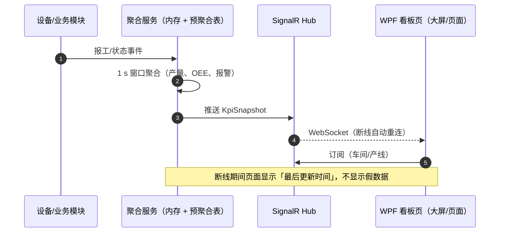

| 项 | 规则 |
|---|---|
| 推送频率 | 看板 1 s，管理页 5 s，报警即时 |
| 数据来源 | 内存聚合 + 预聚合表（小时/日） |
| 断线 | 指数退避重连；超过 30 s 显示「数据已过期」 |
| 多屏 | 每屏一个客户端实例独立订阅，按车间过滤 |
| 曲线性能 | 高频曲线用 `LIVEData` 降采样 + `StreamGeometry` 批量绘制；超过 10 万点切换 ScottPlot（DataLogger 控件） |
| 回放 | 支持按时间回放当日曲线（读历史表） |

### 8.6 指标口径中心

| 指标 | 公式 | 口径要点 |
|---|---|---|
| OEE | 可用率 × 性能 × 质量 | 计划时间要扣计划停机；换型计入停机 |
| 可用率 | 实际运行时间 / 计划时间 | 停机原因必须分类 |
| 性能 | 实际产量 / 理论产量 | 理论节拍按标准工时 |
| 质量 | 合格数 / 总产出 | 返工是否计入要看客户口径 |
| FPY | 一次合格数 / 投入数 | 不含返工后合格 |
| OTD | 按期交付订单 / 总订单 | 以承诺日期为准，非计划日期 |
| 报废率 | 报废数 / 产出 | 含试制？单独口径 |

**示例（沿用 12 的算例）**：计划 480 min，停机 48 min → 可用率 0.90；理论 864 件，实际 821 件 → 性能 0.95；合格 804 件 → 质量 0.98；OEE = 0.90 × 0.95 × 0.98 = **83.8%**。

**口径管理规则**：

1. 每个指标有唯一编码、公式、单位、生效日期、负责人。
2. 口径变更必须新建版本，不覆盖历史；报表按「发生日期」取当时口径。
3. 页面显示指标时带「口径版本」悬浮说明，避免三方报表打架。

### 8.7 订阅与定时报表

| 项 | 做法 |
|---|---|
| 调度 | Quartz，Cron 存 `job_schedule` |
| 订阅 | 用户订阅报表 + 频率 + 收件方式（邮件/企业微信） |
| 执行 | 生成文件 → MinIO → 发送链接（不直接发大附件） |
| 失败 | 重试 3 次，仍失败通知管理员，不静默 |
| 补跑 | 支持「补昨天」，按业务日期重跑 |

### 8.8 性能与缓存

| 手段 | 参数 | 效果 |
|---|---|---|
| 结果缓存 | 30 s（看板类）/ 不缓存（明细类） | 降低重复查询 |
| 预聚合 | 每小时/每日跑一次 | 报表从分钟级降到秒级 |
| 索引 | 时间 + 设备 + 工单组合索引 | 避免全表扫 |
| 只读副本 | 二期 | 报表不影响采集写入 |
| 查询限流 | 并发 3/用户，全局 50 | 防止拖库 |

> **自检 3 问**
> 1. 为什么报表模板必须包含 `/*SCOPE*/` 占位符？没有会怎样？
> 2. 大报表为什么要转异步，而不是把超时调大？
> 3. 两个车间报同一个 OEE 差 3 个点，你先查什么？

---

## 9. 认证、授权与审计

**结论：工控系统的权限不是「能不能登录」，而是「能不能让某个车间的人，在某个班次，对某台设备，执行某个写动作，并且留下可查证的记录」。**

### 9.1 登录方式

| 方式 | 一期 | 说明 | 适用 |
|---|---|---|---|
| 账号 + 密码 | 是 | PBKDF2/Argon2 哈希，禁止明文与 MD5 | 所有现场 |
| 域账号（LDAP/AD） | 插件 | 只验证，不存密码；同步工号与姓名 | 有域环境 |
| OIDC / 企业微信 | 插件 | 授权码模式，映射到本地用户 | 集团统一认证 |
| 工卡/扫码 | 二期 | 工牌扫码快速登录工位 | 车间工位机 |
| 设备证书 | 二期 | 边缘 Agent 双向 TLS | 边缘接入 |

**登录流程**：

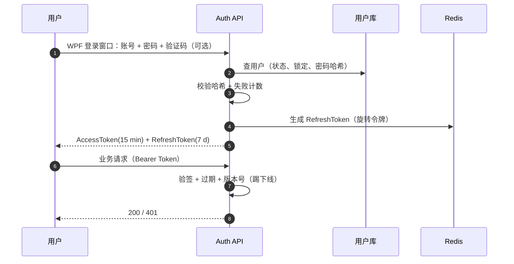

### 9.2 JWT 设计

| 项 | 值 | 说明 |
|---|---|---|
| Access Token | 15 min | 无状态，携带 userId、roles、scopeVersion |
| Refresh Token | 7 d，旋转 | 存 Redis，使用一次即失效，检测重放 |
| 签名 | HS256（单厂）/ RS256（多系统） | 密钥 ≥ 32 字节，定期轮换 |
| 载荷 | `sub`、`name`、`roles`、`scopeVersion`、`jti` | 不放大权限列表，避免 Token 过大 |
| 踢下线 | 用户 `tokenVersion` 变更 | 修改密码/禁用/管理员强制下线时 +1 |
| 存储 | 客户端进程内存（`ProtectedData` 可选加密落盘 RefreshToken） | 不写文件明文、不进配置、不用 localStorage |
| 刷新 | 401 + `token_expired` → 客户端 DelegatingHandler 静默刷新一次并重放请求 | 刷新失败回登录窗口 |

### 9.3 RBAC + 数据权限

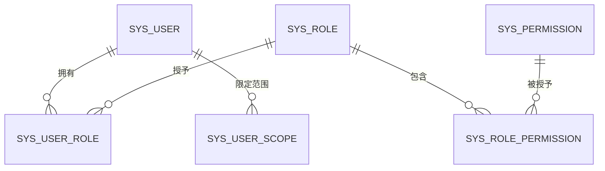

| 模型 | 回答什么 | 例子 |
|---|---|---|
| 功能权限 | 能不能看到/点这个功能 | `device:write`、`report:design` |
| 数据权限 | 能看到哪些范围的数据 | 只看 2 号车间 |
| 字段权限 | 能不能看到敏感字段 | 成本、供应商价格脱敏 |
| 操作权限 | 能不能执行高风险动作 | 设备写、参数下发、插件安装 |

**数据范围四级**：

| 级别 | 含义 | SQL 注入方式 |
|---|---|---|
| 全部 | 集团/全厂 | 不加范围谓词 |
| 工厂 | 指定工厂 | `plant_id IN (...)` |
| 车间 | 指定车间 | `workshop_id IN (...)` |
| 本人 | 只看自己产生的数据 | `created_by = @userId` |

```csharp
// Platform.Abstractions/Security/ICurrentUser.cs
public interface ICurrentUser
{
    long UserId { get; }
    string UserName { get; }
    IReadOnlySet<string> Permissions { get; }
    DataScope Scope { get; }
    IReadOnlyList<long> ScopeIds { get; }   // 由服务端计算，客户端不可传
    string TraceId { get; }
}
```

### 9.4 权限码规范

格式：`域:对象:动作`，全小写，动词用 `read/write/execute/manage/export/approve`。

| 权限码 | 含义 | 默认角色 |
|---|---|---|
| `device:read` | 查看设备与实时值 | 操作工、设备、主管 |
| `device:write` | 写设备点位 | 设备工程师（需复核） |
| `device:command` | 下发高危指令（启停/复位/换刀） | 主管 + 双人复核 |
| `device:config` | 改设备/点位配置 | 设备工程师 |
| `mes:order:pull` | 手动拉取工单 | 计划员 |
| `mes:report:push` | 手动补推报工 | 接口运维 |
| `report:view` | 查看报表 | 全体 |
| `report:design` | 设计并发布报表 | 报表管理员 |
| `report:export` | 导出数据 | 主管及以上（可配脱敏） |
| `sys:user:manage` | 用户与角色管理 | 系统管理员 |
| `plugin:install` | 安装/启用插件 | 系统管理员 + 复核 |
| `audit:view` | 查看审计 | 审计员（只读） |
| `audit:export` | 导出审计 | 审计员 + 审批 |

**命名禁止**：`admin`、`super`、`*` 这种万能权限；不允许客户端隐藏代替后端校验。

### 9.5 接口鉴权

```csharp
[AttributeUsage(AttributeTargets.Class | AttributeTargets.Method)]
public sealed class RequirePermissionAttribute(string code) : Attribute
{
    public string Code { get; } = code;
}

// 控制器
[HttpPost("commands")]
[RequirePermission("device:command")]
public Task<CommandDto> SendCommand([FromBody] SendCommandRequest req) => _svc.SendAsync(req);
```

| 层 | 校验 | 失败返回 |
|---|---|---|
| 网关/Nginx（如有反向代理） | IP 白名单、请求大小 | 403 |
| 认证中间件 | Token 有效、用户启用、tokenVersion | 401 |
| 授权中间件 | 权限码 + 数据范围 | 403 + 审计 |
| 业务层 | 状态机、互锁、幂等 | 409 / 422 |
| 数据层 | 唯一索引、外键 | 回滚 |

**注意**：客户端按钮隐藏只是体验，**后端必须再校验**；两者用同一权限码，避免「界面看不到、接口能调」。

### 9.6 双人复核（四眼原则）

| 动作 | 是否需要复核 | 复核方式 |
|---|---|---|
| 写设备点位（普通） | 否 | 权限 + 审计 |
| 高危指令（启停/复位/换刀） | 是 | 第二人输入工号 + 密码/扫码 |
| 修改点位地址/量程 | 是 | 提交 + 审批 |
| 安装/启用插件 | 是 | 管理员 + 复核人 |
| 修改审计保留期 | 是 | 管理员 + 审计员 |
| 数据修正（报工/库存） | 是 | 主管审批 + 原因码 |

**复核记录**：两条审计（申请人、复核人），关联同一 `requestId`；复核超时（默认 10 min）自动失效。

### 9.7 审计日志（不可篡改的哈希链）

```csharp
// Modules/Audit/AuditWriter.cs（节选）
public async Task WriteAsync(AuditEvent e, CancellationToken ct)
{
    // 串行写入（单写者通道），避免并发导致链断裂
    await _writeLock.WaitAsync(ct);
    try
    {
        var prev = await _db.AuditLogs
            .OrderByDescending(x => x.Id)
            .Select(x => x.SelfHash)
            .FirstOrDefaultAsync(ct) ?? "GENESIS";

        var canonical = JsonSerializer.Serialize(new
        {
            e.TraceId, e.ActorId, e.Action, e.Resource, e.Result,
            e.Before, e.After,
            OccurredAt = e.OccurredAt.ToUniversalTime().ToString("yyyy-MM-ddTHH:mm:ss.fffZ")
        });

        var self = Convert.ToHexString(
            SHA256.HashData(Encoding.UTF8.GetBytes(prev + canonical)));

        _db.AuditLogs.Add(new AuditLog
        {
            TraceId = e.TraceId, ActorId = e.ActorId, ActorName = e.ActorName,
            Action = e.Action, Resource = e.Resource, Result = e.Result,
            BeforeData = e.Before, AfterData = e.After, ClientIp = e.ClientIp,
            OccurredAt = e.OccurredAt, PrevHash = prev, SelfHash = self
        });
        await _db.SaveChangesAsync(ct);
    }
    finally
    {
        _writeLock.Release();
    }
}
```

**校验任务（每日 03:00）**：从最近一条向前逐条重算，发现断链立即告警并锁定导出功能。

> **两个容易踩的坑**：
> 1. **时间精度**：`timestamptz` 是微秒精度，而 `DateTimeOffset.ToString("O")` 带 7 位小数，落库会截断，校验时重算必然不一致。参与哈希的时间统一截断到毫秒（上例 `fff`），且落库字段与参与哈希的字符串来源一致。
> 2. **多实例**：进程内 `SemaphoreSlim` 只能保证单进程串行。API 多实例部署时，写入前取 PostgreSQL 会话级 advisory lock（`pg_advisory_xact_lock(hashtext('audit_chain'))`），或收敛为单一审计写入服务，否则两个实例会各取同一个 `prev`，直接分叉。

**必须审计的事件**：

| 类别 | 事件 |
|---|---|
| 认证 | 登录成功/失败、锁定、改密、强制下线 |
| 权限 | 用户/角色/权限变更、数据范围变更 |
| 设备 | 写点位、高危指令、配置变更、复位 |
| 插件 | 安装、启用、停用、卸载、升级 |
| 数据 | 报工修正、库存调整、工单作废、追溯补录 |
| 报表 | 导出、发布、口径变更 |
| 系统 | 配置变更、审计保留期变更、备份恢复 |

### 9.8 安全加固清单

| 项 | 要求 |
|---|---|
| 密码 | ≥ 8 位，含三类字符；90 天更换（可配）；5 次失败锁 15 min |
| 传输 | 全站 HTTPS；工控网内也建议启用 |
| 会话 | 空闲 30 min 超时；同一账号单点登录（可配） |
| 上传 | 白名单扩展名、大小限制、病毒扫描（可选）、存储不放 Web 根目录 |
| 接口 | 关闭 Swagger（生产）或加鉴权；限制请求体 10 MB |
| 依赖 | 每月扫描已知漏洞（`dotnet list package --vulnerable`） |
| 数据库 | 应用账号最小权限；报表只读账号；禁止 `superuser` |
| 网络 | 按 IEC 62443 分区：L0~L2 控制区、L3 执行区、L4 办公区，区间防火墙 |
| 日志 | 不记录密码、Token、完整身份证号；敏感字段脱敏 |
| 备份 | 备份文件加密，异地保存，恢复需双人 |

> **自检 3 问**
> 1. 为什么「客户端隐藏按钮」不能算权限控制？
> 2. 审计哈希链能防什么、不能防什么？（提示：能防改单条，不能防整链重算）
> 3. 双人复核在什么场景下可以降级为单人？降级要满足什么条件？

---

## 10. 日志与可观测性

**结论：四类日志各自解决不同问题，混在一个文件里，出事时谁也查不清；TraceId 是把它们串起来的唯一线索。**

### 10.1 四类日志的边界

| 类别 | 回答什么问题 | 级别 | 保留 | 去向 | 谁看 |
|---|---|---|---|---|---|
| 业务审计 | 谁在何时改了什么 | INFO（不可关） | 3 年（可配） | `audit_log` + 只读库 | 审计、主管 |
| 系统运行 | 服务是否正常、哪里报错 | DEBUG~ERROR | 90 天 | Serilog 文件 + Seq | 开发、运维 |
| 设备通信 | 这一帧发了什么、回了什么 | TRACE/DEBUG（采样） | 30 天 | 文件 + 按设备分目录 | 设备工程师 |
| 接口调用 | MES 请求/响应、耗时、重试 | INFO/WARN | 180 天 | `mes_outbox` + 日志 | 接口运维 |

**禁止**：把设备原始帧写进业务库；把密码/Token 写进任何日志；正常帧每秒刷屏。

### 10.2 结构化字段规范

| 字段 | 必填 | 示例 | 用途 |
|---|---|---|---|
| `ts` | 是 | `2026-11-02T06:12:33.123Z` | 排序 |
| `level` | 是 | `Information` | 过滤 |
| `svc` | 是 | `platform-api` | 服务 |
| `module` | 是 | `device` / `mes` / `report` | 模块 |
| `traceId` | 是 | `4f2a9c1e8b7d4a63` | 全链路 |
| `userId` | 否 | `1027` | 追责 |
| `deviceId` | 否 | `12` | 设备排障 |
| `taskId` | 否 | `WO-261102-001` | 业务关联 |
| `code` | 否 | `DEV_TIMEOUT` | 机器可读错误码 |
| `msg` | 是 | `读取超时` | 人读 |
| `ctx` | 否 | `{"addr":"40001","elapsedMs":812}` | 结构化上下文 |

**日志模板（Serilog）**：

```csharp
log.LogInformation("设备读取完成 {DeviceId} 点数 {Count} 耗时 {ElapsedMs}ms Trace {TraceId}",
    deviceId, result.Values.Count, sw.ElapsedMilliseconds, traceId);
```

### 10.3 TraceId 贯穿

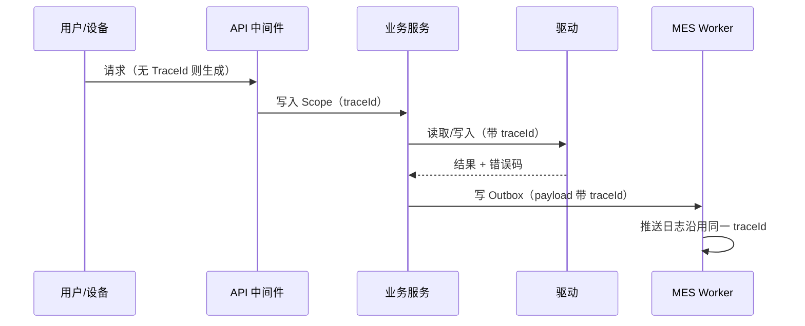

**规则**：

- 入口生成（`X-Trace-Id` 优先，否则 ULID），响应头回传。
- 异步任务、消息、定时任务必须携带 traceId，不能断链。
- 设备侧无 traceId 时，用 `deviceId + commandNo` 关联。

### 10.4 落盘、采集与脱敏

| 项 | 做法 |
|---|---|
| 滚动 | 按天滚动，单文件不设上限，保留 90 个文件（约 90 天） |
| 采集 | Serilog → 文件（生产主路径）；Seq/ELK 为开发/大规模可选 |
| 采样 | 正常通信帧 1%，错误帧 100%，指令帧 100% |
| 脱敏 | 手机号、身份证、密码、Token、连接串密码 |
| 级别 | 生产默认 INFO；排障临时开 DEBUG（自动 30 min 回落） |
| 容量 | 200 设备场景约 3~8 GB/天（含通信日志）；按 90 天全量保留需 270~720 GB。单机 500 GB 时按 10.1 分级保留（通信 30 天、运行 90 天），或外挂日志盘 |

### 10.5 指标与告警

| 指标 | 含义 | 告警阈值 | 级别 |
|---|---|---|---|
| `device_online_ratio` | 在线设备占比 | < 90% 持续 5 min | 严重 |
| `poll_cycle_p99` | 采集周期 P99 | > 设定 1.5 倍 | 警告 |
| `poll_error_rate` | 采集失败率 | > 5% 持续 10 min | 警告 |
| `cmd_timeout_total` | 指令超时数 | > 3/小时 | 严重 |
| `mes_outbox_pending` | 待发消息数 | > 1,000 或 oldest > 10 min | 严重 |
| `mes_dead_total` | 死信数 | > 0 | 严重 |
| `api_p95_ms` | 接口 P95 | > 500 ms | 警告 |
| `api_5xx_rate` | 5xx 比例 | > 1% | 严重 |
| `db_conn_used` | 连接池使用率 | > 85% | 警告 |
| `db_slow_query` | 慢查询 | > 3 s | 警告 |
| `plugin_fault` | 插件故障 | ≥ 1 | 严重 |
| `audit_chain_broken` | 审计断链 | ≥ 1 | 紧急 |
| `disk_free` | 磁盘剩余 | < 20% | 警告 |

**告警通道**：企业微信/钉钉机器人 + 邮件；分级：提示（群）、警告（值班）、严重（电话）。

### 10.6 健康检查

| 检查项 | 端点 | 说明 |
|---|---|---|
| Liveness | `/health/live` | 进程存活即可，不查依赖 |
| Readiness | `/health/ready` | DB、Redis、关键插件、迁移完成 |
| 详细 | `/health/detail`（需权限） | 设备在线数、Outbox 积压、插件状态 |
| 设备 | `/health/devices` | 按车间聚合在线率 |

**就绪判定**：DB 可写 + 迁移完成 + 核心插件 Running + 审计可写；任一不满足 → 503，负载均衡不转发。

### 10.7 排障剧本（七个高频）

| 现象 | 先查 | 再查 | 常见根因 |
|---|---|---|---|
| 设备全部离线 | 通道配置、网线/串口 | 驱动日志、抓包 | IP 改过、串口被占用、网关不通 |
| 单台设备时好时坏 | 采集周期、错误率 | 线路干扰、从站数 | 485 终端电阻、地址冲突 |
| 数据不刷新但显示正常 | 快照时间戳、质量码 | 调度是否卡死 | 采集循环异常、写优先饿死 |
| 报工推送失败 | Outbox 状态、错误码 | 对方接口、鉴权 | Token 过期、字段必填缺失 |
| 报表超时 | 执行计划、扫描行数 | 索引、范围条件 | 缺索引、全表扫、未加时间条件 |
| 登录失败 | 账号状态、锁定 | Token 版本、时钟 | 密码错、账号禁用、服务器时间漂移 |
| 插件加载失败 | manifest、API 版本 | 依赖、签名 | 版本不兼容、缺依赖、哈希不符 |

### 10.8 日志量估算（200 设备场景）

| 来源 | 估算 | 说明 |
|---|---|---|
| 采集正常日志 | 8,000 点 × 1 次/周期，按设备汇总 1 行 | 200 行/s → 约 1,728 万行/天 |
| 错误/重连 | 约 5% 设备产生异常 | 数百行/天 |
| 接口调用 | 500 次/天 | 含重试 |
| 审计 | 2,000 条/天 | 写操作 |
| 通信帧（采样 1%） | 约 17.3 万帧/天 | 200 台 × 1 Hz × 86,400 s × 1%；仅排障用 |
| 合计 | 约 3~8 GB/天 | 按 200 B/行估算 |

> **自检 3 问**
> 1. 为什么审计日志不能和普通运行日志放同一个表/文件？
> 2. TraceId 在异步 Outbox 里怎么保证不断链？
> 3. 「设备全部离线」和「单台时好时坏」的排查顺序有什么不同？

---

## 11. 二次开发手册（脚手架使用）

**结论：二次开发的目标是「新人只改插件/模块，不改核心」；凡是需要改核心才能完成的需求，都应该先补扩展点，而不是直接改。**

### 11.1 环境准备

| 项 | 要求 |
|---|---|
| SDK | .NET SDK 8.0（`dotnet --list-sdks` 确认） |
| 数据库 | PostgreSQL 17（本地 Docker 仅用于开发，可选） |
| 模板 | `dotnet new install Platform.Templates` |
| CLI | `dotnet tool install -g Platform.Cli` |
| 客户端开发 | Windows 10/11 + VS 2022（含 .NET 桌面开发负载）；WPF 无需 Node 工具链 |
| 调试 | VS 2022 / Rider；Docker Desktop（可选） |

```bash
# 初始化一个可运行的最小平台
platform-cli new factory --name "苏州某厂平台"
cd factory
docker compose -f deploy/docker-compose.dev.yml up -d
dotnet run --project src/Platform.Host
# 另开一个终端启动 WPF 客户端，服务器地址 http://localhost:8080
# 默认管理员在首次启动日志里（强制改密）
dotnet run --project src/Platform.Client
```

### 11.2 新增业务模块：12 步

> 动手前先过 11.2.1 落位判定：确认这个需求真的需要一个模块（档 ⑤），而不是配置、开关、报表或插件就能解决。

以「安灯（Andon）」模块为例。

| # | 动作 | 命令 / 文件 | 验收 |
|---|---|---|---|
| 1 | 生成骨架 | `dotnet new platform-module -n Andon -o src/Modules/Andon` | 目录含 Module、Entity、Endpoint、Tests |
| 2 | 声明模块 | `AndonModule.cs` 实现 `IPlatformModule` | 启动日志出现模块加载 |
| 3 | 建实体 | `Entities/AndonCall.cs` | 字段含审计四件套 |
| 4 | 写迁移 | `migrations/001_init.sql` | 启动自动执行，表存在 |
| 5 | 写服务 | `AndonService.cs`（业务规则） | 单测覆盖状态流转 |
| 6 | 写接口 | `AndonEndpoint.cs`（`/api/v1/andon`） | OpenAPI 可见 |
| 7 | 声明权限 | `permissions.json`：`andon:read`、`andon:handle` | 权限表出现 |
| 8 | 加菜单 | `menu.json` | 客户端出现导航项 |
| 9 | 订阅事件 | `WorkOrderReleased` → 生成叫料任务 | 事件触发成功 |
| 10 | 写测试 | 单测 + 集成测试（Testcontainers） | `dotnet test` 全绿 |
| 11 | 打包 | `dotnet platform-cli pack --project src/Modules/Andon` | 生成 `.pkg` |
| 12 | 安装启用 | 平台「插件管理」上传 → 启用 → 授权 | 菜单可用，审计有记录 |

**模块骨架（自动生成，节选）**：

```csharp
public sealed class AndonModule : IPlatformModule
{
    public string Id => "module.andon";
    public string Name => "安灯管理";

    public void Configure(IModuleContext ctx, IServiceCollection services)
    {
        services.AddScoped<AndonService>();
        services.AddScoped<AndonRepository>();
        ctx.AddPermission("andon:read", "查看安灯");
        ctx.AddPermission("andon:handle", "处理安灯");
        ctx.AddMenu("生产管理/安灯", "/andon", "andon:read");
    }

    public void MapEndpoints(IEndpointRouteBuilder api)
    {
        api.MapAndonEndpoints();     // 控制器/最小 API
    }
}
```

#### 11.2.1 定制需求落位：先判档，再动手

**结论：十个定制需求里只有一个真需要写模块。先按这张表判档，判到「配置」就不要写代码——这是平台不烂成「一客户一分支」的唯一防线（对应 1.6 硬规则 1、11.11.8「定制分支禁止改内核」）。**

| 档 | 需求形态 | 落位 | 交付物 | 升级影响 |
|---|---|---|---|---|
| ① 改参数 | 阈值、周期、地址、映射、菜单名 | 配置中心（3.3）/ 插件 `config.schema.json` | 一条配置变更记录 + 审计 | 无 |
| ② 开关裁剪 | 客户不要某功能 | `feature_flag`（3.7） | 一次 Planner 变更（3.7.4） | 无 |
| ③ 新报表/看板 | 新指标、新维度 | 报表定义 + 安全 SQL（8.1~8.3）；拖拽设计器属 P2（8.4、13.1） | `report_def` 记录 | 无 |
| ④ 新设备/新上游 | 新协议、新 MES/ERP、新相机 | 插件（5.12 / 6.13 / 5.13） | `.pkg` | 只装到需要的现场 |
| ⑤ 新业务 | 新单据、新状态机、新界面 | 业务模块（11.2 十二步） | `IPlatformModule` 插件包 | 独立版本，可单独回滚 |

**判档六问**（按顺序问，问到「是」就停）：

1. 只是数值/地址/文案变了吗？→ ①
2. 平台已有这能力，只是本现场不用？→ ②
3. 需求本质是「换个角度看已有数据」？→ ③（先确认 `report_allowed_table` 有视图，再谈开发）
4. 差异只在通信协议或上游报文格式？→ ④
5. 需要新表、新权限码、新状态流转？→ ⑤
6. 以上都不成立（要改采集调度、改插件加载、改审计链）→ **走 11.11.8**：先提 PR 进平台主干，随版本发布；禁止客户分支私改内核。

**四条反模式（评审直接打回）**：

| 反模式 | 为什么禁 | 正解 |
|---|---|---|
| 为一家客户拉平台分支 | 内核从此分叉，平台升级形同虚设 | 差异全部下沉到 ①~⑤，用 `features.yaml` + 插件表达 |
| 在控制器/平台服务里写客户业务 `if (客户 == "XX")` | 业务规则进内核，违反 1.6 硬规则 1 | 写成模块插件，用事件订阅（11.6 `IEventSubscriber`）挂进去 |
| 客户定制直接改 `Platform.Data` 建表 | 绕开迁移体系，升级即冲突 | 模块自带 `migrations/`，表随模块走（11.2 第 4 步） |
| 定制页复制主窗口 XAML 自己搭 | 权限、审计、开关三处失控 | 实现 `IPluginUiProvider`（4.9），复用平台壳与 `IFeatureGate` |

**三个样板模块**（刀具寿命、污水加药、立体仓库 WCS）分别验证扩展点是否够用：08 = 设备数据 + 阈值规则 + 报表；09 = 采集 + 闭环写入（走 5.6 四道闸）+ 配方；10 = 跨设备编排 + 任务状态机 + AGV 驱动。**新模块先对号：若三个样板都装不下你的需求，先怀疑落位判错了。**

### 11.3 新增设备驱动：8 步

> 发布流程看本节，代码级决策（注册与发现、常见教学同步接口 → 平台异步契约的迁移表、三条扩展路线）看 5.12；运动卡/相机等 SDK 类驱动另看 5.11.4 ①② 的封装要点；视觉算法引擎（Halcon/VP/VM/OpenCV）不在此列，走 5.13。

| # | 动作 | 要点 |
|---|---|---|
| 1 | 生成 | `dotnet new platform-driver -n Driver.MyPlc` |
| 2 | 实现 | `Connect/Read/Write/Subscribe` 四个方法 |
| 3 | 解析地址 | 覆盖 Bool/Int/Float，单测四种字节序 |
| 4 | 错误映射 | 协议异常码 → 平台错误码（超时/拒绝/非法地址） |
| 5 | 模拟器 | `Simulator/` 支持正常/超时/异常/断线 |
| 6 | 清单 | `manifest.json`：`kind=Driver`、能力、权限；厂商 DLL 驱动补 `arch`（4.3） |
| 7 | 测试 | 100 帧回放 + 72 h 长稳（可缩短为 8 h 预演） |
| 8 | 打包发布 | `.pkg` → 测试环境 → 灰度一条产线；**拉起原生 SDK / 32 位的驱动**在 README 写明「换版本 = 排空 + 子进程重启」（4.8.1），并给出实测停机时长 |

### 11.4 新增 MES 适配器：8 步

> 发布流程看本节，代码级决策（`IMesAdapterProvider` 注册与路由、五类传输形态、SAP/用友/金蝶/鼎捷/自研画像、多上游共存）看 6.13。

| # | 动作 | 要点 |
|---|---|---|
| 1 | 生成 | `dotnet new platform-mes -n Mes.MyErp` |
| 2 | 鉴权 | Token/签名，缓存与刷新 |
| 3 | 拉单 | 实现 `PullWorkOrdersAsync`，水位 + 重叠窗口 |
| 4 | 推送 | `PushAsync` 支持 6 类报文，幂等 |
| 5 | 映射 | `mapping/*.json`，字段/类型/默认值 |
| 6 | 查询 | `QueryAsync` 供对账 |
| 7 | 契约测 | Mock Server 回放 7 个用例（6.10） |
| 8 | 灰度 | 影子 → 双跑 → 切产线 → 回滚开关 |

### 11.5 新增报表：6 步

| # | 动作 | 要点 |
|---|---|---|
| 1 | 建数据集 | 只暴露白名单视图，字段带含义 |
| 2 | 写模板 | `SELECT ... WHERE ... /*SCOPE*/`，只用参数 |
| 3 | 定义参数 | 类型、默认值、候选项来源 |
| 4 | 定义列 | 标题、格式、合计、脱敏 |
| 5 | 预览 | 取 100 行，检查范围过滤 |
| 6 | 发布 | 指定权限码，管理员审批 |

### 11.6 扩展点清单

| 扩展点 | 接口 | 典型场景 | 稳定性 |
|---|---|---|---|
| 业务模块 | `IPlatformModule` | 安灯、刀具、能源、看板 | 稳定 |
| 设备驱动 | `IDeviceDriver` | 新 PLC/仪表/协议（5.12） | 稳定 |
| 设备大类 | `ICameraDriver` / `IRobotDriver` / `IMotionDriver` / `IAgvDriver` | 相机、机器人、运动卡、AGV（5.11） | 稳定 |
| 视觉引擎 | `IVisionEngine` | Halcon / VisionPro / VM / OpenCV / AI 推理（5.13） | 稳定 |
| MES 适配 | `IMesAdapter` | 新 MES（6.13） | 稳定 |
| 北向业务系统 | `IBusinessSystemAdapter` / `IMasterDataAdapter` | ERP 过账、主数据同步（6.12） | 稳定 |
| 客户端页面 | `IPluginUiProvider` | 视觉复核页、组态设计器（4.9） | 较稳定 |
| 报表 | `IReportProvider` | 行业指标包 | 稳定 |
| 认证 | `IAuthProvider` | LDAP/OIDC | 较稳定 |
| 定时任务 | `IPluginJob` | 对账、清理、巡检 | 稳定 |
| 事件订阅 | `IEventSubscriber<T>` | 工单下达触发备料 | 稳定 |
| 数据导出 | `IDataExporter` | 自定义格式 | 一般 |
| 告警规则 | `IAlarmRule` | 复合条件报警 | 一般 |
| 通知渠道 | `INotificationChannel` | 短信、语音、看板 | 一般 |

**扩展点冻结原则**：`IPlatformModule`、`IDeviceDriver` 及其派生的四个大类接口、`IMesAdapter` / `IBusinessSystemAdapter`、`IVisionEngine` 在 2.0 前不做破坏性变更；新增能力用「新增可选方法 + 默认实现」或事件扩展。`IPluginUiProvider` 与 `IAuthProvider` 属「较稳定」，允许在 Minor 版本调整，插件需跟随适配（11.7）；`IDataExporter`、`IAlarmRule`、`INotificationChannel` 属「一般」，**不承诺兼容**。**这三档分别对应 11.7.1 的 S / T / X 稳定面，变更政策与废弃流程以 11.7.1 为准。**

### 11.7 版本兼容规则

| 变更 | 版本位 | 例子 | 插件影响 |
|---|---|---|---|
| 新增可选成员/事件 | Patch | 1.4.0 → 1.4.1 | 无需改 |
| 新增接口/端点/表 | Minor | 1.4 → 1.5 | 旧插件兼容 |
| 改签名/删接口/改语义 | Major | 1.5 → 2.0 | 插件需适配 |
| 数据库加列 | 向前兼容 | 先加可空列 | 无 |
| 数据库删列 | 两阶段 | 先停用，再删 | 需改插件 |

**插件声明**：`platformApi: ">=1.4 <2.0"`；平台升级到 2.0 时，不兼容插件自动 `Incompatible`，不影响其他插件。

#### 11.7.1 契约稳定面与废弃流程（对外承诺，不是内部约定）

**结论：11.7 那张表规定了「什么算破坏性变更」，但没规定「破坏性变更怎么落地」。P0 阶段插件都是你自己写的，改契约无所谓；一旦客户或第三方按 11.2.1 的第 ④ 档写了插件，废弃流程就是你的商业信誉——「升级平台就把客户的插件打死」是二开生态的头号杀手。**

**三档稳定面（与 11.6 的「稳定性」列一一对应：稳定 → S，较稳定 → T，一般 → X）**

| 档 | 覆盖接口 | 变更政策 | 谁可以改 |
|---|---|---|---|
| **S 稳定面（Stable）** | `IPlatformPlugin`（4.2）、`IPlatformModule`、`IDeviceDriver` 及 `ICameraDriver`/`IRobotDriver`/`IMotionDriver`/`IAgvDriver`、`IVisionEngine`、`IMesAdapter`、`IBusinessSystemAdapter` / `IMasterDataAdapter`、`IReportProvider`、`IPluginJob`、`IEventSubscriber<T>` | **2.0 之前冻结**：只允许「新增可选成员 + 默认实现」；签名、语义、调用时序、线程假设一律不动。破坏性变更只能在 Major 版本，且走下面的五步流程 | 架构评审 + 契约评审双签，需列出现存插件清单与影响面 |
| **T 试验面（Tech-preview）** | `IPluginUiProvider`、`IAuthProvider` | Minor 版本可调，**每次调整必须在 release notes 单列「插件适配指引」**（改了什么、怎么改、给一段 before/after 代码） | 平台组，评审备案 |
| **X 内部面（Internal）** | `IDataExporter`、`IAlarmRule`、`INotificationChannel`，以及 `Platform.*` 全部实现类与内部服务 | **不承诺任何兼容**；外部插件引用即视为违规（4.2 编译期检查已挡，`platform-cli doctor` 复查） | 随意 |

> **命名即承诺**：S/T 档接口放 `Platform.Abstractions.*`，X 档实现类放 `Platform.*`（非 Abstractions），插件工程只被允许引用前者（4.2 编译期检查）。确实要保留给外部实现的 X 档接口（如 `IDataExporter`），放在 `Platform.Abstractions.Experimental` 命名空间并在类型注释首行写「不承诺兼容」——**用命名空间把「随便改」这件事告诉使用者，而不是等他被改坏。**

**废弃五步（Deprecation ladder）**

```text
1. 标记    [Obsolete("将在 2.0 移除，改用 XxxNew")] + manifest 记 deprecated_api_usage
          → 插件编译出警告，CI 夜间全量（11.11.7）汇总「谁还在用」
2. 公告    release notes 列「本版本废弃项」+ 兼容矩阵更新 + 通知所有已登记插件作者
3. 共存    旧新接口同时可用 ≥ 2 个 Minor 版本；旧实现内部转调新实现，不复制逻辑
4. 移除    只在 Major（1.x → 2.0）移除；移除前 platform-cli doctor 输出「你的插件将不兼容」清单
5. 兜底    平台升级向导（platform-cli upgrade --check）先做只读比对，
          把不兼容插件列成「将 Blocked」清单让现场确认后再升，绝不静默失效
```

**兼容矩阵（随每次发版更新，交付时给客户看这张表而不是听你说）**

| 平台 API | 支持插件声明范围 | 已废弃未移除 | 移除于 |
|---|---|---|---|
| 1.4 | `>=1.0 <2.0` | — | — |
| 1.5 | `>=1.2 <2.0` | `ICameraDriver.Grab()` 同步重载（改 `GrabAsync`，5.11.2） | 2.0 |
| 1.6 | `>=1.3 <2.0` | 同上 | 2.0 |
| 2.0 | `>=1.5 <3.0` | — | — |

**插件侧的对称义务**：插件也必须声明自己的 `apiVersion` 与 `platformApi` 范围（4.3），并在 README 写「本插件最后验证过的平台版本」（附录 B 第 14 项的同类要求）。**只声明下限不声明上限，等于让平台替你承担兼容风险。**

> **三条判据**
> 1. 这个接口有没有外部实现者？没有 → 别急着承诺稳定；有 → 现在就归 S 档并冻结。
> 2. 废弃公告发出去到实际移除，中间隔了几个版本？少于「2 个 Minor + 1 个 Major」就是没给人生路。
> 3. 客户升级平台时，谁先知道插件会失效——他本人还是现场操作工？答案是后者，就说明 `upgrade --check` 的清单没做到位。

### 11.8 插件升级与回滚

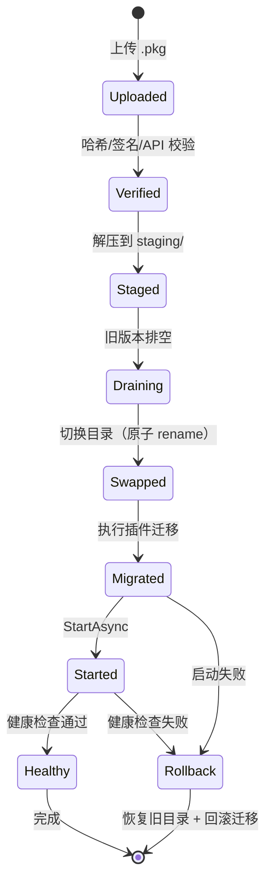

**回滚规则**：

1. 旧版本目录保留到新版本稳定运行 7 天。
2. 迁移必须提供 `down.sql`；不能回滚的迁移要提前声明。
3. 回滚后必须重新对账（设备指令、Outbox）。

### 11.9 十二条禁止事项

1. 插件直接引用 `Platform.Data` 或其他模块实现。
2. 在控制器里写业务规则、直接拼 SQL。
3. 用 `Thread.Sleep` 做调度、用 `Task.Run` 无限开线程。
4. 写设备不落库、不校验权限、不回读。
5. MES 推送不带幂等键、失败后无限重试。
6. 报表模板接受用户拼接 SQL / 执行任意脚本。
7. 日志打印密码、Token、完整身份证号。
8. 插件启动时同步阻塞等待网络（会拖慢整机启动）。
9. 修改历史迁移脚本（已执行的迁移不可改，只能新增）。
10. 绕过审计直接改生产数据。
11. 在进程内插件里热替换原生 DLL，或把「`Unload` 没抛异常」当成卸载成功（4.8.1）。
12. 把**未签名的安装包**发到现场，或为赶交付「这版先不签」（12.11.1）；也不得把「插件包已做哈希校验」当成「安装包已代码签名」——两回事。

### 11.10 代码评审清单（24 条）

1. 新增接口有权限码？有数据范围？
2. 写操作有审计？有幂等键？
3. 设备写有「落库 → 执行 → 回读」？
4. 超时是否被误判为失败？
5. 异常是否被吞掉（空 catch）？
6. 后台任务是否响应 CancellationToken？
7. 是否有无界队列/无界缓存？
8. 数据库查询是否有索引与分页？
9. 是否有 N+1 查询？
10. 事务边界是否清楚（不跨 HTTP 调用）？
11. 插件是否只依赖 Abstractions？
12. 配置是否有默认值与校验？
13. 日志是否结构化、含 TraceId？
14. 敏感字段是否脱敏？
15. 迁移是否向前兼容、可回滚？
16. 单测是否覆盖失败路径？
17. 契约测试是否覆盖重复/超时/4xx/5xx？
18. 客户端是否只做展示校验，后端有强校验？
19. 新增菜单/按钮是否与权限码一致？
20. 是否更新了文档与 OpenAPI？
21. 插件若拉起原生 SDK / 32 位依赖：`arch` 是否声明、是否走 L2 子进程、README 是否写明「换版本 = 排空 + 子进程重启」（4.8.1）？
22. 插件页是否遵守 4.9.1 八条（页级异常捕获、订阅随页生命周期释放、私有资源键前缀、无全局隐式模板、控件许可随包）？
23. 本次改动是否触碰 S 档稳定面（11.7.1）？若触碰，是否走了废弃五步而不是直接改签名？
24. 新增/变更的依赖是否进过许可核查（无 GPL/AGPL 入分发链路）且已计入 SBOM（12.11.2）？构建产物是否全部签名（12.11.1）？

### 11.11 脚手架生成器（按 profile + features 裁剪）

**结论：脚手架不是「复制一份模板」，而是「按发行版与开关清单生成一个能编译、能跑、能升级的工程」；生成物用 `platform.lock.json` 锁版本，后续可合并升级。**

#### 11.11.1 命令

```bash
# 新建一个客户工程
platform-cli new factory \
  --name Acme.Suzhou \
  --profile standard \
  --edition standard \
  --features acq.core,device.registry,alarm.engine,data.history,report.fixed,security.rbac \
  --plugins driver.s7,driver.modbus.tcp,adapter.mes.sap \
  --db postgres \
  --out ./acme-platform

# 在已有工程上加/减能力
platform-cli feature add recipe.download --requires-recheck
platform-cli feature remove report.designer --dry-run

# 诊断环境与配置
platform-cli doctor            # .NET/端口/证书/磁盘/时钟
platform-cli doctor --fix      # 只修可自动修的项，逐条确认
```

| 参数 | 取值 | 作用 |
|---|---|---|
| `--profile` | minimal / standard / full | 目录与模块骨架的粒度 |
| `--edition` | basic / standard / pro | 决定 `edition_min` 与 License 校验 |
| `--features` | 逗号分隔的能力键 | 首次生成时的默认开关集 |
| `--plugins` | 插件 Id + 版本 | 写入 `plugins.lock`，不下载二进制 |
| `--trim` | runtime / build / hybrid | 裁剪模式，见 11.11.4 |
| `--db` | postgres / sqlserver | 影响迁移脚本与连接串模板 |

#### 11.11.2 生成物结构（示意）

```text
acme-platform/
├─ src/
│  ├─ Platform.Abstractions/        # 由平台版本决定，不手工改
│  ├─ Platform.Core/
│  ├─ Platform.Data/
│  ├─ Platform.Host/
│  ├─ Platform.Client/              # WPF 客户端（同一解决方案，无需前端工具链）
│  └─ Business/                    # ★ 业务代码只写这里
│     └─ Acme/Orders/
├─ plugins/                        # 只放 lock 里声明的插件
├─ config/
│  ├─ appsettings.json
│  ├─ features.yaml                # 生成时写入，运行时以此播种
│  └─ plugins.lock
├─ docs/
│  ├─ api/openapi.json
│  └─ ARCHITECTURE.md              # 生成时按 profile 裁剪章节
├─ tests/
│  ├─ Platform.Tests/
│  └─ ContractTests/
├─ deploy/
│  ├─ docker-compose.yml
│  └─ offline/
├─ platform.lock.json              # 平台版本 + 插件版本 + features 哈希
└─ README.md                       # 含本工程实际开启的能力清单
```

#### 11.11.3 features.yaml

```yaml
edition: standard
platformApi: "1.5.0"

features:
  acq.core: true
  device.registry: true
  device.points: true
  data.history: true                 # report.fixed / report.designer 的前置
  alarm.engine: true
  report.fixed: true
  report.designer: false
  northbound.mes: true
  northbound.erp: false
  security.rbac: true                # always_on，仅展示，不可关
  security.auditChain: true          # always_on，审计链不可关

plugins:
  - id: driver.s7
    version: 1.3.0
  - id: driver.modbus.tcp
    version: 1.3.0
  - id: adapter.mes.sap
    version: 1.0.2

build:
  trim: hybrid
  includeSampleData: false
  culture: zh-CN
```

> `features.yaml` 只是**播种值**：首次启动写入 `feature_flag` / `feature_scope`；之后以数据库为准。再次执行 `platform-cli feature` 只改 YAML 与迁移脚本，不直接改库。未列出的键不强制写全，按 `feature_flag.default_enabled` 与 `edition_min` 取默认值；`always_on` 键即使写 `false` 也按常开处理。

#### 11.11.4 三种裁剪模式

| 模式 | 做法 | 产物大小 | 能否绕过 | 适用 | 风险 |
|---|---|---|---|---|---|
| `runtime` | 代码全在，靠开关关闭 | 全量 | 能（改库/改配置即可开） | 同版本多客户、私有化统一包 | 低价版可能被「解锁」 |
| `build` | 生成时移除 csproj、页面、程序集、迁移 | 精简 20%~40% | 难（代码不存在） | 低价版、法规隔离、防破解 | 升级要重新生成，定制分支易漂移 |
| `hybrid`（推荐） | 基础能力用开关；高价值模块（设计器、AI、机器人）构建剔除 | 中等 | 高价值部分安全 | 多数商业发行版 | 需要维护「可裁剪边界」清单 |

**可裁剪边界清单**（只有这些允许 `build` 剔除）：`report.designer`、`ui.designer`、`device.simulator`、`vision.camera`、`robot.integration`、`motion.card`、`ha.pair`。其余能力必须在运行时开关，因为被其他模块引用。

**与升级的关系**：`runtime` 裁剪的工程升级只需导入新 License 并开开关（13.6.4）；`build` / `hybrid` 剔除过高价值模块的工程，升级到包含该模块的发行版必须重新生成或替换安装包，不能只换 License。这条要在低价版交付合同里写明。

#### 11.11.5 生成代码：FeatureCatalog

```csharp
// 生成到 Platform.Abstractions/Features/FeatureCatalog.g.cs
public static class FeatureCatalog
{
    public const string AcqCore        = "acq.core";
    public const string DeviceRegistry = "device.registry";
    public const string AlarmEngine    = "alarm.engine";
    public const string ReportFixed    = "report.fixed";
    // ... 只生成本工程实际包含的能力
}
```

| 用途 | 说明 |
|---|---|
| 编译期常量 | 避免字符串拼错；IDE 可跳转 |
| 菜单与路由 | 生成 `menu.g.json`，客户端按 key 过滤导航树，不手写 |
| 权限码 | 每个能力对应 `feature:{key}:use`，随 RBAC 种子写入 |
| 迁移种子 | 生成 `seed_features.sql`，与 `feature_flag` 定义一致 |
| CI 校验 | `platform-cli doctor --check-features` 比对代码常量、YAML、数据库三方一致 |

#### 11.11.6 其余命令

| 命令 | 作用 | 典型用途 |
|---|---|---|
| `platform-cli pack` | 打 `.pkg`（哈希 + 签名） | 插件发布 |
| `platform-cli edition show` | 显示当前发行版、已开能力、上限 | 交付前核对 |
| `platform-cli edition switch --to pro` | 升级发行版，生成变更脚本 | 客户加购 |
| `platform-cli upgrade` | 按 `platform.lock.json` 三方合并平台升级 | 平台从 1.0 → 1.1 |
| `platform-cli export --offline` | 导出镜像 + 依赖 + 校验清单 | 无网现场 |
| `platform-cli doctor` | 环境与配置体检 | 上线前、故障时 |

#### 11.11.7 CI 矩阵

| 维度 | 组合 | 目的 |
|---|---|---|
| 发行版 | basic / standard / pro | 编译、迁移、冒烟各跑一遍 |
| 裁剪模式 | runtime / build / hybrid | runtime 验开关；build 验剔除后可编译；hybrid 验边界清单 |
| 定制 | 3 个真实客户 features 集 | 防止「只测全量版」 |
| 数据库 | PostgreSQL 17 / SQL Server 2022（若支持） | 迁移脚本双向验证 |
| 插件 | 无插件 / 单插件 / 冲突插件 | 验证 Blocked 与 Degraded |
| 开关 | 全开 / 全关 / 依赖缺失 | 验证 403、降级、启动不崩 |

> 冒烟用例至少覆盖：登录 → 看板 → 采集 60 s → 报警确认 → 报表导出 → 关一个能力 → 验证接口 403 → 再开回来。
>
> **这张矩阵全跑一次是 3×3×3×2×3×3 量级的组合，别把它当 PR 门禁**——那样每次提交等几小时，团队会开始绕开 CI，测试基建反而成了负资产。分两档执行：
>
> | 档 | 触发 | 跑什么 | 时长目标 |
> |---|---|---|---|
> | **PR 门禁（必过）** | 每次提交 | standard 发行版 + runtime 裁剪 + PostgreSQL + 无插件/单插件 + 开关全开；单测 + 契约测试 + 冒烟 | ≤ 15 min |
> | **夜间全量** | 每日 | 上表全部组合 + `build`/`hybrid` 剔除可编译 + 3 个客户 features 集 + 冲突插件 Blocked 验证 + 12.9.2 第 1~6 项短版（30 min 压测） | ≤ 4 h，失败次日首封邮件 |
> | **发版前** | 每个版本 | 全量矩阵 + 72 h 长稳 + 12.9.2 全表 + 离线包在干净机器实装 | 排进发版窗口，不塞进 CI |
>
> **判据**：PR 门禁只放「与本次改动可能相关」的维度；发行版裁剪、剔除可编译这类「低频高价值」组合放夜间。合入前不需要证明 basic 版能编译，发布前必须证明。

#### 11.11.8 升级与漂移控制

- `platform.lock.json` 记录：平台版本、每个插件版本、`features` 的 SHA-256、生成时间。
- 业务代码只在 `src/Business/` 与 `plugins/` 下，平台升级不碰这两处；冲突文件列成清单，人工合并。
- `platform-cli upgrade --check` 先做只读比对，输出「将覆盖 / 将保留 / 需手工合并」三份清单。
- 定制分支禁止直接改 `src/Platform.*`；确需改，先提交到平台主干，再升级生成物，避免每个客户一份内核。

#### 11.11.9 质量门禁（覆盖率、分析器、契约测试范围）

**结论：11.11.7 规定「跑什么组合」，本节规定「跑到什么程度才算过」。没有数字门槛的测试基建只会给人虚假安全感——契约测试能证明「测过的路径对」，证明不了「没测的路径没错」，而现场事故全在没测的那一侧。**

| 门禁 | 门槛 | 卡在哪 | 不达标怎么办 |
|---|---|---|---|
| 单测行覆盖率 | **内核（插件运行时 / 开关 / WriteGuard / Outbox / 审计链）≥ 80%**；业务模块 ≥ 60%；生成物与 DTO 不计入 | PR 门禁：覆盖率**下降**即失败（不要求绝对值），夜间全量出报告 | 补测试，**不许调低阈值**；确属不可测分支（如硬件异常）用 `// coverage:reason` 单行标注并计入评审清单 |
| 分支覆盖（关键路径） | 5.6 四道闸、6.4 幂等、6.6 状态机、9.7 哈希链**逐分支覆盖** | 这四处的分支就是事故清单，缺一个分支的测试等于留一个已知 bug | 按 12.9.2 的故障注入场景补 |
| 变异测试（建议，不卡 PR） | 对上述四个核心模块跑 Stryker，变异存活率 ≤ 25% | 夜间全量 | 存活体即「写了但没真断言」的测试，直接补断言 |
| 分析器 | `TreatWarningsAsErrors=true`（仅 `src/Platform.*`）+ `AnalysisLevel=latest-all` + `Nullable=enable` | 编译期 | 新告警必须当次清掉，禁止 `#pragma warning disable` 无说明滥用 |
| 依赖安全扫描 | `dotnet list package --vulnerable --include-transitive` 无 High/Critical；每次发版生成 SBOM（12.11.2） | 夜间全量 + 发版前 | High 以上当天处理；不可升级的写豁免单并说明缓解措施 |
| 评审清单 | 11.10 的 24 条做成 PR 模板勾选项，缺勾不许合入 | 人工评审 | — |
| 契约测试范围 | 每个驱动插件覆盖 5.10 五种场景；每个 MES 适配器覆盖 6.10 六类报文 + 幂等重放 + 超时挂起 | PR 门禁（只跑改到的那个插件） | 无契约测试的插件不允许进私有仓库（4.11） |
| 长稳 | 72 h 无句柄/线程/RSS 增长（附录 B 第 10 项） | 发版前 | 先查 4.8.1 四类泄漏，别先怀疑 GC |

```xml
<!-- Directory.Build.props（全解决方案统一，别在每个 csproj 里各写一套） -->
<Project>
  <PropertyGroup>
    <Nullable>enable</Nullable>
    <AnalysisLevel>latest-all</AnalysisLevel>
    <LangVersion>latest</LangVersion>
  </PropertyGroup>
  <!-- 只对平台内核要求「告警即错误」；业务与插件代码可先警告，逐步收紧 -->
  <PropertyGroup Condition="$(MSBuildProjectFullPath.Contains('src/Platform'))">
    <TreatWarningsAsErrors>true</TreatWarningsAsErrors>
  </PropertyGroup>
</Project>
```

> **两条反模式**：① **为了凑覆盖率写无断言的测试**——跑得绿、什么都不证明，比没有测试更糟，因为它让阈值看起来「已达标」；② 把全局覆盖率设成 80% 却不区分内核与外围——内核缺一个分支的测试会出生产事故，外围 DTO 覆盖率再高也没有意义。**所以门槛按模块分档，且 PR 只卡「不许下降」。**

> **自检 4 问**
> 1. 一个需求需要改核心代码才能完成，你会先做什么？
> 2. 插件升级失败，回滚要几步？哪一步最容易漏？
> 3. 为什么「已执行的迁移脚本」不能再改？
> 4. 你的 CI 现在能不能在 PR 上回答「这次改动让内核覆盖率降了几个点」？不能，说明门禁还是装饰。

---

---

## 附录 A　术语表

| 缩写 | 全称 | 在本方案中的含义 |
|---|---|---|
| ALC | AssemblyLoadContext | .NET 程序集加载上下文，用于插件隔离；**只回收托管内存，不保证卸掉原生 DLL**（4.8.1） |
| Non-Safety-Claim | — | 平台声明不承担安全功能，互锁/软限位属生产可用性控制（1.3 第 7 条、12.10.1） |
| PLr | Performance Level required | 安全回路要求的性能等级（ISO 13849-1），由机械/电气集成方认证，非软件承担 |
| EDR | Endpoint Detection and Response | 终端杀毒/防护，现场最常见「静默杀掉子进程宿主」的来源（12.10.3 第 3 条） |
| BOM | Bill of Materials | 此处指最小单机硬件与软件配置清单（12.9） |
| Authenticode | — | Windows 代码签名格式；**与「插件包哈希校验」是两回事**，缺它会被 SmartScreen/EDR 拦（12.11.1） |
| OV / EV 证书 | Organization Validation / Extended Validation | 代码签名证书两档：EV 首日起即获 SmartScreen 信誉，OV 需累积（12.11.1） |
| RFC3161 时间戳 | — | 签名时嵌入权威时间，**证书过期后历史安装包仍然有效**；不带则过期当天集体失效 |
| SBOM | Software Bill of Materials | 软件物料清单（SPDX / CycloneDX），回答「这个包里有哪些依赖、什么版本、什么许可」（12.11.2） |
| SPDX / CycloneDX | — | 两种 SBOM 交换格式 |
| PITR | Point-In-Time Recovery | PostgreSQL 按 `recovery_target_time` 恢复到任意时刻；**本方案的真实 RPO 由它决定，不是每日全量**（7.7、12.4） |
| WAL | Write-Ahead Log | 预写日志；持续归档才可能 PITR，归档目录须在另一块盘 |
| SLA | Service Level Agreement | 服务等级协议：分级响应/恢复时限、时段、到场条件（12.13.1） |
| 割接 | Cutover | 从存量系统接管设备写权限与数据源的动作；**唯一硬约束是同一批 PLC 不能有两个写入者**（12.12.3） |
| 只读并行 | — | 割接前平台只采集不写入、与旧系统对照比对的阶段（12.12.3 阶段 A） |
| S / T / X 稳定面 | Stable / Tech-preview / Internal | 插件契约的三档变更承诺（11.7.1） |
| 废弃五步 | Deprecation ladder | 标记→公告→共存≥2 Minor→Major 移除→`upgrade --check` 兜底（11.7.1） |
| CVE | Common Vulnerabilities and Exposures | 公开漏洞编号；依赖高危 CVE 不受质保期限制（12.13.3） |
| GMP / 21 CFR Part 11 | Good Manufacturing Practice / FDA 电子记录与电子签名法规 | 受监管行业合规要求，**本方案一期不承诺其证据包**（1.3 第 9 条） |
| ADR | Architecture Decision Record | 架构决策记录 |
| RBAC | Role-Based Access Control | 基于角色的访问控制 |
| ABAC | Attribute-Based Access Control | 基于属性的访问控制（本方案用数据范围近似） |
| JWT | JSON Web Token | 无状态访问令牌 |
| OIDC | OpenID Connect | 基于 OAuth2 的身份认证协议 |
| LDAP | Lightweight Directory Access Protocol | 目录服务（AD 的基础协议） |
| Outbox | Transactional Outbox | 本地事务内写消息表，异步投递 |
| Inbox | Idempotent Inbox | 接收消息去重表 |
| DLQ | Dead Letter Queue | 死信队列 |
| SKIP LOCKED | — | PostgreSQL 跳过已锁行，支持多消费者 |
| SSE | Server-Sent Events | 服务端推送（单向） |
| SignalR | — | ASP.NET Core 实时通信框架 |
| OEE | Overall Equipment Effectiveness | 设备综合效率 |
| FPY | First Pass Yield | 一次合格率 |
| OTD | On-Time Delivery | 按期交付率 |
| B2MML | Business To Manufacturing Markup Language | ISA-95 的 XML 报文规范 |
| ISA-95 | IEC 62264 | 企业控制系统集成层级模型 |
| IEC 62443 | — | 工业自动化与控制系统网络安全标准 |
| P95 / P99 | — | 95%/99% 分位响应时间 |
| RPO / RTO | Recovery Point/Time Objective | 恢复点/恢复时间目标 |
| SLO | Service Level Objective | 服务等级目标 |
| TraceId | — | 全链路追踪标识 |
| ULID | Universally Unique Lexicographically Sortable Identifier | 可排序的唯一 ID |
| SemVer | Semantic Versioning | 语义化版本 |
| Manifest | — | 插件清单文件 |
| Capability | — | 插件向平台声明的能力 |
| Draining | — | 排空状态，拒绝新请求、等待在途完成 |
| 四眼原则 | Four-Eyes Principle | 两人复核同一高风险操作 |
| 哈希链 | Hash Chain | 每条记录含前一条哈希，防篡改 |

## 附录 B　插件包检查清单（发布前逐条打勾）

| # | 检查项 | 通过标准 |
|---|---|---|
| 1 | manifest 完整 | Id/版本/API 范围/入口类型齐全 |
| 2 | 依赖声明 | 无循环，依赖均已发布 |
| 3 | 能力声明 | 在平台白名单内 |
| 4 | 权限最小化 | 只申请必要权限 |
| 5 | 配置 schema | 所有字段有类型、默认、范围 |
| 6 | 迁移脚本 | 有 up/down，向前兼容 |
| 7 | 单测 | 覆盖地址解析、异常码、取消 |
| 8 | 模拟器 | 五种场景可复现 |
| 9 | 日志 | 结构化、无敏感信息、正常不刷屏 |
| 10 | 资源 | 72 h 无句柄/线程/内存增长 |
| 11 | 哈希/签名 | **两层都要**：① 插件包 `.pkg` 哈希 + 平台验签通过（4.11）；② 包内自研 `.dll` / `.exe` 带 Authenticode 签名与时间戳（12.11.1）——只过第 ① 层，现场 EDR 仍可能杀进程 |
| 12 | 原生依赖 | 带厂商 DLL（运动卡/相机/视觉引擎）：`arch` 位数声明正确、依赖随包、目标机免装厂商运行库或有明确安装步骤 |
| 13 | 许可形态 | 计时/计狗/计点数许可（Halcon、VP、VM）有探测与失效行为：失效报 `Bad` 并报警，不静默放行（5.13.6） |
| 14 | **升级方式声明** | 拉起原生 SDK / 32 位的插件在 README 写明「换版本 = 排空 + 子进程重启」，不承诺同进程热替换（4.8.1）；现场停机时长有实测值 |
| 15 | **UI 插件三项自查** | 带界面的插件：① 资源键用私有前缀、不合并同名 `Application.Resources`；② 不注册全局隐式 `DataTemplate`；③ 第三方控件许可证随包（4.9.1） |
| 16 | README | 安装、配置、排障、回滚齐全 |
| 17 | **再分发许可** | 厂商 SDK 与商用控件**允许随包分发**有书面依据（EULA 条款或授权邮件），许可结论已写入 SBOM 与《接口与硬件依赖清单》（12.11.2、12.10.3 第 9 条） |
| 18 | **SBOM 条目** | 插件自身版本、依赖包与许可证已进本次发版的 SBOM，可回答「哪些现场用了这个版本」（12.11.2） |

---

## 附录 C　MES 适配器契约模板

```markdown
# 适配器：Mes.XXX

## 1. 基本信息
| 项 | 值 |
|---|---|
| 对方系统 | XXX MES（版本） |
| 接口方式 | REST / WebService / 中间库 |
| 鉴权 | OAuth2 / 签名 / IP 白名单 |
| 环境 | 测试地址、生产地址 |
| 联系人 | 对方接口负责人、我方负责人 |

## 2. 接口清单
| 编号 | 名称 | 方向 | 触发 | 幂等键 | 超时 | 重试 |
|---|---|---|---|---|---|---|
| M1 | 工单下发 | 对方→平台 | 事件 + 轮询 | orderNo+version | 5 s | 3 次 |
| M2 | 报工上传 | 平台→对方 | 事件 | orderNo+step+seq | 5 s | 按退避 |

## 3. 字段映射
| 平台字段 | 对方字段 | 类型 | 必填 | 转换 |
|---|---|---|---|---|

## 4. 错误码
| 对方码 | 含义 | 平台处理 |
|---|---|---|

## 5. 契约测试用例
| 用例 | 输入 | 期望 |
|---|---|---|
| 正常 | 1 条报工 | Ack，对方入账 1 |
| 重复 | 同键 3 次 | 入账 1，Ack 3 |
| 超时 | 延迟 10 s | 挂起，不重发 |
| 4xx | 参数错 | 死信 + 告警 |
| 5xx | 服务不可用 | 退避重试 |
| 字符集 | 中文/特殊字符 | 无乱码 |
| 大量明细 | 1 张单 500 行 | 报文完整，耗时可接受 |
```

## 附录 D　配置样例（appsettings.json）

```json
{
  "Platform": {
    "Name": "苏州某厂制造平台",
    "ApiVersion": "1.5.0",
    "Plugin": {
      "Directory": "plugins",
      "RequireSignature": true,
      "AllowProcessIsolation": true,
      "DrainTimeoutSeconds": 30
    },
    "Device": {
      "MaxConcurrentGroups": 32,
      "DefaultPollMs": 1000,
      "ReadbackDelayMs": 120,
      "StaleAfterCycles": 3
    },
    "Mes": {
      "BatchSize": 50,
      "IdleDelayMs": 1000,
      "MaxAttempts": 5,
      "ReconcileCron": "0 0 2 * * *"
    },
    "Report": {
      "MaxRows": 100000,
      "TimeoutSeconds": 30,
      "ConcurrentPerUser": 3
    }
  },
  "ConnectionStrings": {
    "Db": "Host=db;Database=platform;Username=platform;Password=${DB_PASSWORD};Maximum Pool Size=50"
  },
  "Jwt": {
    "Issuer": "platform",
    "Audience": "platform-web",
    "AccessMinutes": 15,
    "RefreshDays": 7,
    "SigningKey": "${JWT_KEY}"
  },
  "Serilog": {
    "MinimumLevel": "Information",
    "WriteTo": [
      { "Name": "File", "Args": { "path": "logs/app-.log", "rollingInterval": "Day", "retainedFileCountLimit": 90 } },
      { "Name": "Seq", "Args": { "serverUrl": "http://seq:5341" } }
    ]
  }
}
```

> `retainedFileCountLimit` 按「文件数」计。这里按天滚动且不设 `fileSizeLimitBytes`，90 个文件即 90 天；若再按大小滚动，文件数不再等于天数，需配合 10.4 的目录配额清理。

## 附录 E　一页速查卡

| 你要做什么 | 看哪节 | 关键动作 |
|---|---|---|
| 新建一个业务模块 | 11.2 | `dotnet new platform-module` → 权限 → 菜单 → 迁移 |
| 接一台新设备 | 11.3 / 5.12 | 选扩展路线（5.12.2）→ 地址表达式 → 模拟器 → 灰度 |
| 接一张运动卡 | 5.11.4 | 厂商封装 → `arch` 位数 → 轴状态机 → MotionGuard 六道闸 |
| 接一套视觉 | 5.13 | 三层拆分 → 配方与标定资产 → 标准图集回归 → 许可探测 |
| 接一家新 MES | 11.4 / 6.13 | 传输形态选型（6.13.3）→ 定幂等键 → 映射 → 契约测试 |
| 接一个定制需求 | 11.2.1 | 判档 ①~⑤ → 选落位 → 四条反模式自查 |
| 加一张报表 | 11.5 / 8.2 | 数据集 → 模板（带 SCOPE）→ 权限 → 发布 |
| 加一个角色 | 9.3 / 9.4 | 角色 → 权限码 → 数据范围 → 审计 |
| 加一个客户端页面 | 2.8 | VM（CommunityToolkit）→ Service 代理 → View 绑定 → 菜单键 |
| 查一次事故 | 10.3 / 10.1 | 先 TraceId，再四类日志 |
| 发一次版 | 12.5 | 镜像 + 插件 + 备份点 + 配置版本 |
| 插件装不上 | 4.3 / 10.7 | manifest → API 版本 → 依赖 → 签名 |
| 升级一个带原生 SDK 的驱动 | 4.8.1 | 排空 → 停子进程 → 起新子进程（**不做同进程 DLL 替换**） |
| 定单机配置 / 判容量够不够 | 12.9 | 按设备数选档 → 照 BOM 配机 → 回填 12 项实测表 |
| 判断能不能按期上线 | 13.7 | 三处矛盾是否已修 → 四块缺失是否补齐 → 人月表对团队规模 → M0/M1/M2/M3 判据 |
| 甲方问「你们保证安全吗」 | 12.10.1 | Non-Safety-Claim：软件互锁不是安全回路，PL 等级归集成方 |
| 甲方问「能不能过 GMP/FDA 审计」 | 1.3 第 9 条 | 一期不承诺合规证据包；要么单列子项目，要么投标阶段说清 |
| 进场前确认环境 | 12.10.3 | 十一条前置条件签字（EDR 白名单、端口、域控、许可采购、签名/SBOM 要求…） |
| **安装包被 SmartScreen/EDR 拦** | 12.11.1 | 查签名与时间戳 → 全链路（含 `PluginHost.exe`）→ 干净机含同款 EDR 复现 → 再谈白名单 |
| **甲方要 SBOM / 许可清单** | 12.11.2 | `sbom-tool` 出 SPDX/CycloneDX + 镜像 digest + GPL/AGPL 核查 + 厂商再分发书面依据 |
| **现场已有 WinCC/组态王和三年数据** | 12.12 | 判型四形态 → 先问「谁有 PLC 写权限」→ 迁移六步（能引用就不搬）→ 三阶段并行 + 回退 |
| **甲方半夜要人 / 问质保** | 12.13.1~12.13.3 | P1~P4 分级 + 「恢复目标 ≠ 根因解决」+ 质保 12 个月 + 年度维护费 |
| **客户现场一句话加个功能** | 12.13.4 | 当天转变更单 → 11.2.1 判档 → 评估 → **未签字不开发** → 入台账 |
| **客户自己写的插件升平台后失效** | 11.7.1 | S/T/X 稳定面 → 废弃五步（≥2 Minor 共存）→ 兼容矩阵 → `upgrade --check` 预警 |
| **这单怎么报价 / 尾款挂哪** | 13.2.2 | License/实施/定制/年度维护分列 + 回款五节点挂 30 天试运行 |
| **测试全绿但心里没底** | 11.11.9 | 内核覆盖率 ≥ 80% 且不许下降 → 四道闸/幂等/状态机/审计链逐分支 → 告警即错误 |

---

> **本方案与前面文档的关系**：01 教「怎么写好一个上位机」，02 教「怎么把协议打通」，03/04/06 教「运动卡、视觉、机器人怎么落地」，08~10 是「三个可交付项目」，12 是「业务系统怎么运转」，13 是「把它们组织成一套可复用、可扩展、可运维的平台」。读完 13，应该能回答同一个问题：**下一台设备、下一张运动卡、下一套视觉、下一家 MES、下一个定制需求——你需要改多少代码？** 合格答案：只写插件包与配置，`src/Platform.*` 零改动；真需要动内核的，按 11.2.1 第 6 问走主干，不开客户分支。
>
> 还有三个问题必须能答，否则前面答得再好也只是纸面功夫：**① 这套东西你的团队几个人、几个月能上线？② 第一个现场会不会卡在装不上卡、进不了厂、装得上跑不起来？③ 现场有没有旧系统要替换、上线后谁伺候、这单怎么报价？** 合格答案分别在 13.2.1（人月）与 13.7.4（里程碑，含 M0）、12.9（配机）/12.10.3（甲方前置）/12.11（签名与供应链）、12.12（割接）/12.13（运维 SLA）/13.2.2（报价与回款）里，而不是「架构没问题」。**架构只是四道门里的第一道。**
